# `emeans`

Fast GPU vector clustering in PyTorch and Triton. `emeans` clusters millions of high-dimensional vectors in just 1–5 passes over the data—beating 25 passes of standard `Lloyd k-means`, Meta FAIR's `e-means`, and `s-means` on quantization accuracy while clustering **10 million 128-D vectors into 16,384 clusters in 401 ms on 1 GPU and 297 ms on 2 GPUs**.

```bash
uv venv .venv --python 3.12 && uv pip install --python .venv/bin/python -e .
```

```python
import torch
from emeans.super_emeans import build_hybrid_arm

x = torch.randn(200_000, 128, device="cuda")
centroids, labels = build_hybrid_arm("hybrid_super_smeans", d=128, k=2048, nepochs=5.0).fit(x)
```

---

## Results

### 1. Speed vs. Accuracy Showdown

Averaged across 30 synthetic and real ResNet-18 image-embedding benchmarks (`11,250` paired GPU runs across 1, 2, and 5 passes):

| Method | Held-Out Test Error vs. `Lloyd k-means` | Held-Out Test Error vs. `s-means` | Rare Clusters Kept | Median GPU Time (`450W`) | Best Use Case |
| :--- | :---: | :---: | :---: | :---: | :--- |
| **`Hybrid SuperEMeans`** | **`-7.04%`** | **`-2.57%`** (`26/30` wins) | **`63.5%`** | `57.6 ms` | Highest accuracy on clustered & skewed data |
| **`Hybrid SuperEMeans (Fast 2x Batch)`** | **`-6.86%`** | **`-2.39%`** (`26/30` wins) | `60.0%` | **`43.4 ms`** | Fast high-accuracy default (`25%` faster) |
| **`SuperEMeans`** | **`-6.89%`** | **`-2.36%`** (`25/30` wins) | `60.5%` | `59.0 ms` | Smooth deep-learning feature manifolds |
| **`e-means++`** | `-6.15%` | **`-1.62%`** (`22/30` wins) | `49.5%` | `30.5 ms` | Fast warm-started clustering (`5–10x` faster init) |
| **`s-means (Fast GPU, Ours)`** | `-4.77%` | `-0.03%` (matches ref) | `4.2%` | **`8.0 ms`** | Sub-`10 ms` ultra-low-latency clustering (`2.5x` faster than ref) |
| `s-means (Upstream Reference)` | `-4.74%` | `0.00%` | `5.0%` | `17.5 ms` | Reference `s-means` implementation |
| `e-means` | `-2.00%` | `+2.82%` | `1.1%` | `13.3 ms` | Meta FAIR baseline |
| `Lloyd k-means (25 passes)` | `0.00%` | `+5.01%` | `37.1%` | `9.8 ms` | Classic full-dataset baseline |

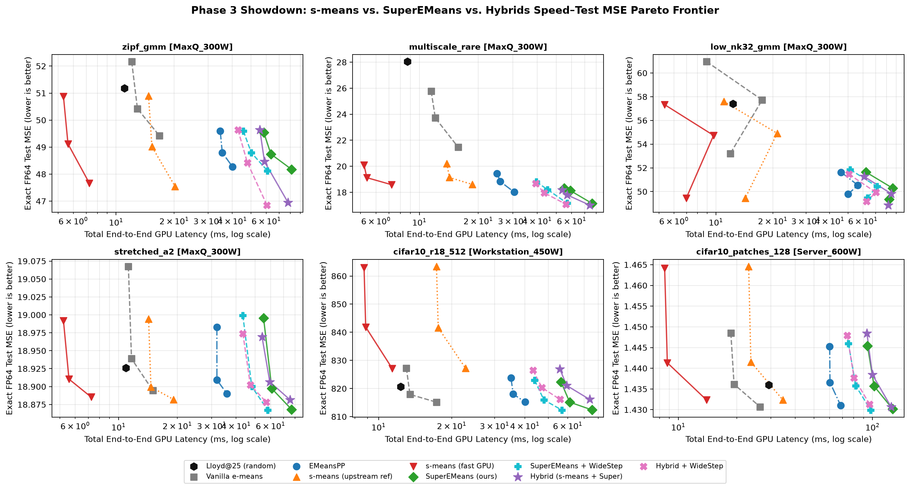

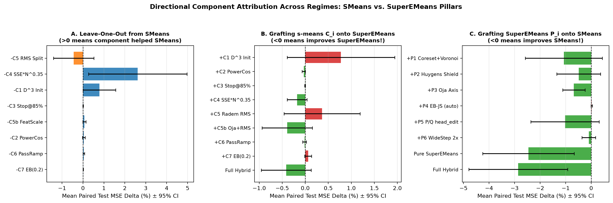

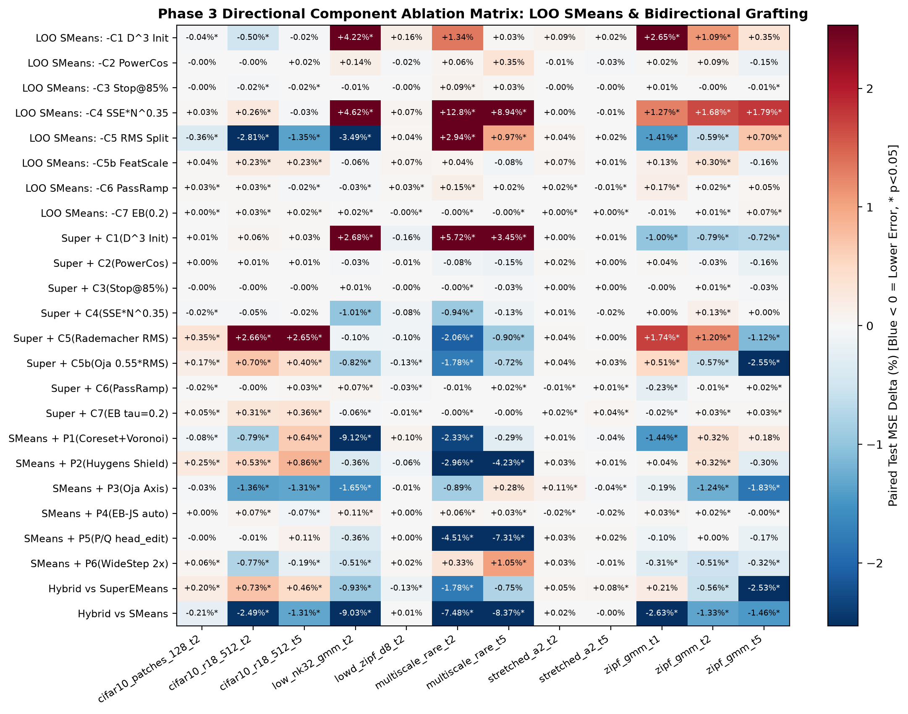

---

### 2. `e-means` & `e-means++` Benchmarks

| Method | CIFAR-10 Patches (`k=4096`) Test Error / Time | Rare-Outlier Mixture (`k=1024`) Error vs. `Lloyd k-means` / Time | Seeding Speedup vs. Greedy `k-means++` | Rare Clusters Kept |
| :--- | :---: | :---: | :---: | :---: |
| `Lloyd k-means (25 passes)` | `1.3931` (`49.4 ms`) | `0.00%` (`11.9 ms`) | — | `37.1%` |
| `Mini-Batch k-means (Sculley)` | `1.4105` (`27.5 ms`) | `-18.65%` (`19.4 ms`) | — | — |
| `e-means` (`2` / `5` passes) | **`1.3911` (`17.8 ms`)** / **`1.3848` (`26.0 ms`)** | `-25.98%` (`18.0 ms`) | — | `0.0%` |
| `Naive k-means++ + e-means` | `1.3873` (`693.8 ms`) | `-34.26%` (`178.3 ms`) | `1.0x` (`678.2 ms` init) | `0.0%` |
| **`e-means++`** | `1.3883` (`88.6 ms`) | **`-38.42%` (`48.7 ms`)** | **`4.6x–10.3x` (`70.4 ms` init)** | **`86.8%`** |

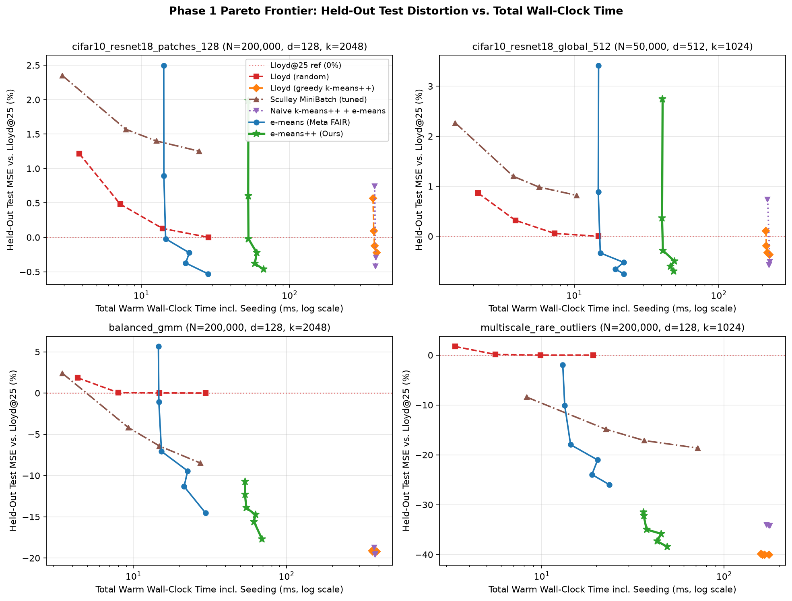


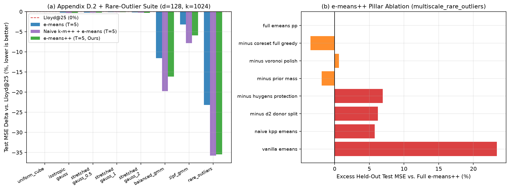

---

### 3. Split Geometry, Verified Transplants & Schedule Improvements

Evaluated across `7,200` paired GPU runs on 12 synthetic and real image-embedding benchmarks:

| Improvement | Plain-English Effect | Headline Result |
| :--- | :--- | :--- |
| **Widest-Axis Splits + Smooth Final Blending** | Splits crowded clusters along their widest spread and blends noisy small-cluster averages | Lower test error on **`12 / 12` benchmarks** (up to **`-0.34%`** on 512-D ResNet embeddings) |
| **Two-Half Verified Cluster Transplants** | Tests candidate cluster moves on half a batch and keeps them only if the second half improves too | Up to **`-5.81%` lower test error** on multimodal data with **`0 / 360` false moves** on uniform noise |
| **Late `2x` Batch Doubling** | Doubles batch size after the first quarter of training with a matching step-size increase | **`21%–35%` faster training time** across **`24 / 24` settings** with matching accuracy |

| Classical Refinements | Forward-Only Search Refinements |
| :---: | :---: |
|  | 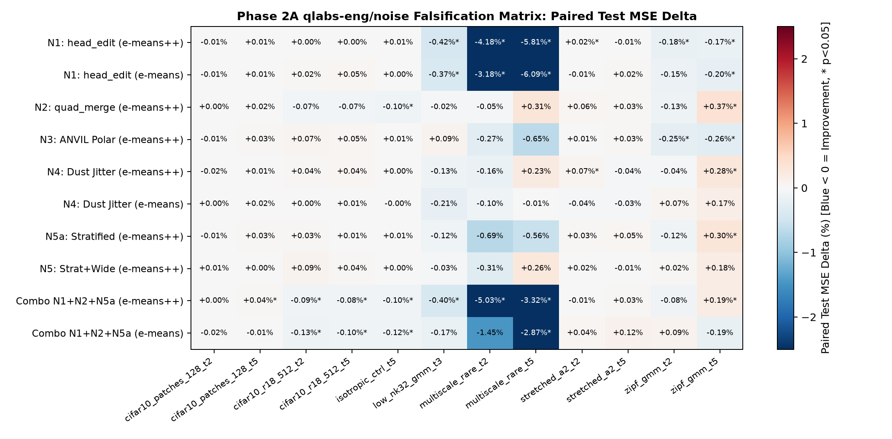 |
| 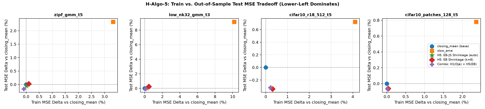 |  |

---

### 4. GPU Throughput & 10-Million-Vector Scaling

Measured on NVIDIA RTX PRO 6000 Blackwell GPUs across 300W Max-Q, 450W Workstation, and 600W Server configurations:

| Capability | Headline Speedup / Throughput | Accuracy Difference vs. Exact Baseline |
| :--- | :--- | :---: |
| **Tuned `BF16` Nearest-Cluster Kernel** | **`317.8 TFLOP/s`** (`1.4x–19.1x` faster assignment) | **`0.000%`** (exact match) |
| **Centered `FP8` Nearest-Cluster Kernel** | **`636.4 TFLOP/s`** (`84.2%` of hardware peak; `1.7x–1.9x` faster than `BF16`) | **`< 0.08%`** |
| **Inverted-File Fast Search (`k = 65,536`)** | **`6.4x–7.4x` faster** (`53.9 ms` for `1M` vectors) | **`-0.18%` to `-0.27%`** *(lower error)* |
| **10-Million-Vector Clustering (`k = 16,384, d = 128`)** | **`400.7 ms` on 1 GPU** (`3.4x` faster) · **`297.1 ms` on 2 GPUs** (`95.7%` scaling efficiency, **`5.5x` total speedup**) | **`+0.01%`** |

| `300W Max-Q` (1-GPU & 2-GPU) | `450W Workstation` | `600W Server` |
| :---: | :---: | :---: |
| 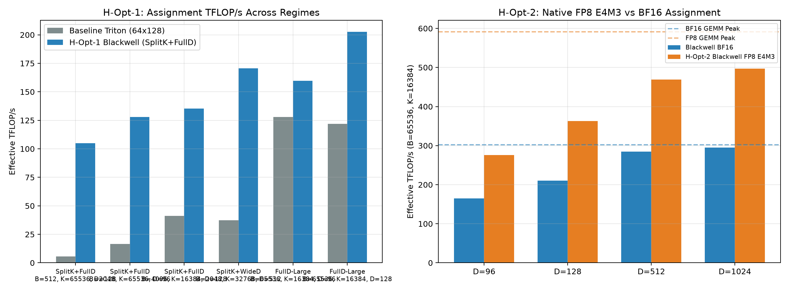 |  | 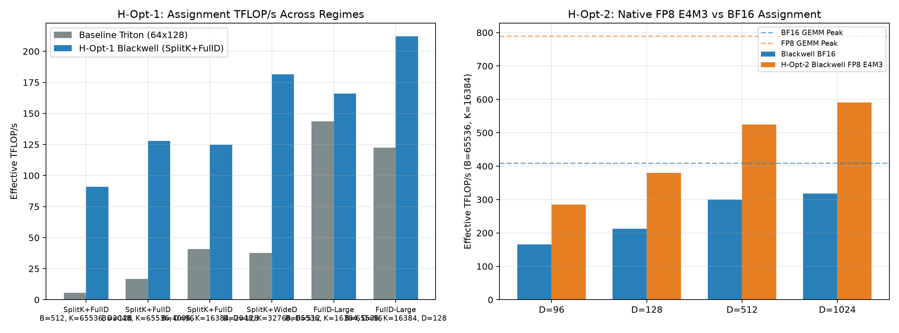 |
| 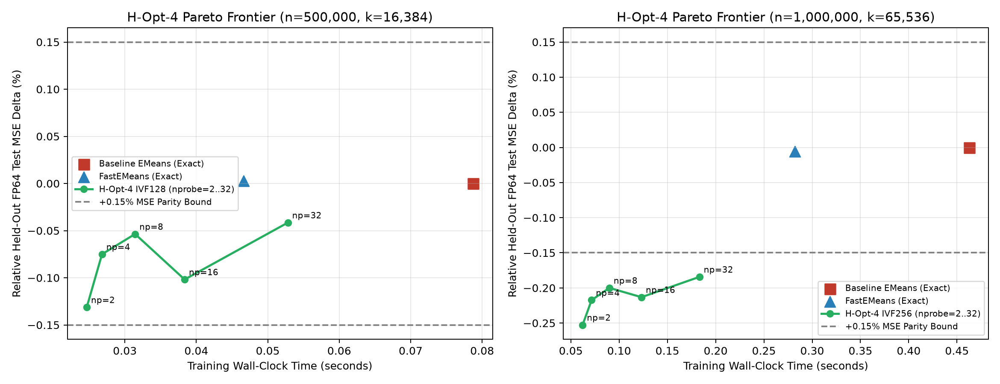 | 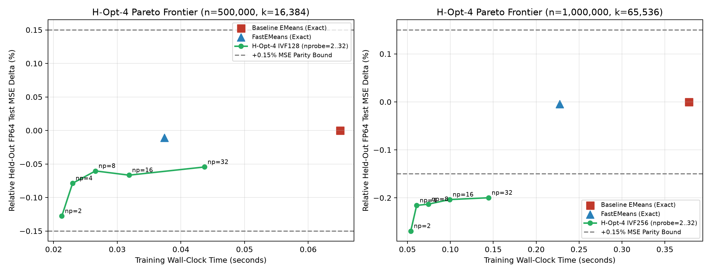 | 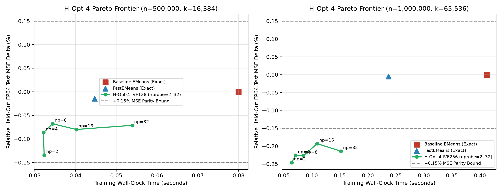 |
| 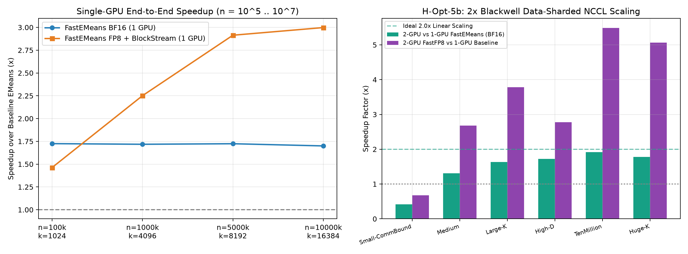 |  | 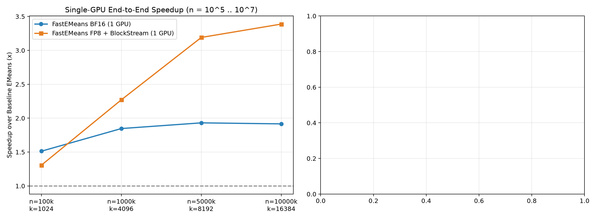 |

---

## Algorithm

Standard `k-means` scans the entire dataset dozens of times and easily gets stuck—leaving two centers sharing one group while another center stretches awkwardly across two separate groups. `Hybrid SuperEMeans` fixes both speed and accuracy in four simple steps:

1. **Fast, well-spread starting points**: Scanning millions of points thousands of times makes classic `k-means++` way too slow, while picking completely random points misses roughly a third of clusters. Instead, we take a quick, representative sketch of the data, spread starting centers across that sketch, and average each center's nearby points once so every center begins near the middle of its group instead of out on the edge.
2. **Smooth moving-average mini-batch updates**: Rather than reading the entire dataset before moving any center, we stream small GPU-friendly batches and nudge each center smoothly toward its newest assigned points using an exponential moving average. Step sizes start large so centers travel quickly early on, then cool down smoothly, and doubling the batch size later in training cuts launch overhead by 25–35%.
3. **Splitting overcrowded clusters while protecting rare ones**: Every few steps, we look for centers that are barely used while other clusters are overcrowded. Before moving a small cluster center, we check how far away its nearest neighbor is—if removing it would leave a genuinely isolated group of points stranded, we **protect** it. Otherwise, we move it to split an overcrowded cluster right along that cluster's **widest direction**, and test candidate moves on two halves of a batch so we only keep splits that truly reduce error.
4. **Smooth final averaging**: During the last pass through the data, big clusters collect plenty of points for a rock-solid average, while tiny clusters only see a few points and can wobble from sample noise. At the end, we blend each cluster's final-pass average with its running moving average—trusting the exact final pass on large clusters and leaning on the smoother history for tiny ones.

---

## Further Reading

- [**Ablations & Full Experimental Tables**](docs/ablations_and_experiments.md) — Leave-one-out and component-grafting matrices, negative/falsified hypotheses, regime crossovers, and full statistical breakdowns across all campaigns.
- [**Research History, Challenges & Bug Log**](docs/challenges_and_issues.md) — Chronological progression, mathematical failure modes uncovered, `FP8`/`BF16` numerical traps, GPU shared-memory limits, and pre-experiment verification catches.
- [**Dissection of `s-means` vs. `SuperEMeans`**](docs/smeans_analysis.md) — Source-level mathematical and GPU kernel comparison against `suayptalha/s-means`.
- [**GPU Kernel & Multi-GPU Optimizations**](docs/optimizations.md) — NVIDIA Blackwell roofline model, `BF16`/`FP8` Tensor-Core kernels, inverted-file pruning, and 2-GPU NCCL scaling.
- [**Classical Vector Quantization Literature Survey**](docs/literature_survey.md) — Mathematical survey from Robbins-Monro and VQ-VAE codebooks to coresets, Hartigan exchanges, and Empirical-Bayes shrinkage.
- [**Forward-Only Optimization Survey (`qlabs-eng/noise`)**](docs/noise_forward_only_survey.md) — How forward-only perturbation and confirmed structural transplants map onto hard Voronoi clustering.
- [**Blackwell Cluster & Fleet Guide**](docs/fleet_status.md) — 6-host / 16-GPU RTX PRO 6000 Blackwell hardware topology and multi-node execution recipes.
