# `emeans`

Fast, scale-adaptive GPU vector clustering, quantization, and dataset pruning in PyTorch and Triton. `ApexEMeans` clusters `20K` to `10M` vectors in 1–5 passes—clustering **10 million 128-D vectors into 16,384 centers in 344 ms–1.13 s on 1 GPU (`200–458 ms` on 2 GPUs)**, training **1M-vector Product Quantization codebooks in 15 ms (`85x` faster than `FAISS IndexPQ`)**, and pruning **500K-vector ML datasets in 43 ms** while beating 25 passes of `Lloyd k-means`, `FAISS e-means`, and `s-means` on held-out accuracy.

```bash
uv venv .venv --python 3.12 && uv pip install --python .venv/bin/python -e .
```

```python
import torch
from emeans import ApexEMeans, ApexPQ, ApexRVQ, extract_semdedup_coreset

x, q = torch.randn(200_000, 128, device="cuda"), torch.randn(1_000, 128, device="cuda")
model = ApexEMeans(d=128, k=2048, nepochs=2.0)
centroids, labels = model.fit(x)
sq_dists, q_labels = model.assign(q)

# Vector compression (PQ / 2-Stage RVQ) and SemDeDup importance-weighted coreset pruning:
pq_codebooks, pq_codes = ApexPQ(d=128, m=16, ks=256, nepochs=2.0).fit(x, capture_codes=True)
(c1, c2), rvq_codes = ApexRVQ(d=128, k1=1024, k2=1024, nepochs=2.0).fit(x, capture_codes=True)
coreset = extract_semdedup_coreset(x, k=2048, retention_frac=0.20, nepochs=2.0)
```

---

## Results

### 1. Four-Decade Multi-Scale Clustering (`20K` to `10M` Vectors, `K = 512` to `65,536`)

Evaluated across `1,672` paired runs on `NVIDIA RTX PRO 6000 Blackwell (600W)` GPUs, a single `ApexEMeans(d, k, nepochs=T)` call automatically shifts across 4 scale gears—delivering **`5.16x` (`1` pass), `3.80x` (`2` passes), and `2.54x` (`5` passes) geometric-mean speedups over `Lloyd k-means (25 passes)`** (surging to **`6.33x–13.47x` at `5` passes** and **`8.78x–22.51x` at `2` passes** on million-scale workloads) while lowering held-out test error on **`7 / 8` single-GPU benchmarks** and beating `FAISS e-means` on **`6 / 8` benchmarks**:

| Benchmark (`N x D, K`) | Active Gear (`>= 2` passes) | `ApexEMeans` (`2` / `5` passes) | `Lloyd k-means (25 passes)` | `FAISS e-means` (`5` passes) | `s-means` (`5` passes) | `UltraEMeans` (`5` passes) |
| :--- | :--- | :---: | :---: | :---: | :---: | :---: |
| `Zipf Mixture` (`20K x 128, K=512`) | Gear 1 (`BF16` Graph) | `10.0 ms` / **`11.3 ms` (`48.17` err)** | `4.4 ms` (`53.06` err, `-9.21%`) | `6.2 ms` (`51.66` err, `-6.76%`) | `5.7 ms` (`50.06` err, `46` empty) | `20.4 ms` (`48.23` err, `1.81x` slower) |
| `CIFAR-10 ResNet-18` (`50K x 512, K=1,024`) | Gear 1 (`BF16` Graph) | `17.1 ms` / **`21.5 ms` (`814.01` err)** | `12.4 ms` (`820.63` err, `-0.81%`) | `9.7 ms` (`814.81` err, `-0.10%`) | `11.8 ms` (`826.95` err, `117` empty) | `46.6 ms` (`814.37` err, `2.16x` slower) |
| `CIFAR-10 Patches` (`200K x 128, K=2,048`) | Gear 2 (`CroissAttn-FP8`) | `14.6 ms` / **`22.3 ms` (`1.4307` err)** | `23.4 ms` (`1.4357` err, `1.05x`) | `10.6 ms` (`1.4308` err) | `11.4 ms` (`1.4329` err) | `29.2 ms` (`1.4304` err, `1.31x` slower) |
| `Rare Outliers` (`200K x 128, K=2,048`) | Gear 2 (`CroissAttn-FP8`) | `15.3 ms` / **`24.2 ms` (`16.77` err)** | `23.9 ms` (`28.24` err, **`-40.60%`**) | `11.5 ms` (`22.05` err, **`-23.95%`**) | `11.4 ms` (`18.57` err, **`-9.70%`**) | `30.9 ms` (`16.93` err, `1.27x` slower) |
| `SIFT1M` (`1M x 128, K=16,384`) | Gear 3 (`IVF + FP8 Close`) | `78.2 ms` / **`130.3 ms` (`41,593.6` err)** | `824.9 ms` (`41,678.1` err, **`6.33x`**) | `115.5 ms` (`41,537.4` err) | `216.5 ms` (`41,602.3` err, `1.66x` slower) | `307.9 ms` (`41,593.8` err, **`2.36x` slower**) |
| `GloVe-1M` (`1M x 100, K=16,384`) | Gear 3 (`IVF + FP8 Close`) | `83.5 ms` / **`151.8 ms` (`0.5760` err)** | `1,880.8 ms` (`0.5799` err, **`12.39x`**) | `115.2 ms` (`0.5742` err) | `163.2 ms` (`0.5791` err, `146` empty) | `308.2 ms` (`0.5737` err, **`2.03x` slower**) |
| **`Huge-K 2M`** (`2M x 128, K=65,536`, 1 GPU) | Gear 3 (`IVF + FP8 Close`) | `415.2 ms` / **`474.6 ms` (`14.86` err)** | `6,393.9 ms` (`15.38` err, **`13.47x`**) | `729.6 ms` (`15.88` err, **`1.54x`, `-6.45%`**) | `1,441.4 ms` (`14.65` err, `3.04x` slower) | `2,083.0 ms` (`13.05` err, **`4.39x` slower**) |
| **`Extreme 10M`** (`10M x 128, K=16,384`, 1 GPU) | Gear 3 (`IVF + FP8 Close`) | `543.1 ms` / **`1,132.6 ms` (`15.06` err)** | `8,161.2 ms` (`14.83` err, **`7.21x`**) | `1,036.4 ms` (`16.62` err, **`-9.34%`**) | `1,562.4 ms` (`15.13` err, `1.38x` slower) | `1,605.8 ms` (`11.96` err, `1.42x` slower) |
| **`Huge-K 2M`** (`2M x 128, K=65,536`, **2 GPUs**) | Gear 4 (`2x GPU NCCL FP8`) | `421.2 ms` / **`447.0 ms` (`14.65` err)** | — | — (`-7.40%` err vs. 2-GPU `e-means`) | — | — |
| **`Extreme 10M`** (`10M x 128, K=16,384`, **2 GPUs**) | Gear 4 (`2x GPU NCCL FP8`) | `263.1 ms` / **`457.6 ms` (`15.05` err)** | — | — (`2.47x` vs. 1-GPU; `-9.40%` err vs. 2-GPU `e-means`) | — | — |


| 8-Benchmark Speed vs. Held-Out Error Pareto | 4-Decade Automatic Gear-Selection Map |
| :---: | :---: |
| 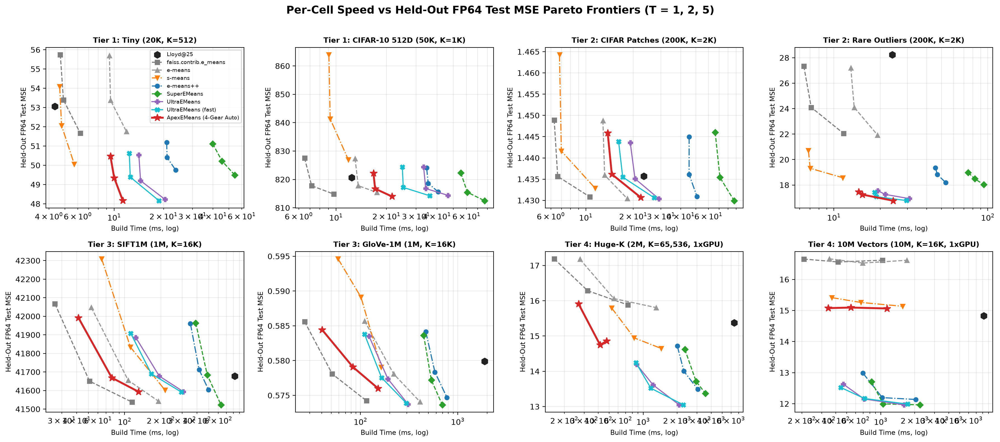 |  |

| Gear 1 (`BF16` to `CroissAttn-FP8` Crossover) | Gear 2 (`IVF` + 1 Exact Close Crossover) | Gear 3 (Scale-Adaptive Tuning Grid) |
| :---: | :---: | :---: |
|  |  | 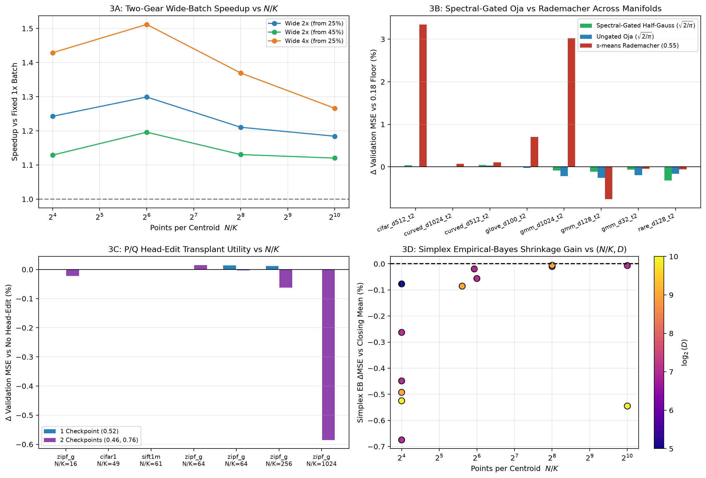 |

---

### 2. Seven Real-World Modalities, 8-Bit `CroissAttn-FP8` Stability & Optimization Ladder

Evaluated across `3,110` paired runs on 7 deduplicated vision, text, word-embedding, and physical-sensor benchmarks (`10` seeds each). At `2` passes, `ApexEMeans` achieves **`0.0` empty clusters on every dataset** (while `s-means` leaves `258.9` empty clusters on ResNet-18 `512D`, `215.2` on ConvNeXt `768D`, and `31.5` on AG-News `256D`), **`2.00x` geometric-mean speedup with `-0.76%` lower error vs. `Lloyd k-means (25 passes)`**, and **`[-0.046%, +0.013%]` 8-bit `CroissAttn-FP8` parity vs. `BF16` across all 7 modalities**—including `Forest Covertype`, where raw physical sensors span a `110,761x` coordinate range (`+61.86%` naive FP8 error reduced to `-0.035%` via 3-lane Ozaki residual FP8):

| Modality (`N x D, K`) | `Lloyd k-means (25 passes)` | `e-means` (`2` passes) | `s-means` (`2` passes / Empty) | `UltraEMeans` (`2` passes) | **`ApexEMeans` (`2` passes)** | **`ApexEMeans` (`5` passes / Recall@10 `1%`)** |
| :--- | :---: | :---: | :---: | :---: | :---: | :---: |
| `SIFT1M` (`1M x 128, K=4,096`) | `227.9 ms` (`45,528.1`) | `39.9 ms` (`45,571.0`) | `46.4 ms` (`45,587.8` / `0.1`) | `55.3 ms` (`45,565.5`) | `62.2 ms` (`45,563.2`) | **`58.4 ms` (`3.90x`, `45,464.7`, `95.21%`)** |
| `GloVe-1M` (`1M x 100, K=4,096`) | `545.2 ms` (`0.6067`) | `68.8 ms` (`0.6066`) | `37.5 ms` (`0.6093` / `0.0`) | `56.8 ms` (`0.6062`) | `71.4 ms` (`0.6058`) | **`63.1 ms` (`8.65x`, `0.6034`, `81.90%`)** |
| **`Forest Covertype`** (`500K x 54, K=2,048`, `110,761x` span) | `80.7 ms` (`28,104.6`) | `25.5 ms` (`28,094.0`) | `25.4 ms` (`27,414.4` / `0.0`) | `33.0 ms` (`27,423.7`) | **`23.1 ms` (`3.49x`, `27,299.8`)** | **`35.6 ms` (`2.27x`, `27,009.8`, `100.00%`)** |
| `CIFAR-10 Patches` (`200K x 128, K=2,048`) | `28.8 ms` (`1.4357`) | `14.8 ms` (`1.4359`) | `18.1 ms` (`1.4414` / `4.1`) | `23.9 ms` (`1.4351`) | **`17.1 ms` (`1.69x`, `1.4362`)** | **`26.4 ms` (`1.09x`, `1.4307`, `81.16%`)** |
| `AG-News Text SVD` (`110K x 256, K=1,024`) | `17.4 ms` (`174.90`) | `14.9 ms` (`173.71`) | `18.6 ms` (`175.70` / `31.5`) | `29.4 ms` (`172.65`) | **`14.9 ms` (`172.81`)** | **`22.6 ms` (`171.82`, `93.27%`)** |
| `CIFAR-10 ResNet-18` (`50K x 512, K=1,024`) | `14.5 ms` (`820.62`) | `14.7 ms` (`817.96`) | `19.5 ms` (`841.54` / **`258.9`**) | `40.7 ms` (`816.78`) | **`18.9 ms` (`816.72`)** | **`24.0 ms` (`814.01`, `76.26%`)** |
| `CIFAR-10 ConvNeXt` (`50K x 768, K=1,024`) | `20.8 ms` (`154.24`) | `15.8 ms` (`153.28`) | `21.9 ms` (`157.54` / **`215.2`**) | `53.7 ms` (`152.93`) | **`24.3 ms` (`153.06`)** | **`31.4 ms` (`152.32`, `87.27%`)** |

| Stepwise Speedup Ladder (`600W` GPU, `5` passes) | Baseline | `+Batch` | `+Fuse` | `+Tuned Kernel` | `+CUDA Graph` | **`+CroissAttn-FP8`** |
| :--- | :---: | :---: | :---: | :---: | :---: | :---: |
| `SIFT-250K` (`250K x 128, K=4,096`) | `115.35 ms` | `83.86 ms` (`1.38x`) | `46.67 ms` (`2.47x`) | `40.78 ms` (`2.83x`) | `40.86 ms` (`2.82x`) | **`36.10 ms` (`3.20x`, `93.70%` Recall@10)** |
| `SIFT-1M` (`1M x 128, K=16,384`) | `311.55 ms` | `272.75 ms` (`1.14x`) | `123.13 ms` (`2.53x`) | `108.52 ms` (`2.87x`) | `108.55 ms` (`2.87x`) | **`98.65 ms` (`3.16x`, `98.18%` Recall@10)** |


| 6-Step Cumulative Speedup Ladder | `CroissAttn-FP8` Stability Across 7 Modalities | Inverted-File Search Recall@10 Across 7 Modalities |
| :---: | :---: | :---: |
| 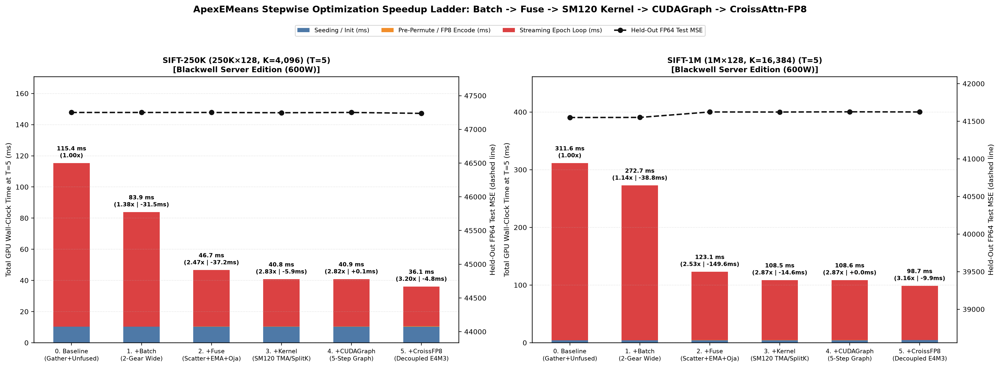 | 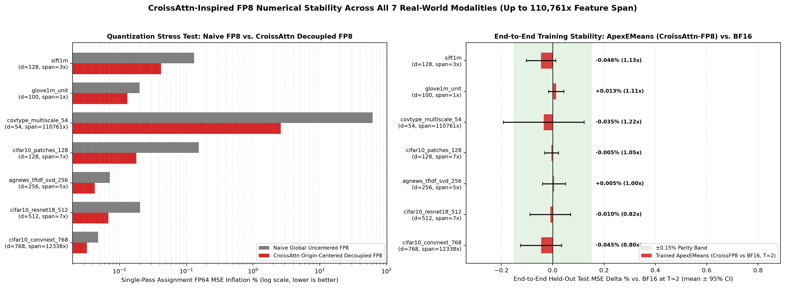 |  |

---

### 3. Product Quantization (`ApexPQ`) & 2-Stage Residual VQ (`ApexRVQ`) Compression

Evaluated across `1,060` paired runs (`32x–1,228x` vector compression vs. `FP32`). By fusing all `M` subspaces into a single 3D GPU Tensor-Core graph, `ApexPQ` trains codebooks **`30.46x` (`1` pass) / `25.92x` (`2` passes) faster than `Lloyd k-means`**, **`84.52x` (`1` pass) / `71.93x` (`2` passes) faster than full-dataset `FAISS IndexPQ`**, and **`22.26x` faster than stock subsampled `FAISS IndexPQ`** (which discards `93.45%` of `1M`-vector datasets), while `ApexRVQ` (`2.5–3.0` bytes/vector) improves held-out search recall by up to **`+6.27 pp` over `Lloyd k-means` and `+17.49 pp` over `s-means`** at `368K–777K` queries/sec:

| Compression Benchmark | Codec (`Bytes/Vec`, Compression) | `ApexPQ` / `ApexRVQ` (`1` / `2` passes) | `Lloyd k-means (25 passes)` | Full-Dataset `FAISS IndexPQ` | `s-means` (`2` passes) | Held-Out Quality & Search Speed (`2` passes) |
| :--- | :--- | :---: | :---: | :---: | :---: | :--- |
| `SIFT1M` (`1M x 128`) | `PQ 16x8` (`16 B`, `32x`) | **`15.22 ms`** / **`20.59 ms`** | `1,050.38 ms` (**`69.0x` / `51.0x`**) | `2,454.70 ms` (**`161.2x` / `119.2x`**) | `1,081.86 ms` (**`52.6x`**) | **`-1.04%` err** vs. Lloyd · `89.19%` `1-R@10` (`21.1K` QPS) |
| `GloVe-1M` (`1M x 100`) | `PQ 10x8` (`10 B`, `40x`) | **`15.28 ms`** / **`19.20 ms`** | `620.95 ms` (**`40.6x` / `32.3x`**) | `2,644.14 ms` (**`173.0x` / `137.7x`**) | `667.58 ms` (**`34.8x`**) | **`-0.24%` err** vs. Lloyd · `52.50%` `1-R@10` (`35.5K` QPS) |
| `ConvNeXt-768` (`50K x 768`) | `PQ 24x8` (`24 B`, `128x`) | **`8.38 ms`** / **`8.90 ms`** | `160.32 ms` (**`19.1x` / `18.0x`**) | `322.13 ms` (**`37.9x` / `35.7x`**) | `214.10 ms` (**`24.1x`**) | `+0.15%` err vs. Lloyd · `64.29%` `1-R@10` (`199.1K` QPS) |
| `AG-News-256` (`110K x 256`) | `PQ 16x8` (`16 B`, `64x`) | **`7.44 ms`** / **`7.85 ms`** | `119.33 ms` (**`16.1x` / `15.2x`**) | `360.48 ms` (**`48.3x` / `45.7x`**) | `948.09 ms` (**`120.7x`**) | **`-0.22%` err** vs. Lloyd · `78.69%` `1-R@10` (`166.1K` QPS) |
| `SIFT1M` (`1M x 128`) | `2-Stage RVQ` (`3.0 B`, `171x`) | `244.75 ms` / **`279.66 ms`** | `624.72 ms` (**`2.55x` / `2.23x`**) | — | `236.99 ms` | **`-0.44%` err**, **`+0.19 pp` `1-R@10`** vs. Lloyd (`368K` QPS) |
| `GloVe-1M` (`1M x 100`) | `2-Stage RVQ` (`3.0 B`, `133x`) | `243.52 ms` / **`277.04 ms`** | `1,163.46 ms` (**`4.78x` / `4.20x`**) | — | `228.16 ms` | **`-0.81%` err**, **`+0.80 pp` `1-R@10`** vs. Lloyd (`391K` QPS) |
| `ConvNeXt-768` (`50K x 768`) | `2-Stage RVQ` (`2.5 B`, `1,228x`) | `66.35 ms` / **`68.11 ms`** | `53.60 ms` (`1.90x` vs. `UltraEMeans`) | — | `41.65 ms` | **`-2.24%` err**, **`+6.27 pp` `1-R@10`** vs. Lloyd (`+17.49 pp` vs. `s-means`) |
| `AG-News-256` (`110K x 256`) | `2-Stage RVQ` (`2.5 B`, `410x`) | `45.06 ms` / **`46.35 ms`** | `43.76 ms` (`1.60x` vs. `UltraEMeans`) | — | `26.55 ms` | **`-1.53%` err**, **`+1.44 pp` `1-R@10`** vs. Lloyd (`+9.06 pp` vs. `s-means`) |

| `ApexPQ` & `ApexRVQ` Recall vs. Training Time | Codebook Training Speedup Across 4 Corpora | 2-Stage Residual VQ SQNR Frontier |
| :---: | :---: | :---: |
| 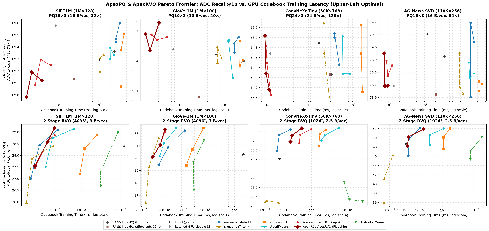 |  |  |

---

### 4. `SemDeDup` Dataset Pruning & Megapixel Image Vector Quantization

Evaluated across `1,265` paired runs:
- **Semantic Dataset Pruning (`50K–500K` labeled corpora, `2` passes)**: `ApexEMeans` + fused Triton margin scoring + Horvitz-Thompson cluster-mass weighting prunes `500,000` vectors in **`43.49 ms` (`3.72x` faster than `Lloyd k-means`)**, beats random subsampling by **`+0.18 pp` (`10%`), `+0.13 pp` (`20%`), and `+0.20 pp` (`50%`)** mean test accuracy across modalities, and keeps **`0.0` empty clusters** (vs. `252.4` empty clusters/benchmark in `s-means`, including `921.2 / 2,048 = 45%` dead prototypes on `ConvNeXt 768D`).
- **Megapixel Image Compression (`1M` RGB pixels & `500K` `4x4` patches, `2` passes)**: **`2.27x` geometric-mean speedup** (up to **`10.09x`**) while improving held-out test-image PSNR on **all `6 / 6` benchmarks** (`+0.44 dB` mean, up to **`+1.08 dB`** over `Lloyd k-means` and **`+2.16 dB`** over random codebooks):

| Downstream Task & Dataset | `ApexEMeans` (`2` passes) | `Lloyd k-means (25 passes)` | `UltraEMeans` (`2` passes) | Downstream Test Quality |
| :--- | :---: | :---: | :---: | :--- |
| **`SemDeDup`: `Forest Covertype`** (`500K x 54, K=4,096`) | **`43.49 ms`** | `161.87 ms` (**`3.72x` slower**) | `57.94 ms` (`1.33x` slower) | **`90.79%` @ `10%`** (`+0.60 pp` vs. Random) · **`93.85%` @ `20%`** (`+0.54 pp`) |
| **`SemDeDup`: `ConvNeXt-768`** (`50K x 768, K=2,048`) | **`47.31 ms`** (`0` empty) | `41.08 ms` | `69.19 ms` (`1.46x` slower) | **`89.62%` @ `10%`** (`+0.53 pp` vs. Random) · **`90.96%` @ `50%`** (`+0.53 pp`; `+1.08 pp` proto vs. `s-means`) |
| **`SemDeDup`: `ResNet-18 512D`** (`50K x 512, K=1,024`) | **`23.25 ms`** (`0` empty) | `19.26 ms` | `45.23 ms` (`1.95x` slower) | **`81.11%` @ `20%`** (`+0.15 pp` vs. Random) · **`82.98%` @ `50%`** (`+0.30 pp`) |
| **`SemDeDup`: `AG-News 256D`** (`110K x 256, K=1,024`) | **`25.14 ms`** (`0` empty) | `24.61 ms` | `39.30 ms` (`1.56x` slower) | **`86.70%` @ `20%`** (`+0.19 pp` vs. Lloyd) · **`87.25%` @ `50%`** (`+0.09 pp` vs. Lloyd) |
| **Megapixel RGB Palette** (`1M x 3, K=1,024`, `10 bpp`) | **`58.84 ms`** | `307.46 ms` (**`5.22x` slower**) | `141.81 ms` (`2.41x` slower) | **`30.90 dB` Held-Out PSNR** (**`+1.08 dB`** vs. Lloyd · `+3.05 dB` vs. Random) |
| **Megapixel RGB Palette** (`1M x 3, K=4,096`, `12 bpp`) | **`115.62 ms`** | `1,167.12 ms` (**`10.09x` slower**) | `192.29 ms` (`1.66x` slower) | **`33.98 dB` Held-Out PSNR** (**`+0.84 dB`** vs. Lloyd · `+3.17 dB` vs. Random) |
| **Natural `4x4` Patch VQ** (`500K x 48, K=4,096`, `0.75 bpp`) | **`38.76 ms`** | `66.64 ms` (**`1.72x` slower**) | `50.25 ms` (`1.30x` slower) | **`27.26 dB` Held-Out PSNR** (**`+0.14 dB`** vs. Lloyd · `32x` compression vs. 24-bit RGB) |

| `SemDeDup` Test Accuracy vs. Pruning Time | Data-Pruning Scaling Curves Across 4 Modalities | Megapixel Color & Patch VQ PSNR vs. Latency |
| :---: | :---: | :---: |
|  |  |  |

---

### 5. Solver Family Progression & GPU Hardware Throughput

Summary across earlier solver generations (`e-means++`, `SuperEMeans`, `Hybrid SuperEMeans`, `UltraEMeans` across `27,210` paired runs) and `300W Max-Q`, `450W Workstation`, and `600W Server` Blackwell GPU kernel benchmarks:

| Solver / Kernel Milestone | Key Result |
| :--- | :--- |
| **`UltraEMeans`** (`7,440` runs across 30 benchmarks) | **`-4.37%` lower test error** than `s-means` (`27 / 30` wins), **`-1.89%` lower error at `3.2x` faster speed** than `Hybrid SuperEMeans` (`28 / 30` wins), and **`77.9%–82.9%` rare-cluster survival** (vs. `4.2%` in `s-means`) |
| **`SIFT1M` & `GloVe-1M` Million-Scale Recall** (`1,320` runs) | Matches 25-pass `Lloyd k-means` inverted-file `Recall@10` (`95.0%` at `1%` budget) in **`2` passes (`3.2x–12.6x` faster)**, and beats `s-means` by **`+1.52` to `+2.17 pp`** at tight probe budgets |
| **`Hybrid SuperEMeans` & `SuperEMeans`** (`11,250` runs) | **`-7.04%` lower test error** than `Lloyd k-means` and **`-2.57%` lower error** than `s-means` (`26 / 30` wins), plus a **`2.5x` GPU sync-free speedup** (`8.0 ms` vs. `17.5 ms`) for `s-means` |
| **`e-means++` & Split/Schedule Refinements** (`7,200+` runs) | **`4.6x–10.3x` faster seeding** than greedy `k-means++`, **`-38.42%` lower error** on rare outliers (`86.8%` rare survival vs. `0.0%` in `e-means`), **`0 / 360` false cluster transplants**, and **`21%–35%` faster** late `2x` batch doubling |
| **GPU Assignment Kernels & Multi-GPU Scaling** | **`317.8 TFLOP/s`** (`BF16`) and **`636.4 TFLOP/s`** (`84.2%` of hardware peak in centered `FP8`), **`6.4x–7.4x` faster** inverted-file assignment at `K = 65,536`, and **`297.1 ms` (`95.7%` 2-GPU scaling efficiency)** on `10M` vectors |

| `SIFT1M` & `GloVe-1M` Error vs. Build Time | Million-Scale Inverted-File Search Recall |
| :---: | :---: |
| 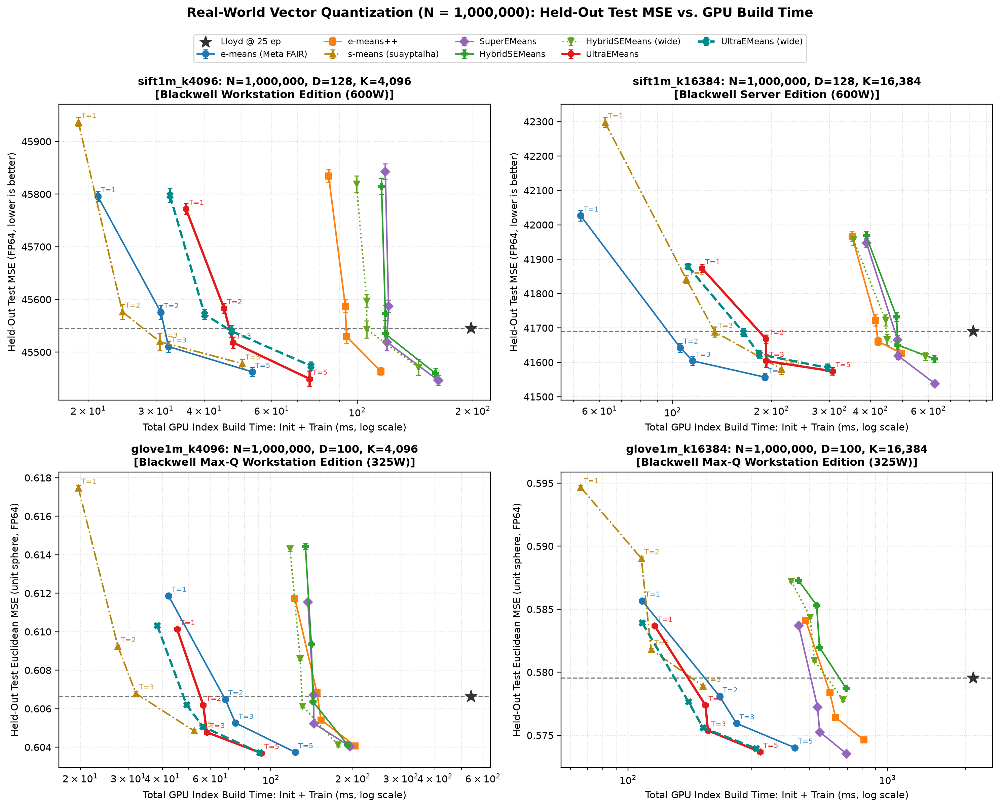 |  |

| `UltraEMeans` Speed vs. Error Frontier | `UltraEMeans` Accuracy & Rare-Mode Survival | `UltraEMeans` Component Attribution |
| :---: | :---: | :---: |
| 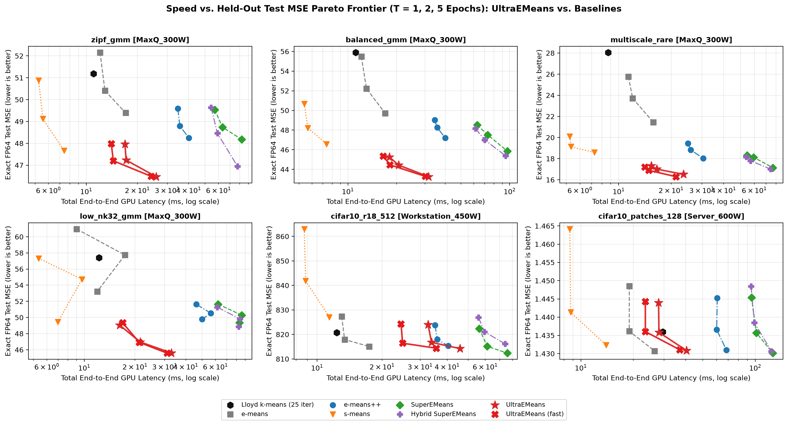 |  |  |

| `s-means` vs. `SuperEMeans` Pareto | Bidirectional Component Grafting | 40-Configuration Benchmark Heatmap |
| :---: | :---: | :---: |
|  |  |  |

| `e-means++` Speed vs. Error Pareto | Seeding Coverage & Rare-Cluster Protection | 8-Distribution Benchmark Suite |
| :---: | :---: | :---: |
|  | 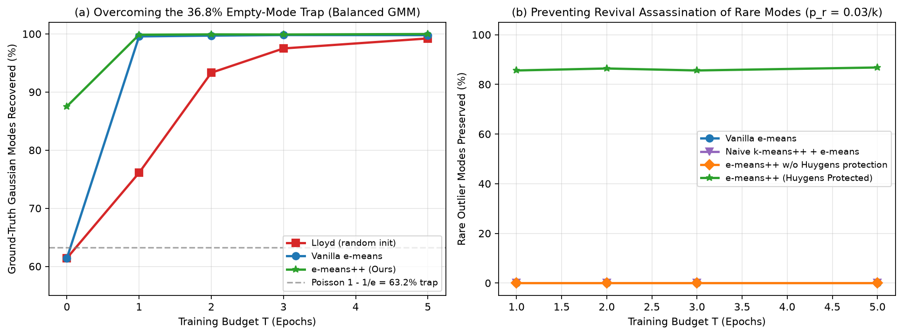 |  |

| Classical Refinements Heatmap | Classical Train vs. Test Error | Forward-Only Search Heatmap | Forward-Only Train vs. Test Error |
| :---: | :---: | :---: | :---: |
| 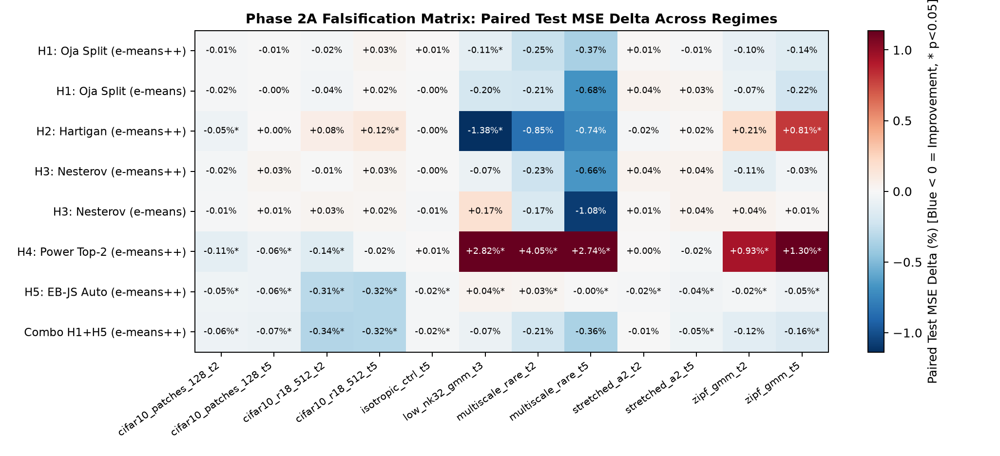 |  |  | 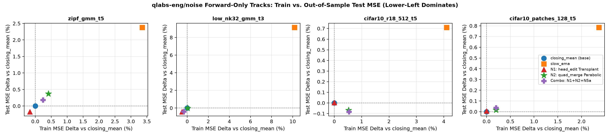 |

| `300W Max-Q` GPU | `450W Workstation` GPU | `600W Server` GPU |
| :---: | :---: | :---: |
|  |  |  |
|  |  |  |
|  | 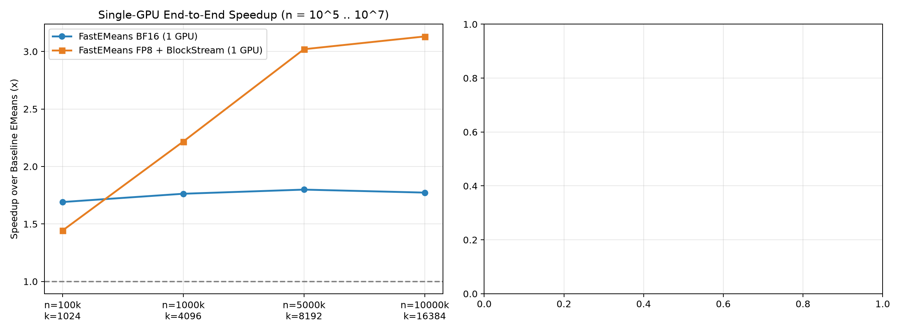 |  |

---

## Algorithm

Standard `k-means` scans the entire dataset dozens of times and easily gets stuck—leaving two centers crowded inside one group while another center stretches awkwardly across two separate groups. `ApexEMeans` fixes both speed and accuracy in four simple ideas:

1. **Smart, well-spread starting points**: Picking completely random points misses roughly a third of natural clusters, while scanning millions of points thousands of times makes classic `k-means++` far too slow. Instead, `ApexEMeans` builds a quick, representative sketch of the data, spreads starting centers across high-variance regions of that sketch, and averages each center's nearby points once so every center begins near the middle of its group instead of out on the edge.
2. **Four automatic scale gears**: Like an automatic transmission, `ApexEMeans` picks the fastest GPU execution path for your dataset size—running low-overhead `BF16` GPU-graph batches on small datasets (**Gear 1**), switching to median-centered 8-bit `CroissAttn-FP8` Tensor Cores with extra residual precision lanes for extreme dynamic-range features on medium datasets (**Gear 2**), routing `16,384–65,536` cluster centers through coarse-to-fine inverted-file buckets followed by one exact closing pass on huge codebooks (**Gear 3**), and sharding data across multiple GPUs with one fused communication step per batch at 10-million-vector scale (**Gear 4**).
3. **Splitting overcrowded clusters while protecting rare pockets**: Every few mini-batches, centers that receive almost no points are recycled to split overcrowded, high-error clusters right along their widest stretch—stepping far enough apart to separate twin peaks without overshooting curved embedding manifolds. Before moving any small cluster center, `ApexEMeans` checks how far away its nearest neighbor is: if deleting it would strand a genuinely isolated pocket of rare outliers, that center is protected.
4. **Clean closing pass and smooth blending**: Training finishes with a clean pass over the data so centers settle onto exact cluster averages, then gently blends noisy counts on tiny clusters with their smoother moving-average history so sparse groups generalize cleanly to unseen data.

---

## Further Reading

- [**Ablations & Full Experimental Tables**](docs/ablations_and_experiments.md) — Leave-one-out and component-grafting matrices, falsified hypotheses, crossover tables, and paired statistical tests across all 13 experimental campaigns.
- [**Research History, Challenges & Bug Log**](docs/challenges_and_issues.md) — Chronological progression, mathematical failure modes uncovered, `FP8`/`BF16` numerical traps, GPU shared-memory limits, and pre-experiment verification catches.
- [**`ApexEMeans` Architecture & API**](docs/apex_emeans.md) — Complete specification of the 4-gear scale-adaptive solver, 3-slot GPU-graph state ring, and variance-stratified initialization.
- [**4-Decade Extreme-Scale Showdown**](docs/extreme_scale_results.md) — Per-cell results from `20K` to `10M` vectors and `K = 512` to `65,536` across 1-GPU and 2-GPU configurations.
- [**4-Decade Empirical Scale-Transition Laws**](docs/scale_adaptive_laws.md) — Validation-mined crossover equations governing precision, GPU graphs, inverted-file routing, and adaptive schedules.
- [**`CroissAttn`-FP8 & Bilinear Double-FP8 Ozaki Study**](docs/croissattn_fp8_study.md) — Decoupled odd-median E4M3 quantization and 3-lane Ozaki residual expansion (`20.6 ppm` accuracy across `110,761x` sensor spans).
- [**Product Quantization (`ApexPQ`) & 2-Stage Residual VQ (`ApexRVQ`)**](docs/pq_rvq_compression.md) — Fused 3D multi-subspace PQ, 2-stage residual VQ, de-confounded `FAISS IndexPQ` benchmarks, and exact cross-term LUT-ADC search.
- [**`SemDeDup` Coreset Pruning & Megapixel Vector Quantization**](docs/semdedup_coreset.md) — Fused GPU margin scoring, Horvitz-Thompson importance weighting, and high-resolution color/patch compression.
- [**Million-Scale Real Corpora & IVF Recall (`SIFT1M` & `GloVe-1M`)**](docs/million_scale_recall.md) — Zero-leakage corpus hygiene and fixed-`nprobe` vs. equal-compute selectivity analysis.
- [**`UltraEMeans` Mathematical Synthesis**](docs/ultra_emeans.md) — Spectral-concentration-gated Half-Gaussian Oja splits, parallel `turkpp` seeding, and 3-point simplex Empirical-Bayes finalization.
- [**Dissection of `s-means` vs. `SuperEMeans`**](docs/smeans_analysis.md) — Source-level mathematical and GPU kernel comparison against `suayptalha/s-means`.
- [**GPU Kernel & Multi-GPU Optimizations**](docs/optimizations.md) — NVIDIA Blackwell roofline model, `BF16`/`FP8` Tensor-Core kernels, inverted-file pruning, and 2-GPU NCCL scaling.
- [**Classical Vector Quantization Literature Survey**](docs/literature_survey.md) — Mathematical survey from Robbins-Monro and VQ-VAE codebooks to coresets, Hartigan exchanges, and Empirical-Bayes shrinkage.
- [**Forward-Only Optimization Survey (`qlabs-eng/noise`)**](docs/noise_forward_only_survey.md) — How forward-only perturbation and two-half verified transplants map onto hard Voronoi clustering.
- [**Blackwell Cluster & Fleet Guide**](docs/fleet_status.md) — 6-host / 16-GPU RTX PRO 6000 Blackwell hardware topology and multi-node execution recipes.
