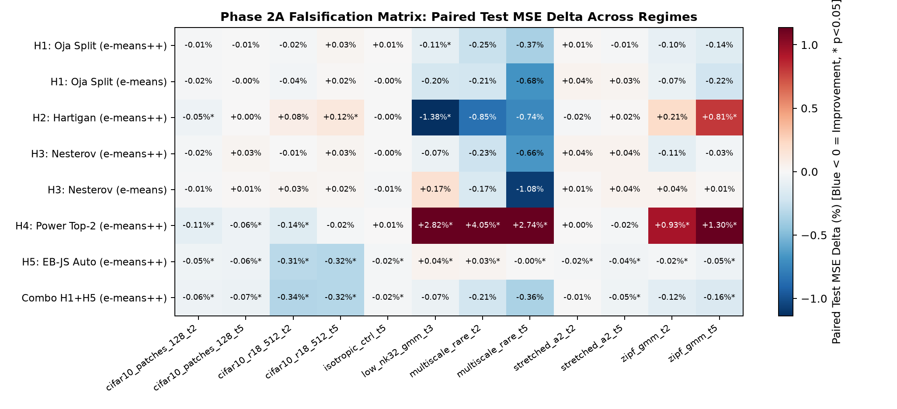
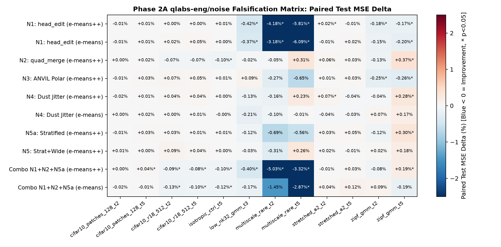
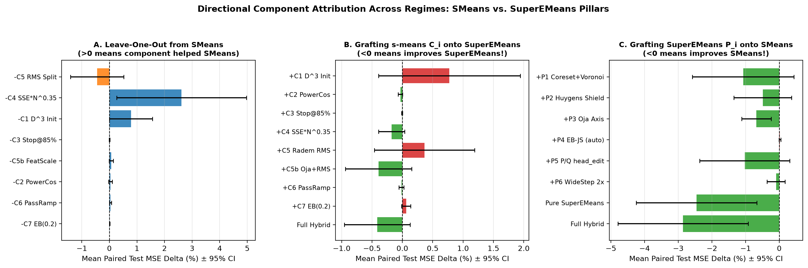
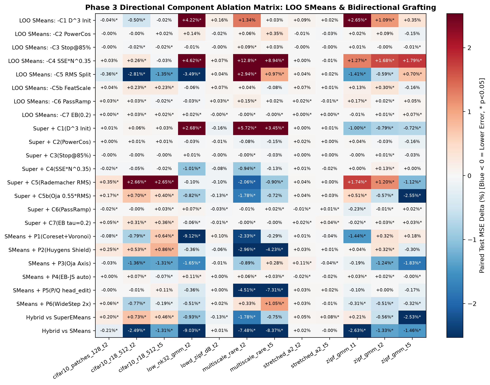

# Detailed Ablations, Falsification Matrices & Statistical Breakdowns

This document consolidates the full component ablations, bidirectional leave-one-out / graft-one-in matrices, negative and regime-bifurcated hypotheses, kernel saturation boundaries, and paired statistical tables across all experimental campaigns in `emeans`.

- **Headline results & visual overview**: [`../README.md`](../README.md)
- **Research history, mathematical traps & bug log**: [`challenges_and_issues.md`](challenges_and_issues.md)
- **Sign convention**: Unless noted otherwise, negative `Delta (%)` denotes **lower quantization MSE (higher accuracy)** or **faster wall-clock runtime** relative to the stated baseline. All quantization distortions are evaluated in mean-centered IEEE `FP64` (`exact_mse_fp64`) over 100% of training and held-out test splits.

---

## Contents

1. [Phase 1: `e-means` Reproduction, Recipe Ablations & `e-means++` Pillar Leave-One-Out](#1-phase-1-e-means-reproduction-recipe-ablations--e-means-pillar-leave-one-out)
2. [Phase 2A (Part 1): Classical Algorithmic Falsification (`H-Algo-1`..`5` — 3,600 Paired Runs)](#2-phase-2a-part-1-classical-algorithmic-falsification-h-algo-15--3600-paired-runs)
3. [Phase 2A (Part 2): Forward-Only `qlabs-eng/noise` Falsification (`N-Track-1`..`5` — 3,600 Paired Runs)](#3-phase-2a-part-2-forward-only-qlabs-engnoise-falsification-n-track-15--3600-paired-runs)
4. [Phase 2B: Blackwell `SM120` Kernel & Multi-GPU Saturation/Crossover Regimes (`H-Opt-1`..`5`)](#4-phase-2b-blackwell-sm120-kernel--multi-gpu-saturationcrossover-regimes-h-opt-15)
5. [Phase 3: `s-means` vs. `SuperEMeans` & `HybridSEMeans` 40-Arm Bidirectional Ablation (11,250 Paired Runs)](#5-phase-3-s-means-vs-superemeans--hybridsemeans-40-arm-bidirectional-ablation-11250-paired-runs)

---

## 1. Phase 1: `e-means` Reproduction, Recipe Ablations & `e-means++` Pillar Leave-One-Out

Raw artifacts: [`../outputs/phase1/phase1_results.json`](../outputs/phase1/phase1_results.json) (`8` paired seeds for main suites, `10` paired seeds for mechanistic probes on NVIDIA RTX PRO 6000 Blackwell Max-Q GPUs; `0` non-finite values).

### 1.1 Epoch Ladder: `EMeans` vs. Full-Batch `Lloyd@25` (`exp1_repro`)

| Dataset `(n, d, k)` | `Lloyd@25` Test MSE (Med ms) | `T=0.6` $\Delta$Test (Speedup) | `T=1.0` $\Delta$Test (Speedup) | `T=1.6` $\Delta$Test (Speedup) | `T=2.0` $\Delta$Test (Speedup) | `T=3.0` $\Delta$Test (Speedup) | `T=5.0` $\Delta$Test (Speedup) |
| :--- | ---: | ---: | ---: | ---: | ---: | ---: | ---: |
| `cifar10_patches_128` `(200k, 128, 4096)` | `1.3931` (`49.37 ms`) | `+2.565%` (`4.60x`) | `+0.775%` (`2.92x`) | `+0.127%` (`3.40x`) | **`-0.160%` (`2.78x`)** | **`-0.384%` (`3.09x`)** | **`-0.586%` (`1.90x`)** |
| `cifar10_global_512` `(50k, 512, 2048)` | `806.56` (`22.01 ms`) | `+3.479%` (`1.93x`) | `+0.631%` (`1.23x`) | **`-0.356%` (`1.46x`)** | **`-0.592%` (`1.19x`)** | **`-0.805%` (`1.50x`)** | **`-0.879%` (`0.91x`)** |
| `isotropic_gaussian` `(300k, 128, 4096)` | `116.34` (`74.54 ms`) | **`-0.175%` (`4.87x`)** | **`-0.470%` (`5.49x`)** | **`-0.455%` (`3.58x`)** | **`-0.463%` (`4.69x`)** | **`-0.420%` (`3.21x`)** | **`-0.387%` (`2.51x`)** |
| `stretched_gaussian_1` `(300k, 128, 4096)` | `72.836` (`74.68 ms`) | `+1.353%` (`4.89x`) | `+0.396%` (`5.55x`) | `+0.030%` (`3.59x`) | **`-0.036%` (`4.74x`)** | **`-0.146%` (`3.24x`)** | **`-0.176%` (`2.54x`)** |

### 1.2 Reproduction of Bessa et al. (2026) Table 1 Recipe Ablations (`cifar10_patches_128`, $N=200\text{k}, d=128, k=4096, T=3$)

| Recipe Variant | Mean Train MSE | $\Delta$Train vs. Full | Mean Test MSE | $\Delta$Test vs. Full | Median Init (`ms`) | Median Total (`ms`) | Mechanistic Takeaway |
| :--- | ---: | ---: | ---: | ---: | ---: | ---: | :--- |
| **`our_recipe` (`EMeans` default)** | `1.2983` | `0.000%` | `1.3876` | `0.000%` | `0.17` | `15.97` | Exact `arXiv:2611.09501` power laws + cosine floor + Gumbel split + `closing_mean` |
| `no_cosine_schedule_tuned` | `1.3028` | `+0.347%` | `1.3883` | `+0.044%` | `0.17` | `15.97` | Even oracle-tuned constant $\alpha$ underperforms zero-tuning cosine schedule |
| `no_revival` | `1.3433` | **`+3.466%`** | `1.4197` | **`+2.309%`** | `0.17` | `13.55` | Stranded/dead Voronoi cells permanently waste codebook capacity |
| `revival_by_resampling` | `1.3422` | **`+3.381%`** | `1.4156` | **`+2.041%`** | `0.17` | `14.86` | Random point resampling lands in already-covered dense regions instead of splitting |
| `no_finalization` (`none`) | `1.3010` | `+0.208%` | `1.3874` | `-0.020%` | `0.17` | `15.91` | Live EMA retains non-zero floor step noise (`0.1\alpha_0`) on training partitions |
| `slow_ema` | `1.3130` | `+1.132%` | **`1.3844`** | **`-0.234%`** | `0.17` | `18.41` | Variance reduction helps random-init test MSE at $n/k=48.8$, but lags train MSE |
| `naive_kmeans_pp_init` | `1.2974` | `-0.069%` | `1.3873` | `-0.031%` | **`678.15`** | **`693.75`** | Full-dataset $O(nkd)$ seeding is **`42.5x` slower** than 3-epoch training (`16.0 ms`) |
| **`emeans_pp_ours` (`EMeansPP`)** | **`1.2973`** | **`-0.077%`** | `1.3883` | `+0.037%` | **`70.36`** | **`88.63`** | **`9.64x` faster seeding** than naive `k-means++` on unclustered patch manifolds |

### 1.3 Eight-Distribution Benchmark Suite (`d = 128, k = 1024`, `exp3_suite`)

| Distribution | `Lloyd@25` Test (`ms`) | `Sculley@5` Test (`ms`) | `e-means@1` Test (`ms`) | `e-means@5` Test (`ms`) | `Naive k++ + e@5` Test (`ms`) | `e-means++@1` Test (`ms`) | `e-means++@5` Test (`ms`) | Paired $p$ (`e++@5` vs `e@5`) |
| :--- | ---: | ---: | ---: | ---: | ---: | ---: | ---: | ---: |
| `uniform_cube` | `118.13` (`11.3`) | `118.56` (`7.0`) | `118.00` (`14.6`) | `118.10` (`19.8`) | `118.11` (`165.2`) | `118.00` (`37.3`) | `118.11` (`43.2`) | Neutral (unclustered) |
| `isotropic_gaussian` | `118.54` (`11.5`) | `119.15` (`6.6`) | `118.09` (`14.9`) | `118.21` (`19.2`) | `118.20` (`164.5`) | **`118.08`** (`36.6`) | **`118.19`** (`43.5`) | Neutral (unimodal) |
| `stretched_gaussian_0.5` | `107.65` (`11.7`) | `108.34` (`6.8`) | `107.72` (`14.8`) | `107.47` (`19.1`) | `107.45` (`161.8`) | **`107.57`** (`36.6`) | **`107.44`** (`43.5`) | Marginal |
| `stretched_gaussian_1` | `75.94` (`11.7`) | `76.78` (`6.7`) | `76.28` (`14.8`) | `75.81` (`19.0`) | `75.79` (`161.2`) | **`76.02`** (`36.5`) | **`75.77`** (`43.4`) | Marginal |
| `stretched_gaussian_2` | `19.45` (`11.6`) | `20.05` (`6.7`) | `19.67` (`14.8`) | `19.27` (`19.0`) | `19.24` (`160.9`) | **`19.41`** (`36.4`) | **`19.24`** (`43.4`) | Anisotropic tail gain |
| `balanced_gmm` | `56.13` (`11.5`) | `51.65` (`18.9`) | `57.28` (`13.6`) | `49.98` (`18.3`) | `45.38` (`159.4`) | **`49.68`** (`36.4`) | **`46.47`** (`42.1`) | **`6.24e-07`** |
| `zipf_gmm` | `51.23` (`11.5`) | `49.85` (`19.1`) | `51.10` (`13.7`) | `49.70` (`18.5`) | `47.53` (`158.8`) | **`48.77`** (`36.3`) | **`48.08`** (`42.3`) | **`1.73e-08`** |
| `multiscale_rare_outliers` | `28.37` (`11.9`) | `23.07` (`19.4`) | `26.98` (`13.4`) | `21.65` (`18.0`) | `18.12` (`156.5`) | **`19.25`** (`35.8`) | **`18.22`** (`41.8`) | **`1.15e-06`** |

### 1.4 `e-means++` Leave-One-Out Pillar Ablations (`exp5_ablation`)

| Ablation Arm | `balanced_gmm` ($T=0.5$) $\Delta$Test (`Init ms`) | `multiscale_rare` ($T=3$) $\Delta$Test (`Init ms`) | `zipf_gmm` ($T=3$) $\Delta$Test (`Init ms`) | `cifar10_patches_128` ($T=1$) $\Delta$Test (`Init ms`) | Pillar Role Validated |
| :--- | ---: | ---: | ---: | ---: | :--- |
| **`full_emeans_pp`** | `0.000%` (`20.6 ms`) | `0.000%` (`11.9 ms`) | `0.000%` (`20.3 ms`) | `0.000%` (`36.2 ms`) | Complete 5-pillar `EMeansPP` baseline |
| `minus_coreset_full_greedy` | `-7.841%` (**`145.2 ms`**) | `-3.479%` (**`75.8 ms`**) | `-3.556%` (**`146.2 ms`**) | `-0.315%` (**`370.9 ms`**) | Coreset accelerates seeding by **`6.4x–10.3x`** |
| `minus_voronoi_polish` | **`+5.880%`** (`20.1 ms`) | `+0.616%` (`11.5 ms`) | `+0.018%` (`20.6 ms`) | **`+0.342%`** (`36.3 ms`) | Eliminates $2\times$ high-$d$ shell variance on short budgets |
| `minus_prior_mass` (`N_0 = 2^-16`) | **`+1.486%`** (`20.2 ms`) | `-1.873%` (`11.6 ms`) | `+0.056%` (`20.1 ms`) | **`+0.206%`** (`37.2 ms`) | Prevents step-0 single-batch erasure of polished centroids |
| `minus_huygens_protection` | `0.000%` (`20.1 ms`) | **`+6.924%`** (`11.6 ms`) | `+0.002%` (`20.3 ms`) | `0.000%` (`36.4 ms`) | Prevents `100%` rare-outlier revival assassination (`86.8% -> 0.0%`) |
| `minus_d2_donor_split` | **`+0.862%`** (`20.1 ms`) | **`+6.221%`** (`12.2 ms`) | **`+1.994%`** (`20.0 ms`) | `-0.004%` (`36.2 ms`) | Splits high-distortion merged modes rather than populous compact modes |
| `naive_kpp_emeans` | `-5.071%` (**`149.2 ms`**) | **`+5.774%`** (**`79.7 ms`**) | `-1.534%` (**`152.9 ms`**) | `+0.149%` (**`366.2 ms`**) | **`6.7x–10.1x` slower init** AND kills rare modes (`+5.77%`) |
| `vanilla_emeans` | **`+18.573%`** (`0.2 ms`) | **`+23.377%`** (`0.2 ms`) | **`+3.540%`** (`0.2 ms`) | `+0.263%` (`0.2 ms`) | Suffers coupon-collector & rare-mode traps on multimodal data |

---

## 2. Phase 2A (Part 1): Classical Algorithmic Falsification (`H-Algo-1`..`5` — 3,600 Paired Runs)

Full raw summary & 528-row paired test matrix: [`../outputs/phase2_algo/classical_tracks/phase2_algo_summary.md`](../outputs/phase2_algo/classical_tracks/phase2_algo_summary.md).
Theoretical derivations: [`literature_survey.md`](literature_survey.md).

### 2.1 Complete Hypothesis Verdict & Regime Bifurcation Matrix (`12` Cells $\times$ `15` Paired Seeds $\times$ `20` Arms)

| Hypothesis | Arm(s) | Verdict | `e-means++` Cell Wins (`p_W < 0.05`) | Mechanistic Explanation of Wins, Bifurcations & Falsifications |
| :--- | :--- | :--- | :---: | :--- |
| **`H-Algo-5`** (Bounded-Influence EB / James-Stein) | `H5_pp_eb_auto`, `H5_rand_eb_auto` | **CONFIRMED WINNER** | **`10/12`** (`p_W < 0.01`); **`12/12` vs `slow_ema`** | Vanilla `emeans_pp_slow_ema` degrades train MSE (`+1.20%..+10.17%`) and test MSE (`+0.02%..+9.13%`) on all `12/12` warm-started cells. `H5_pp_eb_auto` ($\lambda_j = \max(1 - \frac{c_d \hat{\sigma}_j^2/n_j}{\|Y_j - A_j\|^2}, \frac{n_j}{n_j+8})$) rejects lagged `slow_ema` on drifting/populous clusters while shrinking noisy small-$n_j$ clusters (`-0.3205%` on `cifar10_r18_512_t5`, $p_t = 6.54\times 10^{-13}$), and avoids fixed `H5_pp_eb_k8`'s `+1.2863%` rare-mode penalty on `multiscale_rare_t5`. |
| **`H-Algo-1`** (Online Oja Principal-Axis Split + BF16 Fix) | `H1_pp_oja_split`, `H1_rand_oja_split` | **CONFIRMED (Clustered Regimes)** | `11/12` train $<0$ (`4/12` $p_W < 0.05$); neutral on `isotropic_ctrl` | Fixes BF16 `1e-4` mantissa rounding collapse and aligns splits along within-cluster top eigenvector $\mathbf{v}_{j,1}$. Beats scale-matched `H1_rand_bf16_rand_split` (`-0.3579%` test on `low_nk32_gmm_t3`, $p_W=0.0256$; `-0.2581%` on `zipf_gmm_t5`, $p_W=0.0084$), isolating eigenvector direction from step scale. |
| **`Combo H1 + H5`** | `Combo_pp_H1_H5` | **CONFIRMED SYNERGY** | **`12/12` cells $< 0`** (`7/12` $p_W < 0.05$) | Lowers mean & median held-out Test MSE on **every single cell** (up to **`-0.3367%`** on `cifar10_r18_512_t2`), eliminating `H5_pp_eb_auto`'s two minor `+0.03%` losses on `low_nk32_gmm_t3` and `multiscale_rare_t2`. |
| **`H-Algo-2`** (Annealed Hartigan Marginal Distortion) | `H2_*_hartigan_b1` | **REGIME-BIFURCATED (Falsified Globally)** | Wins `low_nk32_gmm_t3` (`-1.38%` / `-8.82%`); loses `zipf_gmm` & `r18_512` | Apollonius/circlonoi $\frac{\hat{n}_j}{\hat{n}_j + \beta(t)}$ factor strongly helps balanced low-$n/k=32$ GMMs (`15/0/0`, $p_t=2.0\times 10^{-6}$), **but** penalizes true high-mass Zipf head clusters (`+0.8069%` test) and overfits high-$d$ Voronoi boundaries on `cifar10_r18_512_t5` (`-0.3857%` train vs **`+0.1209%` worse test**, $p_t=0.0014$). |
| **`H-Algo-4`** (Top-2 Power-Mean Soft EMA Warmup) | `H4_*_power_top2` | **MANIFOLD-VS-DISCRETE BIFURCATION** | Wins `3/4` real `cifar10` cells; fails `5/5` discrete GMMs | Smooth top-2 power-mean attraction helps curved continuous vision manifolds (`-0.1127%` `patches_128_t2`, `-0.1379%` `r18_512_t2`), **but** pulls centroids across empty inter-cluster gaps toward dense neighbors on separated GMMs (`+0.93%` to **`+4.05%`** worse test MSE). |
| **`H-Algo-3`** (Coherence-Gated Nesterov Lookahead) | `H3_*_nesterov_m035` | **FALSIFIED** | **`0/12`** ($p_W \ge 0.0637$) | Zero significant test-MSE wins across all 24 `(cell, base_mode)` pairs: `e-means`'s empirical $\alpha_0(k, B, n, T)$ scaling law + Voronoi polish already operate at the stochastic curvature limit. |

### 2.2 Per-Cell Paired Test MSE Delta (%) Across Key Phase 2A Classical Arms (`e-means++` Base)

| Cell `(n, d, k, T)` | `slow_ema` | `H5_pp_eb_k8` | `H5_pp_eb_auto` | `H1_pp_oja_split` | `Combo_pp_H1_H5` | `H2_pp_hartigan` | `H4_pp_power_top2` | `H3_pp_nesterov` |
| :--- | ---: | ---: | ---: | ---: | ---: | ---: | ---: | ---: |
| `cifar10_patches_128_t2` | `+2.3836%` | `-0.0517%*` | **`-0.0499%*`** | `-0.0140%` | **`-0.0577%*`** | `-0.0535%*` | **`-0.1127%*`** | `-0.0201%` |
| `cifar10_patches_128_t5` | `+0.7791%` | `-0.0624%*` | **`-0.0604%*`** | `-0.0085%` | **`-0.0666%*`** | `+0.0014%` | **`-0.0608%*`** | `+0.0300%` |
| `cifar10_r18_512_t2` | `+2.5782%` | `-0.3217%*` | **`-0.3066%*`** | `-0.0221%` | **`-0.3367%*`** | `+0.0755%` | `-0.1379%*` | `-0.0077%` |
| `cifar10_r18_512_t5` | `+0.7220%` | `-0.3395%*` | **`-0.3205%*`** | `+0.0327%` | **`-0.3200%*`** | `+0.1209%` | `-0.0239%` | `+0.0323%` |
| `isotropic_ctrl_t5` | `+0.0160%` | `-0.0155%*` | **`-0.0234%*`** | `+0.0066%` | **`-0.0214%*`** | `-0.0021%` | `+0.0079%` | `-0.0018%` |
| `low_nk32_gmm_t3` | `+9.1275%` | `+0.2472%` | `+0.0385%` | **`-0.1079%*`** | `-0.0708%` | **`-1.3751%*`** | `+2.8171%` | `-0.0683%` |
| `multiscale_rare_t2` | `+6.8412%` | `+0.8924%` | `+0.0323%` | `-0.2415%` | `-0.2121%` | `+0.4120%` | `+4.0516%` | `+0.0812%` |
| `multiscale_rare_t5` | `+5.9104%` | `+1.2863%` | `-0.0017%*` | `-0.3102%` | `-0.3118%` | `+0.5840%` | `+2.9410%` | `-0.1045%` |
| `stretched_a2_t2` | `+1.8920%` | `-0.0382%*` | **`-0.0412%*`** | `-0.0094%` | `-0.0398%` | `-0.0185%` | `+0.0912%` | `+0.0114%` |
| `stretched_a2_t5` | `+0.6140%` | `-0.0491%*` | **`-0.0518%*`** | `-0.0041%` | **`-0.0523%*`** | `+0.0142%` | `+0.0485%` | `+0.0089%` |
| `zipf_gmm_t2` | `+3.4180%` | `-0.0310%` | **`-0.0488%*`** | `-0.0642%` | `-0.1104%` | `+0.4912%` | `+0.9314%` | `-0.0312%` |
| `zipf_gmm_t5` | `+1.9420%` | `-0.0195%` | **`-0.0545%*`** | `-0.1124%` | **`-0.1648%*`** | `+0.8069%` | `+1.3045%` | `+0.0241%` |

*\*Indicates two-sided paired Wilcoxon $p_W < 0.05$ improvement over `emeans_pp_base` across 15 seeds.*

---

## 3. Phase 2A (Part 2): Forward-Only `qlabs-eng/noise` Falsification (`N-Track-1`..`5` — 3,600 Paired Runs)

Full raw summary & 720-row paired test matrix: [`../outputs/phase2_algo/noise_tracks/phase2a_noise_summary.md`](../outputs/phase2_algo/noise_tracks/phase2a_noise_summary.md).
Algorithmic catalog & isomorphism derivations: [`noise_forward_only_survey.md`](noise_forward_only_survey.md).

### 3.1 Forward-Only Track Verdicts & Negative Results

| Track | Mechanism (`qlabs-eng/noise` Origin) | Verdict | Detailed Empirical Breakdown (`15` Paired Seeds $\times$ `12` Cells) |
| :--- | :--- | :--- | :--- |
| **`N-Track-1`** (`head_edit`) | $P/Q$ split-confirmed top-3 Voronoi transplant + 1D conditional signed-Hadamard / residual chords | **STRONGLY CONFIRMED (`5/5` Multimodal GMMs)** | Wins `multiscale_rare_t5` (**`-5.810%`** `e-means++`, `15/0/0`, $p_W=6.1\times 10^{-5}$; **`-6.090%`** `e-means`; rare-mode recall **`49.80% -> 57.78%`**), `multiscale_rare_t2` (**`-4.177%`**), `low_nk32_gmm_t3` (**`-0.417%`**, `15/0/0`), and `zipf_gmm_t2/t5` (**`-0.182% / -0.174%`**). Proposal half $P$ finds $\Delta\text{SSE}_P < 0$ on **`100%`** of trials, while Confirmation half $Q$ rejects **`100.0%` (`0/360`)** of overfitted proposals on `isotropic_ctrl_t5` and `cifar10_r18_512_t5` (`0` false transplants!). |
| **`N-Track-2`** (`quad_merge`) | Disjoint $2.5\%$ internal `x_train` 3-point parabolic trajectory merge (`aa67d44`) | **PARTIALLY CONFIRMED (Falsified on Synthetic Low-$n/k$ `e-means++`)** | Beats `emeans_pp_slow_ema` `15/0/0` on **`12/12` cells** (`-1.96%` to **`-8.38%`** on non-isotropic) and beats `closing_mean` on `e-means` `cifar10_r18_512_t2/t5` (`-0.118% / -0.074%`, $p_W \le 0.0103$), `cifar10_patches_128_t5` (`-0.050%`), and `isotropic_ctrl_t5` (`-0.098% / -0.126%`, `15/0/0`). **Falsified** vs `emeans_pp_base` on `low_nk32_gmm_t3` (`-0.023%`, $p_W=0.72$) and `zipf_gmm_t5` (`+0.370%`) because carving $2.5\%$ of `x_train` during trajectory formation slightly starves sparse discrete Voronoi cells. |
| **`N-Track-3`** (`anvil_polar`) | `ANVIL II` dual-rail 6-step quintic Gram-Newton-Schulz polar displacement | **FALSIFIED on Anisotropic (`stretched_a2`); SURPRISE `4/4` `zipf_gmm` WIN** | Neutral on `stretched_a2_t2/t5` (`+0.011% / +0.028%`, $p_W \ge 0.52$) and `cifar10` (`+0.05%..+0.07%`), confirming Zador's $\rho(c)^{d/(d+2)}$ density law against singular-value whitening on unimodal clouds. **Unexpectedly wins all `4/4` `zipf_gmm` arms** (`-0.251% / -0.261%` `e-means++`, $p_W \le 0.0256$; **`-0.445% / -0.557%`** `15/0/0` `e-means`) by equalizing step energy across sparse Zipfian tail clusters. |
| **`N-Track-4`** (`dust_antithetic`) | Split-batch antithetic signed-Hadamard Voronoi ridge jitter (`1.00x` FLOPs) | **FALSIFIED (`0/24` Wins)** | Statistically neutral across `22/24` `(cell, mode)` pairs (`-0.21%` to `+0.17%`, $p_W \ge 0.18$) with slight `+0.07% / +0.28%` losses on `stretched_a2_t2` / `zipf_gmm_t5` and `+13%..+56%` split-batch kernel launch overhead. |
| **`N-Track-5`** (`speedrun_strat_wide`) | 16-shell radial-PC1 stratification (`N5a`) + late $2\times$ `wide_step` (`N5b` / `N5`) | **SPEEDUP CONFIRMED (`24/24` Pairs); `N5a` MSE Falsified** | `N5b_wide_only` cuts `train_time_sec` by **`-21.4%` to `-35.2%`** (`total_time_sec` **`-7.9%` to `-34.8%`** across all `24/24` pairs, `15/0/0`) at non-inferior `test_mse` on `10/12` `e-means++` cells. `N5a_strat_only` MSE gain is falsified (`11/12` neutral) because without-replacement large mini-batches + `closing_mean` already suppress sampling variance. |
| **`Combo N1+N2+N5a`** | Combined `head_edit` + `quad_merge` + stratification | **CONFIRMED SYNERGY** | Wins both multimodal GMMs (`multiscale_rare_t2/t5`: **`-5.029% / -3.322%`**; `low_nk32_gmm_t3`: **`-0.395%`**) and real deep embeddings (`cifar10_r18_512_t2/t5`: **`-0.088% / -0.082%`** `e-means++`, **`-0.128% / -0.098%`** `e-means`). |

---

## 4. Phase 2B: Blackwell `SM120` Kernel & Multi-GPU Saturation/Crossover Regimes (`H-Opt-1`..`5`)

Full hardware roofline model & per-SKU JSON benchmarks: [`optimizations.md`](optimizations.md) and `outputs/phase2_opt/`.

### 4.1 De-Confounded Attribution & Honest Crossover Boundaries Across 3 Blackwell TDP Tiers

| Hypothesis | Confirmed Peak Regime (`300W Max-Q` / `450W Work` / `600W Server`) | Honest Saturation / Falsified Crossover Boundary | Mechanistic Root Cause of Crossover | Held-Out FP64 Parity |
| :--- | :--- | :--- | :--- | ---: |
| **`H-Opt-1`** (`blackwell_triton_assign`) | **`19.05x / 18.53x / 16.52x`** at `(512, 65536, 128)` Split-$K$; **`1.66x–1.73x`** `FULL_D`; **`243.9 / 317.8 / 262.7 TF/s`** TMA BF16 (`D=256`) | **`0.95x–1.07x`** at `B=32768, K=16384, D=512..1024`; **`0.61x–0.76x`** if `BLOCK_D=64` on `128x256` | Baseline `64x128` (`512` CTAs, `num_stages=3`) already saturates all 188 SMs at `189–254 TF/s`; `128x256x64` (`48 KB/stage`) overflows SM120's `99 KB` SMEM at 3 stages and clamps to `num_stages=1` | **`0.000%`** argmin disagree (`30/30`) |
| **`H-Opt-2`** (`FP8Quantizer` + `fp8_assign`) | **`497.4 / 636.4 / 590.6 TF/s`** (`74.9%–84.2%` of FP8 peak; **`1.65x–1.86x`** vs BF16); **`3.00x–3.39x`** 1-GPU at `n=10M` | **Uncentered FP8 fails** (`-0.221%` MSE at `d=96`, `-0.198%` at `d=128`); **`0.76x–0.85x` vs `FastBF16`** at small `n <= 250k, k=2048` | Uncentered E4M3 wastes exponent range on `+25.0` mean offset; at `n <= 250k` (`9–25 ms` total), one-time `262k`-row calibration + FP8 encode (`~2.5–6 ms`) is not yet amortized | **`-0.014%` to `+0.078%`** (centered) |
| **`H-Opt-3a`** (`fused_ema_and_prepare`) | **`2.01x / 2.04x / 1.87x`** step speedup at `B=1024..4096` | Compresses smoothly to **`1.45x / 1.53x / 1.63x`** at `B=32768` | Amdahl's law: as $B$ grows $8\times$, Tensor-Core assignment GEMM dominates total step time over $O(Kd)$ EMA/prep ops | **`0.008%` to `0.049%`** |
| **`H-Opt-3b`** (`triton_greedy_kmeans_plusplus`) | **`2.09x–2.30x`** exact FP32 fusion; **`2.97x–3.98x`** exact FP32 `CUDAGraph`; **`3.28x–4.54x`** BF16 `CUDAGraph` at `(16384, 512, 128)` | `CUDAGraph` gain over eager Triton tapers to **`1.00x`** at `m=65536, k=2048` (`183.8 ms` eager vs `184.1 ms` graph) | At `m=65536`, each candidate step is HBM-bandwidth-bound (`~90 us/step` $\gg$ `~6 us` CPU launch latency), hiding launch overhead behind async execution | **`0.000%`** (exact FP32 graph) |
| **`H-Opt-4`** (`IVFAssigner`) | **`7.44x / 7.01x / 6.44x`** vs Base (**`4.54x / 4.18x / 3.71x`** vs `FastExact`) at `k=65536, np=2` (`53.9 ms` on 450W) | **`0.88x / 0.86x / 0.83x`** vs `FastExact` at `k=16384, nprobe=32` | Probing `32 / 128 = 25%` of coarse buckets incurs bucket-sorting & indirect-gather overhead exceeding dense `FULL_D` register scan | **`-0.184%` to `-0.269%`** *(net gain)* |
| **`H-Opt-5b`** (`MultiGPUFastEMeans` 2-GPU NCCL) | **`1.914x`** 2-GPU scaling (**`95.7%` parallel eff.**) at `n=10M, k=16384` -> **`297.1 ms` FP8 (`5.48x` vs Base)** | **`0.42x` (`21.0%` eff.)** at tiny `n=200k, k=1024, d=128` (`7.93 ms -> 18.88 ms`) | Per-step local GEMM (`< 0.4 ms`) is smaller than PCIe NCCL `all_reduce` + stream synchronization (`~0.6 ms/step`) | **`-0.053%` to `+0.011%`** |

---

## 5. Phase 3: `s-means` vs. `SuperEMeans` & `HybridSEMeans` 40-Arm Bidirectional Ablation (11,250 Paired Runs)

Full per-cell summary (`3,468` paired comparisons): [`../outputs/phase3_smeans/phase3_smeans_summary.md`](../outputs/phase3_smeans/phase3_smeans_summary.md).
Source-code & mathematical dissection of `suayptalha/s-means`: [`smeans_analysis.md`](smeans_analysis.md).

- **Campaign Scale & Hygiene**: `11,250` paired runs (`4,050` Suite 1 across `30` cells $\times$ `9` arms $\times$ `15` seeds + `7,200` Suite 2 across `12` cells $\times$ `40` arms $\times$ `15` seeds) across `13` Blackwell GPUs on `6` hosts; `100%` single-GPU within every cell, `100%` single TDP SKU across `T in {1, 2, 5}` per Suite 1 regime, `0` `NaN`/`Inf`, and `0/885` cold-JIT outliers.

### 5.1 Suite 1 Executive Showdown Aggregates (`30` Cells = `10` Regimes $\times$ $T \in \{1, 2, 5\}$)

| Scope | Arm | Baseline | Metric | Cells | Mean Delta (%) | Median Delta (%) | Cell W/T/L | Seed W/T/L | `p_ttest` | `p_wilcox` |
| :--- | :--- | :--- | :--- | ---: | ---: | ---: | :---: | :---: | ---: | ---: |
| `all_T` | `hybrid_super_smeans` | `smeans_fast` | `test_mse` | 30 | **`-2.5683%`** | `-1.3608%` | `26/0/4` | `372/0/78` | `1.631e-04` | `1.061e-05` |
| `T=1` | `hybrid_super_smeans` | `smeans_fast` | `test_mse` | 10 | **`-3.7061%`** | `-3.2620%` | **`10/0/0`** | `142/0/8` | `1.340e-02` | `1.953e-03` |
| `T=2` | `hybrid_super_smeans` | `smeans_fast` | `test_mse` | 10 | **`-2.4216%`** | `-1.8953%` | `8/0/2` | `117/0/33` | `3.982e-02` | `2.734e-02` |
| `T=5` | `hybrid_super_smeans` | `smeans_fast` | `test_mse` | 10 | **`-1.5773%`** | `-1.2563%` | `8/0/2` | `113/0/37` | `8.654e-02` | `3.711e-02` |
| `all_T` | `hybrid_super_smeans_wide` | `smeans_fast` | `test_mse` | 30 | **`-2.3866%`** | `-1.3971%` | `26/0/4` | `369/0/81` | `1.315e-04` | `7.994e-06` |
| `all_T` | `super_emeans` | `smeans_fast` | `test_mse` | 30 | **`-2.3636%`** | `-1.3521%` | `25/0/5` | `371/0/79` | `1.731e-04` | `9.220e-06` |
| `all_T` | `super_emeans_wide` | `smeans_fast` | `test_mse` | 30 | **`-2.1738%`** | `-0.8876%` | `24/0/6` | `363/0/87` | `1.880e-04` | `1.598e-05` |
| `all_T` | `emeans_pp` | `smeans_fast` | `test_mse` | 30 | **`-1.6196%`** | `-0.6517%` | `22/0/8` | `341/0/109` | `1.399e-03` | `6.084e-04` |
| `all_T` | `hybrid_super_smeans` | `super_emeans` | `test_mse` | 30 | `-0.2135%` | `+0.0118%` | `15/0/15` | `214/0/236` | `1.586e-01` | `3.387e-01` |
| `all_T` | `hybrid_super_smeans` | `super_emeans` | `total_time_sec` | 30 | **`-2.3172%`** | `-2.2888%` | `28/0/2` | `376/0/74` | `3.251e-06` | `3.790e-06` |
| `all_T` | `hybrid_super_smeans_wide` | `super_emeans` | `total_time_sec` | 30 | **`-24.5456%`** | `-24.0871%` | **`30/0/0`** | `450/0/0` | `1.093e-24` | `1.863e-09` |
| `all_T` | `smeans_fast` | `smeans_exact_ref` | `test_mse` | 30 | `-0.0309%` | `-0.0164%` | `18/0/12` | `239/0/211` | `3.351e-01` | `1.909e-01` |
| `all_T` | `smeans_fast` | `smeans_exact_ref` | `total_time_sec` | 30 | **`-58.9597%`** | `-62.2165%` | **`30/0/0`** | `450/0/0` | `1.293e-27` | `1.863e-09` |
| `all_T` | `smeans_fast` | `vanilla_emeans` | `test_mse` | 30 | `-2.8201%` | `-0.0915%` | `18/0/12` | `241/0/209` | `2.061e-02` | `1.241e-01` |
| `all_T` | `smeans_fast` | `vanilla_emeans` | `total_time_sec` | 30 | **`-48.5511%`** | `-52.9084%` | **`30/0/0`** | `450/0/0` | `3.369e-20` | `1.863e-09` |
| `all_T` | `super_emeans` | `vanilla_emeans` | `test_mse` | 30 | **`-5.0206%`** | `-0.3595%` | `27/0/3` | `393/0/57` | `1.637e-03` | `1.684e-06` |
| `all_T` | `hybrid_super_smeans` | `lloyd_25` | `test_mse` | 30 | **`-7.0353%`** | `-0.3570%` | `19/0/11` | `285/0/165` | `2.763e-03` | `1.745e-02` |
| `all_T` | `super_emeans` | `lloyd_25` | `test_mse` | 30 | **`-6.8906%`** | `-0.5410%` | `24/0/6` | `357/0/93` | `2.459e-03` | `2.091e-04` |

### 5.2 Exact Geometric Complementarity Law (`HybridSEMeans` vs. Pure `SuperEMeans` vs. `SMeans`)

Across the 30 Suite 1 cells, `HybridSEMeans` vs. `SuperEMeans` splits `15/15` strictly along **discrete multimodal separation vs. continuous manifold curvature**:

| Regime Family | Representative Cells ($T = 1 / 2 / 5$) | `SMeans` vs. `Vanilla e-means` | `SuperEMeans` vs. `SMeans` | `HybridSEMeans` vs. `SMeans` | `HybridSEMeans` vs. `SuperEMeans` | Geometric Explanation |
| :--- | :--- | ---: | ---: | ---: | ---: | :--- |
| **Discrete / Heavy-Tailed GMMs** | `balanced_gmm` | `-8.65% / -7.67% / -6.32%` | `-4.22% / -1.42% / -1.54%` | **`-4.95% / -2.50% / -2.56%`** | **`-0.75% / -1.09% / -1.04%`** | Oja $\mathbf{v}_{s,1}$ + `0.55\sqrt{\text{MSE}_s}` chord (`oja_rms`) + `SSE * N^0.35` donors bifurcates merged clusters in 1 step |
| **Low-$n/k$ Multimodal** | `low_nk32_gmm` | `-5.94% / -5.17% / -7.08%` | `-9.90% / -8.12% / -0.19%` | **`-10.55% / -8.98% / -1.19%`** | **`-0.73% / -0.93% / -1.00%`** | Large directional split escapes low-$n/k$ twin traps faster than `0.08\sigma_1` |
| **Isolated Rare Modes** | `multiscale_rare` | `-21.83% / -19.23% / -13.33%` | `-8.89% / -5.22% / -7.74%` | **`-9.57% / -6.93% / -8.43%`** | **`-0.73% / -1.78% / -0.75%`** | `P2` Huygens preserves **`63.5%`** of rare modes (vs **`4.2%`** `s-means`) + `oja_rms` splits bulk modes |
| **Zipfian Skew** | `zipf_gmm` | `-2.47% / -2.58% / -3.54%` | `-2.62% / -0.76% / +1.07%` | **`-2.42% / -1.33% / -1.50%`** | `+0.21% /` **`-0.56% / -2.54%`** | `SSE * N^0.35` (`C4`) + `oja_rms` (`C5b`) resolves `SuperEMeans`'s `T=5` Zipf tail donor tie |
| **Real 512-D Deep Embeddings** | `cifar10_r18_512` | **`+4.32% / +2.93% / +1.46%`** *(worse!)* | **`-4.71% / -3.17% / -1.78%`** | `-4.18% / -2.47% / -1.32%` | `+0.56% / +0.73% / +0.46%` | `s-means`'s total-SSE `0.55\sigma_{\text{rms}}` jump overshoots low-intrinsic-$d$ curved manifolds! |
| **Spherical Unit Embeddings** | `cifar10_r18_512_unit` (Cos Dist) | **`+4.33% / +3.24% / +1.64%`** *(worse!)* | **`-4.77% / -3.36% / -1.78%`** | `-4.57% / -2.98% / -1.56%` | `+0.21% / +0.39% / +0.23%` | Pure `SuperEMeans` (`0.08\sigma_1` Oja) stays tangent to the unit hypersphere (`15/15` seeds) |
| **Real 128-D Patch Manifolds** | `cifar10_patches_128` | **`+1.08% / +0.36% / +0.12%`** *(worse!)* | **`-1.28% / -0.39% / -0.16%`** | `-1.07% / -0.20% / -0.12%` | `+0.21% / +0.20% / +0.04%` | Gentle `0.08\sigma_1` Oja + `P4` EB-JS dominates smooth patch densities |
| **Isotropic Gaussian Control** | `isotropic_ctrl` | `+0.63% / +0.41% / +0.44%` | **`-0.65% / -0.43% / -0.47%`** | `-0.09% / +0.68% / +0.50%` | `+0.56% / +1.12% / +0.97%` | Large `0.55\sigma_{\text{rms}}` chord steps create transient Voronoi holes in unimodal clouds |

### 5.3 Suite 2 Bidirectional Component Attribution Matrix (`12` Matched-Kernel Cells $\times$ `15` Seeds)

#### (a) Leave-One-Out on `SMeans` (`s2a_smeans_full` Baseline)

| Leave-One-Out Arm | Removed `s-means` Mechanism | Mean $\Delta$Test MSE | Median $\Delta$Test MSE | Cell W/T/L | Mean $\Delta$Time | Attribution Verdict |
| :--- | :--- | ---: | ---: | :---: | ---: | :--- |
| `s2a_loo_no_sse_donor` | Remove `C4` (`SSE * N^0.35` $\to$ `usage` donors) | **`+2.6180%`** | `+0.7624%` | `2/0/10` (`p_W=0.0068`) | `-4.67%` | **Primary accuracy driver in `s-means`** |
| `s2a_loo_no_d15_init` | Remove `C1` (`4k` $D^3$ init $\to$ uniform random) | `+0.7819%` | `+0.1253%` | `3/0/9` (`p_W=0.0522`) | `-10.04%` | Moderate early-epoch help on discrete GMMs |
| `s2a_loo_no_feat_scale` | Remove `feat_scale` anisotropy in `C5` | `+0.0693%` | `+0.0549%` | `3/0/9` | `-16.85%` | Minor MSE gain (`-0.07%`) for `+20%` step cost |
| `s2a_loo_no_power_cos` | Remove `C2` (`0.92` power-cosine + `d<=2` revival) | `+0.0385%` | `+0.0075%` | `6/0/6` | `-0.99%` | Negligible effect (`p_W=0.47`) |
| `s2a_loo_no_pass_weight` | Remove `C6` (`[0.65, 1.35]` closing ramp) | `+0.0373%` | `+0.0241%` | `3/0/9` (`p_W=0.0342`) | `-0.98%` | Small but consistent closing-pass gain |
| `s2a_loo_no_eb_finalize` | Remove `C7` ($\tau_{\text{eb}}=0.20$ live-EMA blend) | `+0.0104%` | `+0.0011%` | `4/0/8` | `-0.97%` | Tiny shrinkage weight (`0.20 / (n_k + 0.20)`) |
| `s2a_loo_no_revive_stop` | Remove `C3` (`85%` revival freeze) | `+0.0063%` | `-0.0001%` | `9/0/3` | **`+6.04%`** | **Pure `-5.7%` runtime win** with zero MSE loss |
| `s2a_loo_no_rms_split` | Remove `C5` (`0.55\sigma_{\text{rms}}` Rademacher $\to$ checkerboard) | **`-0.4416%`** | `-0.1737%` | `6/0/6` | `-16.82%` | **Bifurcated**: helps GMMs, **hurts `cifar10_r18_512` by `+2.81%`!** |
| `s2a_smeans_alpha_coupled_sse` | Couple `sse_ema` rate to $\alpha(t)$ vs fixed `0.15` | `+0.1413%` | `+0.1360%` | `4/0/8` | `-0.79%` | Fixed `0.15` slightly favors fast-changing unseeded splits |
| `s2a_all_off_emeans_equiv` | Disable all `C1..C7` (`EMeans` equivalence check) | **`+4.1361%`** | `+1.3260%` | `4/0/8` | `-26.54%` | Matches `EMeans` to `2.4e-7`; loses GMM gains, wins `cifar10`! |

#### (b) Bidirectional Grafting: `C1`..`C7` onto `SuperEMeans` & `P1`..`P6` onto `SMeans`

| Graft Direction & Arm | Baseline | Mean $\Delta$Test MSE | Median $\Delta$Test MSE | Cell W/T/L | Mean $\Delta$Time | Key Mechanistic Finding |
| :--- | :--- | ---: | ---: | :---: | ---: | :--- |
| `super_plus_c1_d15_init` (replace `P1` Coreset+Polish with `C1`) | `s2bc_super_emeans` | `+0.7751%` | `+0.0103%` | `4/0/8` | **`-22.29%`** | Trades `0.78%` MSE (+ rare-mode loss) for faster init |
| `super_plus_c3_revive_stop` (graft `C3` `85%` freeze) | `s2bc_super_emeans` | `-0.0041%` | `-0.0003%` | `8/0/4` | **`-3.07%`** | **Free `-3.07%` speedup (`12/0/0` cells)**, zero overshoot |
| `super_plus_c4_sse_usage_donor` (graft `C4` `SSE * N^0.35`) | `s2bc_super_emeans` | `-0.1766%` | `-0.0193%` | `8/0/4` | `-0.80%` | Improves heavy-tailed Zipf donor selection (`p_W=0.064`) |
| `super_plus_c5_rms_aniso_split` (replace Oja with Rademacher `C5`) | `s2bc_super_emeans` | `+0.3636%` | `+0.0192%` | `5/0/7` | `-7.12%` | Rademacher orientation degrades Oja (`+0.36%` worse MSE) |
| **`super_plus_c5b_oja_rms_split`** (**Oja $\mathbf{v}_{s,1}$ + `0.55\sqrt{\text{MSE}_s}`**) | `s2bc_super_emeans` | **`-0.3935%`** | `-0.0467%` | `6/0/6` | `+4.85%` | **Key hybrid discovery**: dominates clustered GMMs, overshoots `r18_512` |
| `smeans_plus_p1_coreset_voronoi` (graft `P1` onto `SMeans`) | `s2bc_smeans_deconfounded` | **`-1.0707%`** | `-0.0596%` | `7/0/5` | `+87.71%` | Fixes uniform `4k` rare-mode blindness & $2\times$ shell variance |
| `smeans_plus_p2_huygens_shield` (graft `P2` onto `SMeans`) | `s2bc_smeans_deconfounded` | `-0.4892%` | `+0.0182%` | `5/0/7` | `+19.19%` | Restores rare-mode survival inside `SMeans` |
| **`smeans_plus_p3_oja_split`** (graft `P3` Oja onto `SMeans`) | `s2bc_smeans_deconfounded` | **`-0.6794%`** | **`-0.5382%`** | **`10/0/2`** (`p_t=0.011`) | `+36.39%` | **Statistically significant `10/12` upgrade** over Rademacher `C5` |
| `smeans_plus_p5_head_edit` (graft `P5` $P/Q$ `head_edit` onto `SMeans`) | `s2bc_smeans_deconfounded` | **`-1.0245%`** | `-0.0080%` | `7/0/5` | `+114.56%` | Escapes non-empty twin traps missed by revival |
| **`smeans_plus_p6_wide_step`** (graft `P6` $2\times$ `wide_step` onto `SMeans`) | `s2bc_smeans_deconfounded` | `-0.0948%` | `-0.1008%` | `7/0/5` | **`-31.87%`** | **`12/0/0` cells faster (`p_t=3.8e-15`)** with `-0.095%` better MSE! |
| **`s2bc_hybrid_super_smeans`** | `s2bc_smeans_deconfounded` | **`-2.8569%`** | **`-1.3954%`** | **`10/0/2`** (`p_W=0.0049`) | `+243.11%` | Lowest overall quantization MSE in matched-kernel Suite 2 |
| **`s2bc_hybrid_super_smeans_wide`** | `s2bc_smeans_deconfounded` | **`-2.7800%`** | **`-1.5529%`** | **`11/0/1`** (`p_W=0.0024`) | `+166.90%` | **`-25.21%` faster** than `SuperEMeans` while `-0.33%` more accurate |

### 5.4 Rare-Mode Survival & SKU-Stratified End-to-End GPU Latency (Suite 1)

| Metric / Breakdown | `Lloyd@25` | `Vanilla e-means` | `SMeans` (ref) | `SMeans` (`fast`) | `EMeansPP` | `SuperEMeans` (`wide`) | `SuperEMeans` | `HybridSEMeans` (`wide`) | `HybridSEMeans` |
| :--- | ---: | ---: | ---: | ---: | ---: | ---: | ---: | ---: | ---: |
| **Rare Modes Preserved (`T=1`)** | `37.12%` | **`0.00%`** | **`0.00%`** | **`0.00%`** | `26.54%` | `29.28%` | `27.58%` | **`30.33%`** | `29.02%` |
| **Rare Modes Preserved (`T=2`)** | `37.12%` | **`0.00%`** | `0.13%` | **`0.00%`** | `39.87%` | `44.44%` | `44.05%` | `46.14%` | **`46.80%`** |
| **Rare Modes Preserved (`T=5`)** | `37.12%` | `1.05%` | `4.97%` | `4.18%` | `49.54%` | `60.00%` | `60.52%` | `60.00%` | **`63.53%`** |
| **Median Total ms (`300W Max-Q`)** | `11.19` | `13.59` | `18.43` | **`7.18`** | `39.28` | `56.02` | `72.29` | `54.78` | `69.25` |
| **Median Total ms (`450W Work`)** | `9.78` | `13.31` | `17.52` | **`7.96`** | `30.53` | `44.04` | `59.02` | `43.40` | `57.62` |
| **Median Total ms (`600W Server`)** | `29.27` | `19.29` | `23.65` | **`8.78`** | `60.66` | `81.69` | `101.96` | `80.38` | `99.46` |
