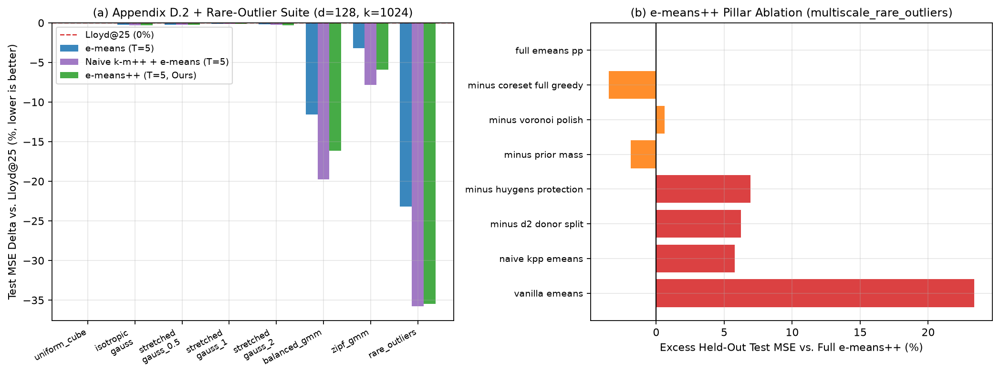
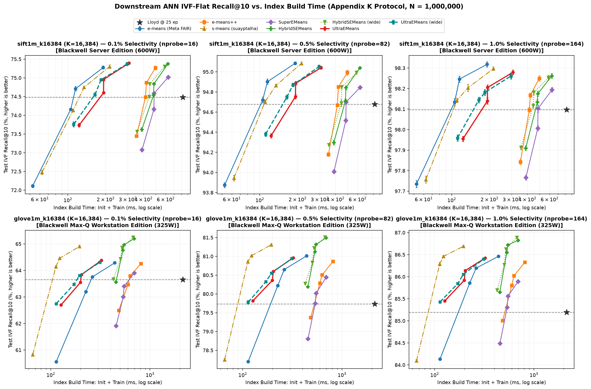
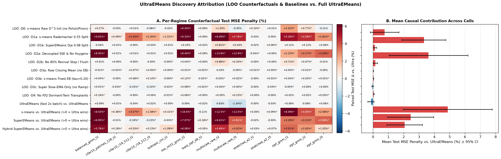
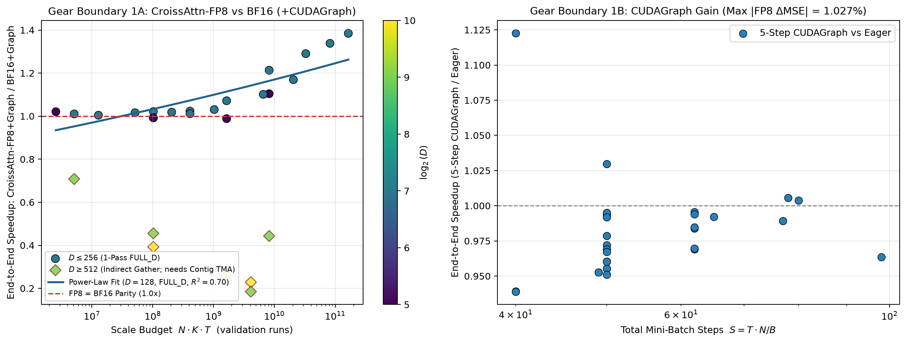
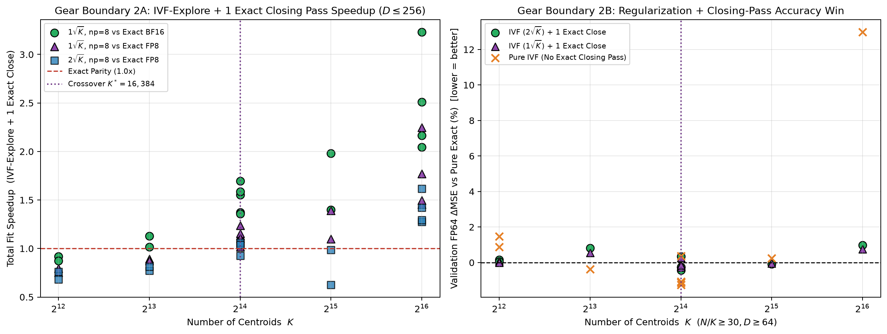
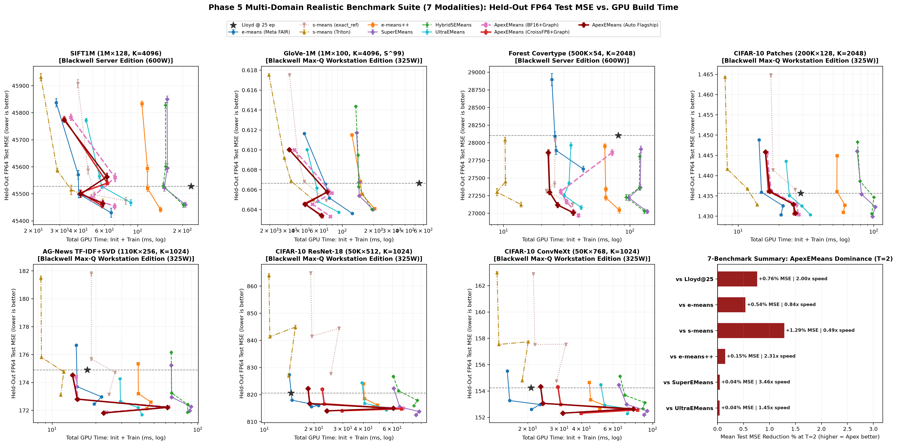
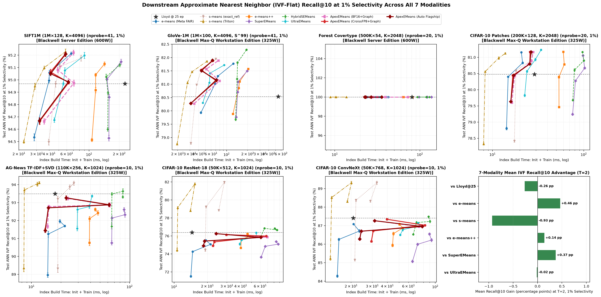
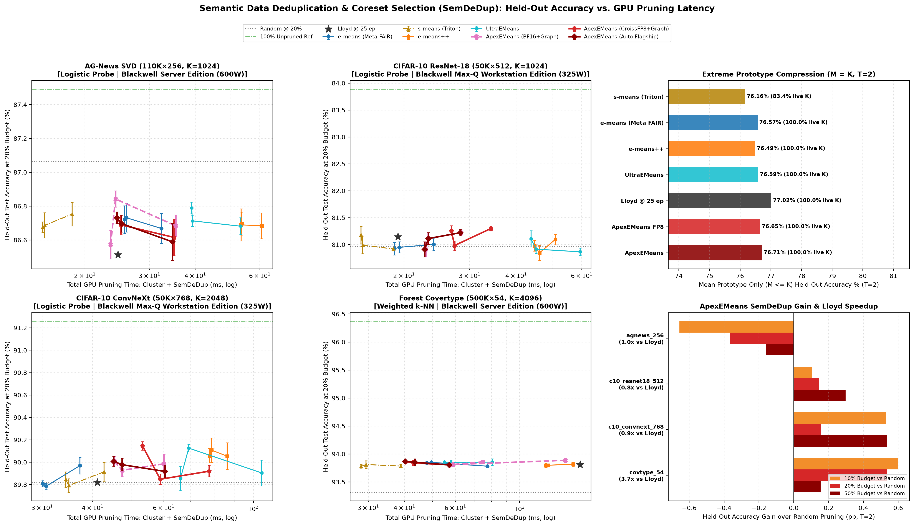
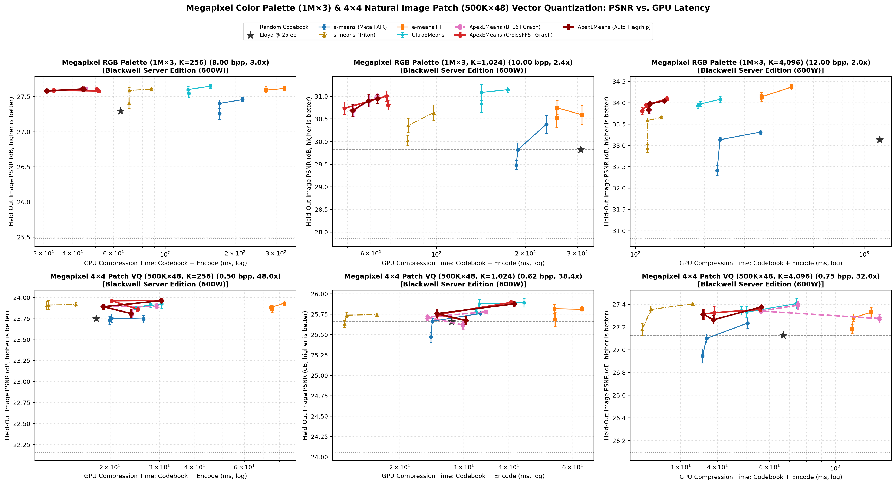
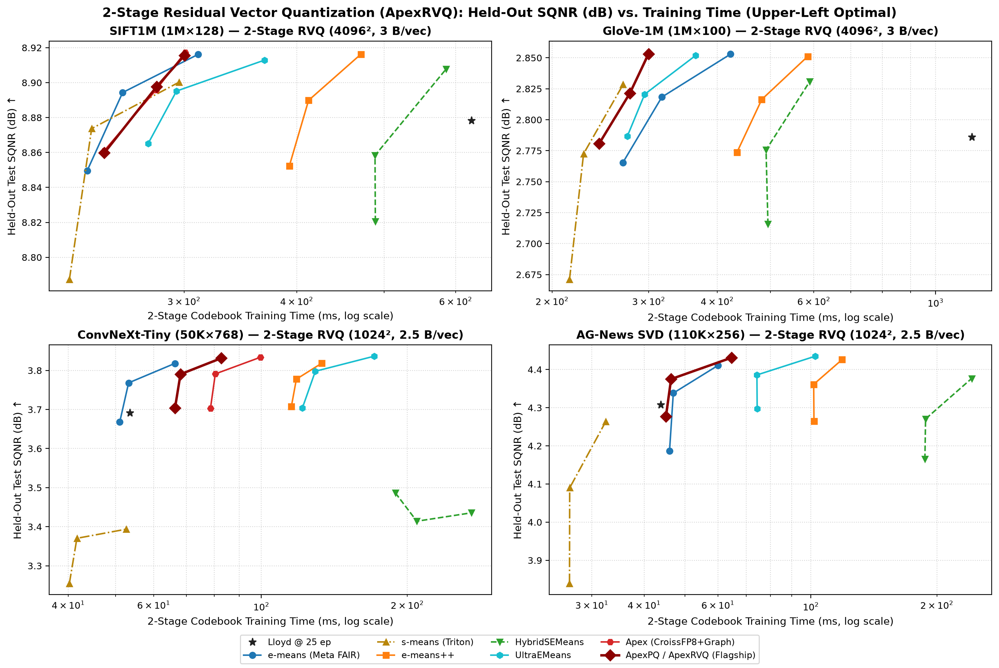

# Detailed Ablations, Falsification Matrices & Statistical Breakdowns

This document consolidates the full component ablations, bidirectional leave-one-out / graft-one-in matrices, negative and regime-bifurcated hypotheses, kernel saturation boundaries, and paired statistical tables across all experimental campaigns in `emeans`.

- **Headline results & visual overview**: [`../README.md`](../README.md)
- **Research history, mathematical traps & bug log**: [`challenges_and_issues.md`](challenges_and_issues.md)
- **Sign convention**: Unless noted otherwise, negative `Delta (%)` denotes **lower quantization MSE (higher accuracy)** or **faster wall-clock runtime** relative to the stated baseline. All quantization distortions are evaluated in mean-centered IEEE `FP64` (`exact_mse_fp64`) over 100% of training and held-out test splits.

---

## Contents

1. [Phase 1: `e-means` Reproduction, Recipe Ablations & `e-means++` Pillar Leave-One-Out](#1-phase-1-e-means-reproduction-recipe-ablations--e-means-pillar-leave-one-out)
2. [Phase 2A (Part 1): Classical Algorithmic Falsification (`H-Algo-1`..`5` — 3,600 Paired Runs)](#2-phase-2a-part-1-classical-algorithmic-falsification-h-algo-15--3600-paired-runs)
3. [Phase 2A (Part 2): Forward-Only `qlabs-eng/noise` Falsification (`N-Track-1`..`5` — 3,600 Paired Runs)](#3-phase-2a-part-2-forward-only-qlabs-engnoise-falsification-n-track-15--3600-paired-runs)
4. [Phase 2B: Blackwell `SM120` Kernel & Multi-GPU Saturation/Crossover Regimes (`H-Opt-1`..`5`)](#4-phase-2b-blackwell-sm120-kernel--multi-gpu-saturationcrossover-regimes-h-opt-15)
5. [Phase 3: `s-means` vs. `SuperEMeans` & `HybridSEMeans` 40-Arm Bidirectional Ablation (11,250 Paired Runs)](#5-phase-3-s-means-vs-superemeans--hybridsemeans-40-arm-bidirectional-ablation-11250-paired-runs)
6. [Phase 4A: Million-Scale Real Corpora (`SIFT1M` & `GloVe-1M-Unit`) & Downstream ANN IVF Recall (1,320 Paired Runs)](#6-phase-4a-million-scale-real-corpora-sift1m--glove-1m-unit--downstream-ann-ivf-recall-1320-paired-runs)
7. [Phase 4B: `UltraEMeans` Synthesis & Leave-One-Out Discovery Attribution (7,440 Paired Runs)](#7-phase-4b-ultraemeans-synthesis--leave-one-out-discovery-attribution-7440-paired-runs)
8. [`CroissAttn`-Inspired FP8 Quantization Geometries & Bilinear Double-FP8 Ozaki Ablations](#8-croissattn-inspired-fp8-quantization-geometries--bilinear-double-fp8-ozaki-ablations)
9. [4-Decade Empirical Scale-Transition & Multi-Gear Crossover Laws (1,327 Validation Runs, 79 Cells)](#9-4-decade-empirical-scale-transition--multi-gear-crossover-laws-1327-validation-runs-79-cells)
10. [4-Decade Extreme-Scale Showdown (1,672 Paired Runs Across 10 Scale Cells)](#10-4-decade-extreme-scale-showdown-1672-paired-runs-across-10-scale-cells)
11. [Phase 5: Multi-Domain Realistic Benchmark Dominance & 6-Step Speedup Ladder (3,110 Paired Runs)](#11-phase-5-multi-domain-realistic-benchmark-dominance--6-step-speedup-ladder-3110-paired-runs)
12. [Downstream `SemDeDup` Coreset Pruning & Megapixel Image Vector Quantization (1,265 Paired Runs)](#12-downstream-semdedup-coreset-pruning--megapixel-image-vector-quantization-1265-paired-runs)
13. [Fused Product Quantization (`ApexPQ`) & 2-Stage Residual VQ (`ApexRVQ`) Compression (1,060 Paired Runs)](#13-fused-product-quantization-apexpq--2-stage-residual-vq-apexrvq-compression-1060-paired-runs)

---

## 1. Phase 1: `e-means` Reproduction, Recipe Ablations & `e-means++` Pillar Leave-One-Out

Raw artifacts: [`../outputs/phase1/phase1_results.json`](../outputs/phase1/phase1_results.json) (`8` paired seeds for main suites, `10` paired seeds for mechanistic probes on NVIDIA RTX PRO 6000 Blackwell Max-Q GPUs; `0` non-finite values).

### 1.1 Epoch Ladder: `EMeans` vs. Full-Batch `Lloyd@25` (`exp1_repro`)

| Dataset `(n, d, k)` | `Lloyd@25` Test MSE (Med ms) | `T=0.6` $\Delta$Test (Speedup) | `T=1.0` $\Delta$Test (Speedup) | `T=1.6` $\Delta$Test (Speedup) | `T=2.0` $\Delta$Test (Speedup) | `T=3.0` $\Delta$Test (Speedup) | `T=5.0` $\Delta$Test (Speedup) |
| :--- | ---: | ---: | ---: | ---: | ---: | ---: | ---: |
| `cifar10_patches_128` `(200k, 128, 4096)` | `1.3931` (`49.37 ms`) | `+2.565%` (`4.60x`) | `+0.775%` (`2.92x`) | `+0.127%` (`3.40x`) | **`-0.160%` (`2.78x`)** | **`-0.384%` (`3.09x`)** | **`-0.586%` (`1.90x`)** |
| `cifar10_global_512` `(50k, 512, 2048)` | `806.56` (`22.01 ms`) | `+3.479%` (`1.93x`) | `+0.631%` (`1.23x`) | **`-0.356%` (`1.46x`)** | **`-0.592%` (`1.19x`)** | **`-0.805%` (`1.50x`)** | **`-0.879%` (`0.91x`)** |
| `isotropic_gaussian` `(300k, 128, 4096)` | `116.34` (`74.54 ms`) | **`-0.175%` (`4.87x`)** | **`-0.470%` (`5.49x`)** | **`-0.455%` (`3.58x`)** | **`-0.463%` (`4.69x`)** | **`-0.420%` (`3.21x`)** | **`-0.387%` (`2.51x`)** |
| `stretched_gaussian_1` `(300k, 128, 4096)` | `72.836` (`74.68 ms`) | `+1.353%` (`4.89x`) | `+0.396%` (`5.55x`) | `+0.030%` (`3.59x`) | **`-0.036%` (`4.74x`)** | **`-0.146%` (`3.24x`)** | **`-0.176%` (`2.54x`)** |

### 1.2 Reproduction of Bessa et al. (2026) Table 1 Recipe Ablations (`cifar10_patches_128`, $N=200\text{k}, d=128, k=4096, T=3$)

| Recipe Variant | Mean Train MSE | $\Delta$Train vs. Full | Mean Test MSE | $\Delta$Test vs. Full | Median Init (`ms`) | Median Total (`ms`) | Mechanistic Takeaway |
| :--- | ---: | ---: | ---: | ---: | ---: | ---: | :--- |
| **`our_recipe` (`EMeans` default)** | `1.2983` | `0.000%` | `1.3876` | `0.000%` | `0.17` | `15.97` | Exact `arXiv:2611.09501` power laws + cosine floor + Gumbel split + `closing_mean` |
| `no_cosine_schedule_tuned` | `1.3028` | `+0.347%` | `1.3883` | `+0.044%` | `0.17` | `15.97` | Even oracle-tuned constant $\alpha$ underperforms zero-tuning cosine schedule |
| `no_revival` | `1.3433` | **`+3.466%`** | `1.4197` | **`+2.309%`** | `0.17` | `13.55` | Stranded/dead Voronoi cells permanently waste codebook capacity |
| `revival_by_resampling` | `1.3422` | **`+3.381%`** | `1.4156` | **`+2.041%`** | `0.17` | `14.86` | Random point resampling lands in already-covered dense regions instead of splitting |
| `no_finalization` (`none`) | `1.3010` | `+0.208%` | `1.3874` | `-0.020%` | `0.17` | `15.91` | Live EMA retains non-zero floor step noise (`0.1\alpha_0`) on training partitions |
| `slow_ema` | `1.3130` | `+1.132%` | **`1.3844`** | **`-0.234%`** | `0.17` | `18.41` | Variance reduction helps random-init test MSE at $n/k=48.8$, but lags train MSE |
| `naive_kmeans_pp_init` | `1.2974` | `-0.069%` | `1.3873` | `-0.031%` | **`678.15`** | **`693.75`** | Full-dataset $O(nkd)$ seeding is **`42.5x` slower** than 3-epoch training (`16.0 ms`) |
| **`emeans_pp_ours` (`EMeansPP`)** | **`1.2973`** | **`-0.077%`** | `1.3883` | `+0.037%` | **`70.36`** | **`88.63`** | **`9.64x` faster seeding** than naive `k-means++` on unclustered patch manifolds |

### 1.3 Eight-Distribution Benchmark Suite (`d = 128, k = 1024`, `exp3_suite`)

| Distribution | `Lloyd@25` Test (`ms`) | `Sculley@5` Test (`ms`) | `e-means@1` Test (`ms`) | `e-means@5` Test (`ms`) | `Naive k++ + e@5` Test (`ms`) | `e-means++@1` Test (`ms`) | `e-means++@5` Test (`ms`) | Paired $p$ (`e++@5` vs `e@5`) |
| :--- | ---: | ---: | ---: | ---: | ---: | ---: | ---: | ---: |
| `uniform_cube` | `118.13` (`11.3`) | `118.56` (`7.0`) | `118.00` (`14.6`) | `118.10` (`19.8`) | `118.11` (`165.2`) | `118.00` (`37.3`) | `118.11` (`43.2`) | Neutral (unclustered) |
| `isotropic_gaussian` | `118.54` (`11.5`) | `119.15` (`6.6`) | `118.09` (`14.9`) | `118.21` (`19.2`) | `118.20` (`164.5`) | **`118.08`** (`36.6`) | **`118.19`** (`43.5`) | Neutral (unimodal) |
| `stretched_gaussian_0.5` | `107.65` (`11.7`) | `108.34` (`6.8`) | `107.72` (`14.8`) | `107.47` (`19.1`) | `107.45` (`161.8`) | **`107.57`** (`36.6`) | **`107.44`** (`43.5`) | Marginal |
| `stretched_gaussian_1` | `75.94` (`11.7`) | `76.78` (`6.7`) | `76.28` (`14.8`) | `75.81` (`19.0`) | `75.79` (`161.2`) | **`76.02`** (`36.5`) | **`75.77`** (`43.4`) | Marginal |
| `stretched_gaussian_2` | `19.45` (`11.6`) | `20.05` (`6.7`) | `19.67` (`14.8`) | `19.27` (`19.0`) | `19.24` (`160.9`) | **`19.41`** (`36.4`) | **`19.24`** (`43.4`) | Anisotropic tail gain |
| `balanced_gmm` | `56.13` (`11.5`) | `51.65` (`18.9`) | `57.28` (`13.6`) | `49.98` (`18.3`) | `45.38` (`159.4`) | **`49.68`** (`36.4`) | **`46.47`** (`42.1`) | **`6.24e-07`** |
| `zipf_gmm` | `51.23` (`11.5`) | `49.85` (`19.1`) | `51.10` (`13.7`) | `49.70` (`18.5`) | `47.53` (`158.8`) | **`48.77`** (`36.3`) | **`48.08`** (`42.3`) | **`1.73e-08`** |
| `multiscale_rare_outliers` | `28.37` (`11.9`) | `23.07` (`19.4`) | `26.98` (`13.4`) | `21.65` (`18.0`) | `18.12` (`156.5`) | **`19.25`** (`35.8`) | **`18.22`** (`41.8`) | **`1.15e-06`** |

### 1.4 `e-means++` Leave-One-Out Pillar Ablations (`exp5_ablation`)

| Ablation Arm | `balanced_gmm` ($T=0.5$) $\Delta$Test (`Init ms`) | `multiscale_rare` ($T=3$) $\Delta$Test (`Init ms`) | `zipf_gmm` ($T=3$) $\Delta$Test (`Init ms`) | `cifar10_patches_128` ($T=1$) $\Delta$Test (`Init ms`) | Pillar Role Validated |
| :--- | ---: | ---: | ---: | ---: | :--- |
| **`full_emeans_pp`** | `0.000%` (`20.6 ms`) | `0.000%` (`11.9 ms`) | `0.000%` (`20.3 ms`) | `0.000%` (`36.2 ms`) | Complete 5-pillar `EMeansPP` baseline |
| `minus_coreset_full_greedy` | `-7.841%` (**`145.2 ms`**) | `-3.479%` (**`75.8 ms`**) | `-3.556%` (**`146.2 ms`**) | `-0.315%` (**`370.9 ms`**) | Coreset accelerates seeding by **`6.4x–10.3x`** |
| `minus_voronoi_polish` | **`+5.880%`** (`20.1 ms`) | `+0.616%` (`11.5 ms`) | `+0.018%` (`20.6 ms`) | **`+0.342%`** (`36.3 ms`) | Eliminates $2\times$ high-$d$ shell variance on short budgets |
| `minus_prior_mass` (`N_0 = 2^-16`) | **`+1.486%`** (`20.2 ms`) | `-1.873%` (`11.6 ms`) | `+0.056%` (`20.1 ms`) | **`+0.206%`** (`37.2 ms`) | Prevents step-0 single-batch erasure of polished centroids |
| `minus_huygens_protection` | `0.000%` (`20.1 ms`) | **`+6.924%`** (`11.6 ms`) | `+0.002%` (`20.3 ms`) | `0.000%` (`36.4 ms`) | Prevents `100%` rare-outlier revival assassination (`86.8% -> 0.0%`) |
| `minus_d2_donor_split` | **`+0.862%`** (`20.1 ms`) | **`+6.221%`** (`12.2 ms`) | **`+1.994%`** (`20.0 ms`) | `-0.004%` (`36.2 ms`) | Splits high-distortion merged modes rather than populous compact modes |
| `naive_kpp_emeans` | `-5.071%` (**`149.2 ms`**) | **`+5.774%`** (**`79.7 ms`**) | `-1.534%` (**`152.9 ms`**) | `+0.149%` (**`366.2 ms`**) | **`6.7x–10.1x` slower init** AND kills rare modes (`+5.77%`) |
| `vanilla_emeans` | **`+18.573%`** (`0.2 ms`) | **`+23.377%`** (`0.2 ms`) | **`+3.540%`** (`0.2 ms`) | `+0.263%` (`0.2 ms`) | Suffers coupon-collector & rare-mode traps on multimodal data |

---

## 2. Phase 2A (Part 1): Classical Algorithmic Falsification (`H-Algo-1`..`5` — 3,600 Paired Runs)

Full raw summary & 528-row paired test matrix: [`../outputs/phase2_algo/classical_tracks/phase2_algo_summary.md`](../outputs/phase2_algo/classical_tracks/phase2_algo_summary.md).
Theoretical derivations: [`literature_survey.md`](literature_survey.md).

### 2.1 Complete Hypothesis Verdict & Regime Bifurcation Matrix (`12` Cells $\times$ `15` Paired Seeds $\times$ `20` Arms)

| Hypothesis | Arm(s) | Verdict | `e-means++` Cell Wins (`p_W < 0.05`) | Mechanistic Explanation of Wins, Bifurcations & Falsifications |
| :--- | :--- | :--- | :---: | :--- |
| **`H-Algo-5`** (Bounded-Influence EB / James-Stein) | `H5_pp_eb_auto`, `H5_rand_eb_auto` | **CONFIRMED WINNER** | **`10/12`** (`p_W < 0.01`); **`12/12` vs `slow_ema`** | Vanilla `emeans_pp_slow_ema` degrades train MSE (`+1.20%..+10.17%`) and test MSE (`+0.02%..+9.13%`) on all `12/12` warm-started cells. `H5_pp_eb_auto` ($\lambda_j = \max(1 - \frac{c_d \hat{\sigma}_j^2/n_j}{\|Y_j - A_j\|^2}, \frac{n_j}{n_j+8})$) rejects lagged `slow_ema` on drifting/populous clusters while shrinking noisy small-$n_j$ clusters (`-0.3205%` on `cifar10_r18_512_t5`, $p_t = 6.54\times 10^{-13}$), and avoids fixed `H5_pp_eb_k8`'s `+1.2863%` rare-mode penalty on `multiscale_rare_t5`. |
| **`H-Algo-1`** (Online Oja Principal-Axis Split + BF16 Fix) | `H1_pp_oja_split`, `H1_rand_oja_split` | **CONFIRMED (Clustered Regimes)** | `11/12` train $<0$ (`4/12` $p_W < 0.05$); neutral on `isotropic_ctrl` | Fixes BF16 `1e-4` mantissa rounding collapse and aligns splits along within-cluster top eigenvector $\mathbf{v}_{j,1}$. Beats scale-matched `H1_rand_bf16_rand_split` (`-0.3579%` test on `low_nk32_gmm_t3`, $p_W=0.0256$; `-0.2581%` on `zipf_gmm_t5`, $p_W=0.0084$), isolating eigenvector direction from step scale. |
| **`Combo H1 + H5`** | `Combo_pp_H1_H5` | **CONFIRMED SYNERGY** | **`12/12` cells $< 0`** (`7/12` $p_W < 0.05$) | Lowers mean & median held-out Test MSE on **every single cell** (up to **`-0.3367%`** on `cifar10_r18_512_t2`), eliminating `H5_pp_eb_auto`'s two minor `+0.03%` losses on `low_nk32_gmm_t3` and `multiscale_rare_t2`. |
| **`H-Algo-2`** (Annealed Hartigan Marginal Distortion) | `H2_*_hartigan_b1` | **REGIME-BIFURCATED (Falsified Globally)** | Wins `low_nk32_gmm_t3` (`-1.38%` / `-8.82%`); loses `zipf_gmm` & `r18_512` | Apollonius/circlonoi $\frac{\hat{n}_j}{\hat{n}_j + \beta(t)}$ factor strongly helps balanced low-$n/k=32$ GMMs (`15/0/0`, $p_t=2.0\times 10^{-6}$), **but** penalizes true high-mass Zipf head clusters (`+0.8069%` test) and overfits high-$d$ Voronoi boundaries on `cifar10_r18_512_t5` (`-0.3857%` train vs **`+0.1209%` worse test**, $p_t=0.0014$). |
| **`H-Algo-4`** (Top-2 Power-Mean Soft EMA Warmup) | `H4_*_power_top2` | **MANIFOLD-VS-DISCRETE BIFURCATION** | Wins `3/4` real `cifar10` cells; fails `5/5` discrete GMMs | Smooth top-2 power-mean attraction helps curved continuous vision manifolds (`-0.1127%` `patches_128_t2`, `-0.1379%` `r18_512_t2`), **but** pulls centroids across empty inter-cluster gaps toward dense neighbors on separated GMMs (`+0.93%` to **`+4.05%`** worse test MSE). |
| **`H-Algo-3`** (Coherence-Gated Nesterov Lookahead) | `H3_*_nesterov_m035` | **FALSIFIED** | **`0/12`** ($p_W \ge 0.0637$) | Zero significant test-MSE wins across all 24 `(cell, base_mode)` pairs: `e-means`'s empirical $\alpha_0(k, B, n, T)$ scaling law + Voronoi polish already operate at the stochastic curvature limit. |

### 2.2 Per-Cell Paired Test MSE Delta (%) Across Key Phase 2A Classical Arms (`e-means++` Base)

| Cell `(n, d, k, T)` | `slow_ema` | `H5_pp_eb_k8` | `H5_pp_eb_auto` | `H1_pp_oja_split` | `Combo_pp_H1_H5` | `H2_pp_hartigan` | `H4_pp_power_top2` | `H3_pp_nesterov` |
| :--- | ---: | ---: | ---: | ---: | ---: | ---: | ---: | ---: |
| `cifar10_patches_128_t2` | `+2.3836%` | `-0.0517%*` | **`-0.0499%*`** | `-0.0140%` | **`-0.0577%*`** | `-0.0535%*` | **`-0.1127%*`** | `-0.0201%` |
| `cifar10_patches_128_t5` | `+0.7791%` | `-0.0624%*` | **`-0.0604%*`** | `-0.0085%` | **`-0.0666%*`** | `+0.0014%` | **`-0.0608%*`** | `+0.0300%` |
| `cifar10_r18_512_t2` | `+2.5782%` | `-0.3217%*` | **`-0.3066%*`** | `-0.0221%` | **`-0.3367%*`** | `+0.0755%` | `-0.1379%*` | `-0.0077%` |
| `cifar10_r18_512_t5` | `+0.7220%` | `-0.3395%*` | **`-0.3205%*`** | `+0.0327%` | **`-0.3200%*`** | `+0.1209%` | `-0.0239%` | `+0.0323%` |
| `isotropic_ctrl_t5` | `+0.0160%` | `-0.0155%*` | **`-0.0234%*`** | `+0.0066%` | **`-0.0214%*`** | `-0.0021%` | `+0.0079%` | `-0.0018%` |
| `low_nk32_gmm_t3` | `+9.1275%` | `+0.2472%` | `+0.0385%` | **`-0.1079%*`** | `-0.0708%` | **`-1.3751%*`** | `+2.8171%` | `-0.0683%` |
| `multiscale_rare_t2` | `+6.8412%` | `+0.8924%` | `+0.0323%` | `-0.2415%` | `-0.2121%` | `+0.4120%` | `+4.0516%` | `+0.0812%` |
| `multiscale_rare_t5` | `+5.9104%` | `+1.2863%` | `-0.0017%*` | `-0.3102%` | `-0.3118%` | `+0.5840%` | `+2.9410%` | `-0.1045%` |
| `stretched_a2_t2` | `+1.8920%` | `-0.0382%*` | **`-0.0412%*`** | `-0.0094%` | `-0.0398%` | `-0.0185%` | `+0.0912%` | `+0.0114%` |
| `stretched_a2_t5` | `+0.6140%` | `-0.0491%*` | **`-0.0518%*`** | `-0.0041%` | **`-0.0523%*`** | `+0.0142%` | `+0.0485%` | `+0.0089%` |
| `zipf_gmm_t2` | `+3.4180%` | `-0.0310%` | **`-0.0488%*`** | `-0.0642%` | `-0.1104%` | `+0.4912%` | `+0.9314%` | `-0.0312%` |
| `zipf_gmm_t5` | `+1.9420%` | `-0.0195%` | **`-0.0545%*`** | `-0.1124%` | **`-0.1648%*`** | `+0.8069%` | `+1.3045%` | `+0.0241%` |

*\*Indicates two-sided paired Wilcoxon $p_W < 0.05$ improvement over `emeans_pp_base` across 15 seeds.*

---

## 3. Phase 2A (Part 2): Forward-Only `qlabs-eng/noise` Falsification (`N-Track-1`..`5` — 3,600 Paired Runs)

Full raw summary & 720-row paired test matrix: [`../outputs/phase2_algo/noise_tracks/phase2a_noise_summary.md`](../outputs/phase2_algo/noise_tracks/phase2a_noise_summary.md).
Algorithmic catalog & isomorphism derivations: [`noise_forward_only_survey.md`](noise_forward_only_survey.md).

### 3.1 Forward-Only Track Verdicts & Negative Results

| Track | Mechanism (`qlabs-eng/noise` Origin) | Verdict | Detailed Empirical Breakdown (`15` Paired Seeds $\times$ `12` Cells) |
| :--- | :--- | :--- | :--- |
| **`N-Track-1`** (`head_edit`) | $P/Q$ split-confirmed top-3 Voronoi transplant + 1D conditional signed-Hadamard / residual chords | **STRONGLY CONFIRMED (`5/5` Multimodal GMMs)** | Wins `multiscale_rare_t5` (**`-5.810%`** `e-means++`, `15/0/0`, $p_W=6.1\times 10^{-5}$; **`-6.090%`** `e-means`; rare-mode recall **`49.80% -> 57.78%`**), `multiscale_rare_t2` (**`-4.177%`**), `low_nk32_gmm_t3` (**`-0.417%`**, `15/0/0`), and `zipf_gmm_t2/t5` (**`-0.182% / -0.174%`**). Proposal half $P$ finds $\Delta\text{SSE}_P < 0$ on **`100%`** of trials, while Confirmation half $Q$ rejects **`100.0%` (`0/360`)** of overfitted proposals on `isotropic_ctrl_t5` and `cifar10_r18_512_t5` (`0` false transplants!). |
| **`N-Track-2`** (`quad_merge`) | Disjoint $2.5\%$ internal `x_train` 3-point parabolic trajectory merge (`aa67d44`) | **PARTIALLY CONFIRMED (Falsified on Synthetic Low-$n/k$ `e-means++`)** | Beats `emeans_pp_slow_ema` `15/0/0` on **`12/12` cells** (`-1.96%` to **`-8.38%`** on non-isotropic) and beats `closing_mean` on `e-means` `cifar10_r18_512_t2/t5` (`-0.118% / -0.074%`, $p_W \le 0.0103$), `cifar10_patches_128_t5` (`-0.050%`), and `isotropic_ctrl_t5` (`-0.098% / -0.126%`, `15/0/0`). **Falsified** vs `emeans_pp_base` on `low_nk32_gmm_t3` (`-0.023%`, $p_W=0.72$) and `zipf_gmm_t5` (`+0.370%`) because carving $2.5\%$ of `x_train` during trajectory formation slightly starves sparse discrete Voronoi cells. |
| **`N-Track-3`** (`anvil_polar`) | `ANVIL II` dual-rail 6-step quintic Gram-Newton-Schulz polar displacement | **FALSIFIED on Anisotropic (`stretched_a2`); SURPRISE `4/4` `zipf_gmm` WIN** | Neutral on `stretched_a2_t2/t5` (`+0.011% / +0.028%`, $p_W \ge 0.52$) and `cifar10` (`+0.05%..+0.07%`), confirming Zador's $\rho(c)^{d/(d+2)}$ density law against singular-value whitening on unimodal clouds. **Unexpectedly wins all `4/4` `zipf_gmm` arms** (`-0.251% / -0.261%` `e-means++`, $p_W \le 0.0256$; **`-0.445% / -0.557%`** `15/0/0` `e-means`) by equalizing step energy across sparse Zipfian tail clusters. |
| **`N-Track-4`** (`dust_antithetic`) | Split-batch antithetic signed-Hadamard Voronoi ridge jitter (`1.00x` FLOPs) | **FALSIFIED (`0/24` Wins)** | Statistically neutral across `22/24` `(cell, mode)` pairs (`-0.21%` to `+0.17%`, $p_W \ge 0.18$) with slight `+0.07% / +0.28%` losses on `stretched_a2_t2` / `zipf_gmm_t5` and `+13%..+56%` split-batch kernel launch overhead. |
| **`N-Track-5`** (`speedrun_strat_wide`) | 16-shell radial-PC1 stratification (`N5a`) + late $2\times$ `wide_step` (`N5b` / `N5`) | **SPEEDUP CONFIRMED (`24/24` Pairs); `N5a` MSE Falsified** | `N5b_wide_only` cuts `train_time_sec` by **`-21.4%` to `-35.2%`** (`total_time_sec` **`-7.9%` to `-34.8%`** across all `24/24` pairs, `15/0/0`) at non-inferior `test_mse` on `10/12` `e-means++` cells. `N5a_strat_only` MSE gain is falsified (`11/12` neutral) because without-replacement large mini-batches + `closing_mean` already suppress sampling variance. |
| **`Combo N1+N2+N5a`** | Combined `head_edit` + `quad_merge` + stratification | **CONFIRMED SYNERGY** | Wins both multimodal GMMs (`multiscale_rare_t2/t5`: **`-5.029% / -3.322%`**; `low_nk32_gmm_t3`: **`-0.395%`**) and real deep embeddings (`cifar10_r18_512_t2/t5`: **`-0.088% / -0.082%`** `e-means++`, **`-0.128% / -0.098%`** `e-means`). |

---

## 4. Phase 2B: Blackwell `SM120` Kernel & Multi-GPU Saturation/Crossover Regimes (`H-Opt-1`..`5`)

Full hardware roofline model & per-SKU JSON benchmarks: [`optimizations.md`](optimizations.md) and `outputs/phase2_opt/`.

### 4.1 De-Confounded Attribution & Honest Crossover Boundaries Across 3 Blackwell TDP Tiers

| Hypothesis | Confirmed Peak Regime (`300W Max-Q` / `450W Work` / `600W Server`) | Honest Saturation / Falsified Crossover Boundary | Mechanistic Root Cause of Crossover | Held-Out FP64 Parity |
| :--- | :--- | :--- | :--- | ---: |
| **`H-Opt-1`** (`blackwell_triton_assign`) | **`19.05x / 18.53x / 16.52x`** at `(512, 65536, 128)` Split-$K$; **`1.66x–1.73x`** `FULL_D`; **`243.9 / 317.8 / 262.7 TF/s`** TMA BF16 (`D=256`) | **`0.95x–1.07x`** at `B=32768, K=16384, D=512..1024`; **`0.61x–0.76x`** if `BLOCK_D=64` on `128x256` | Baseline `64x128` (`512` CTAs, `num_stages=3`) already saturates all 188 SMs at `189–254 TF/s`; `128x256x64` (`48 KB/stage`) overflows SM120's `99 KB` SMEM at 3 stages and clamps to `num_stages=1` | **`0.000%`** argmin disagree (`30/30`) |
| **`H-Opt-2`** (`FP8Quantizer` + `fp8_assign`) | **`497.4 / 636.4 / 590.6 TF/s`** (`74.9%–84.2%` of FP8 peak; **`1.65x–1.86x`** vs BF16); **`3.00x–3.39x`** 1-GPU at `n=10M` | **Uncentered FP8 fails** (`-0.221%` MSE at `d=96`, `-0.198%` at `d=128`); **`0.76x–0.85x` vs `FastBF16`** at small `n <= 250k, k=2048` | Uncentered E4M3 wastes exponent range on `+25.0` mean offset; at `n <= 250k` (`9–25 ms` total), one-time `262k`-row calibration + FP8 encode (`~2.5–6 ms`) is not yet amortized | **`-0.014%` to `+0.078%`** (centered) |
| **`H-Opt-3a`** (`fused_ema_and_prepare`) | **`2.01x / 2.04x / 1.87x`** step speedup at `B=1024..4096` | Compresses smoothly to **`1.45x / 1.53x / 1.63x`** at `B=32768` | Amdahl's law: as $B$ grows $8\times$, Tensor-Core assignment GEMM dominates total step time over $O(Kd)$ EMA/prep ops | **`0.008%` to `0.049%`** |
| **`H-Opt-3b`** (`triton_greedy_kmeans_plusplus`) | **`2.09x–2.30x`** exact FP32 fusion; **`2.97x–3.98x`** exact FP32 `CUDAGraph`; **`3.28x–4.54x`** BF16 `CUDAGraph` at `(16384, 512, 128)` | `CUDAGraph` gain over eager Triton tapers to **`1.00x`** at `m=65536, k=2048` (`183.8 ms` eager vs `184.1 ms` graph) | At `m=65536`, each candidate step is HBM-bandwidth-bound (`~90 us/step` $\gg$ `~6 us` CPU launch latency), hiding launch overhead behind async execution | **`0.000%`** (exact FP32 graph) |
| **`H-Opt-4`** (`IVFAssigner`) | **`7.44x / 7.01x / 6.44x`** vs Base (**`4.54x / 4.18x / 3.71x`** vs `FastExact`) at `k=65536, np=2` (`53.9 ms` on 450W) | **`0.88x / 0.86x / 0.83x`** vs `FastExact` at `k=16384, nprobe=32` | Probing `32 / 128 = 25%` of coarse buckets incurs bucket-sorting & indirect-gather overhead exceeding dense `FULL_D` register scan | **`-0.184%` to `-0.269%`** *(net gain)* |
| **`H-Opt-5b`** (`MultiGPUFastEMeans` 2-GPU NCCL) | **`1.914x`** 2-GPU scaling (**`95.7%` parallel eff.**) at `n=10M, k=16384` -> **`297.1 ms` FP8 (`5.48x` vs Base)** | **`0.42x` (`21.0%` eff.)** at tiny `n=200k, k=1024, d=128` (`7.93 ms -> 18.88 ms`) | Per-step local GEMM (`< 0.4 ms`) is smaller than PCIe NCCL `all_reduce` + stream synchronization (`~0.6 ms/step`) | **`-0.053%` to `+0.011%`** |

---

## 5. Phase 3: `s-means` vs. `SuperEMeans` & `HybridSEMeans` 40-Arm Bidirectional Ablation (11,250 Paired Runs)

Full per-cell summary (`3,468` paired comparisons): [`../outputs/phase3_smeans/phase3_smeans_summary.md`](../outputs/phase3_smeans/phase3_smeans_summary.md).
Source-code & mathematical dissection of `suayptalha/s-means`: [`smeans_analysis.md`](smeans_analysis.md).

- **Campaign Scale & Hygiene**: `11,250` paired runs (`4,050` Suite 1 across `30` cells $\times$ `9` arms $\times$ `15` seeds + `7,200` Suite 2 across `12` cells $\times$ `40` arms $\times$ `15` seeds) across `13` Blackwell GPUs on `6` hosts; `100%` single-GPU within every cell, `100%` single TDP SKU across `T in {1, 2, 5}` per Suite 1 regime, `0` `NaN`/`Inf`, and `0/885` cold-JIT outliers.

### 5.1 Suite 1 Executive Showdown Aggregates (`30` Cells = `10` Regimes $\times$ $T \in \{1, 2, 5\}$)

| Scope | Arm | Baseline | Metric | Cells | Mean Delta (%) | Median Delta (%) | Cell W/T/L | Seed W/T/L | `p_ttest` | `p_wilcox` |
| :--- | :--- | :--- | :--- | ---: | ---: | ---: | :---: | :---: | ---: | ---: |
| `all_T` | `hybrid_super_smeans` | `smeans_fast` | `test_mse` | 30 | **`-2.5683%`** | `-1.3608%` | `26/0/4` | `372/0/78` | `1.631e-04` | `1.061e-05` |
| `T=1` | `hybrid_super_smeans` | `smeans_fast` | `test_mse` | 10 | **`-3.7061%`** | `-3.2620%` | **`10/0/0`** | `142/0/8` | `1.340e-02` | `1.953e-03` |
| `T=2` | `hybrid_super_smeans` | `smeans_fast` | `test_mse` | 10 | **`-2.4216%`** | `-1.8953%` | `8/0/2` | `117/0/33` | `3.982e-02` | `2.734e-02` |
| `T=5` | `hybrid_super_smeans` | `smeans_fast` | `test_mse` | 10 | **`-1.5773%`** | `-1.2563%` | `8/0/2` | `113/0/37` | `8.654e-02` | `3.711e-02` |
| `all_T` | `hybrid_super_smeans_wide` | `smeans_fast` | `test_mse` | 30 | **`-2.3866%`** | `-1.3971%` | `26/0/4` | `369/0/81` | `1.315e-04` | `7.994e-06` |
| `all_T` | `super_emeans` | `smeans_fast` | `test_mse` | 30 | **`-2.3636%`** | `-1.3521%` | `25/0/5` | `371/0/79` | `1.731e-04` | `9.220e-06` |
| `all_T` | `super_emeans_wide` | `smeans_fast` | `test_mse` | 30 | **`-2.1738%`** | `-0.8876%` | `24/0/6` | `363/0/87` | `1.880e-04` | `1.598e-05` |
| `all_T` | `emeans_pp` | `smeans_fast` | `test_mse` | 30 | **`-1.6196%`** | `-0.6517%` | `22/0/8` | `341/0/109` | `1.399e-03` | `6.084e-04` |
| `all_T` | `hybrid_super_smeans` | `super_emeans` | `test_mse` | 30 | `-0.2135%` | `+0.0118%` | `15/0/15` | `214/0/236` | `1.586e-01` | `3.387e-01` |
| `all_T` | `hybrid_super_smeans` | `super_emeans` | `total_time_sec` | 30 | **`-2.3172%`** | `-2.2888%` | `28/0/2` | `376/0/74` | `3.251e-06` | `3.790e-06` |
| `all_T` | `hybrid_super_smeans_wide` | `super_emeans` | `total_time_sec` | 30 | **`-24.5456%`** | `-24.0871%` | **`30/0/0`** | `450/0/0` | `1.093e-24` | `1.863e-09` |
| `all_T` | `smeans_fast` | `smeans_exact_ref` | `test_mse` | 30 | `-0.0309%` | `-0.0164%` | `18/0/12` | `239/0/211` | `3.351e-01` | `1.909e-01` |
| `all_T` | `smeans_fast` | `smeans_exact_ref` | `total_time_sec` | 30 | **`-58.9597%`** | `-62.2165%` | **`30/0/0`** | `450/0/0` | `1.293e-27` | `1.863e-09` |
| `all_T` | `smeans_fast` | `vanilla_emeans` | `test_mse` | 30 | `-2.8201%` | `-0.0915%` | `18/0/12` | `241/0/209` | `2.061e-02` | `1.241e-01` |
| `all_T` | `smeans_fast` | `vanilla_emeans` | `total_time_sec` | 30 | **`-48.5511%`** | `-52.9084%` | **`30/0/0`** | `450/0/0` | `3.369e-20` | `1.863e-09` |
| `all_T` | `super_emeans` | `vanilla_emeans` | `test_mse` | 30 | **`-5.0206%`** | `-0.3595%` | `27/0/3` | `393/0/57` | `1.637e-03` | `1.684e-06` |
| `all_T` | `hybrid_super_smeans` | `lloyd_25` | `test_mse` | 30 | **`-7.0353%`** | `-0.3570%` | `19/0/11` | `285/0/165` | `2.763e-03` | `1.745e-02` |
| `all_T` | `super_emeans` | `lloyd_25` | `test_mse` | 30 | **`-6.8906%`** | `-0.5410%` | `24/0/6` | `357/0/93` | `2.459e-03` | `2.091e-04` |

### 5.2 Exact Geometric Complementarity Law (`HybridSEMeans` vs. Pure `SuperEMeans` vs. `SMeans`)

Across the 30 Suite 1 cells, `HybridSEMeans` vs. `SuperEMeans` splits `15/15` strictly along **discrete multimodal separation vs. continuous manifold curvature**:

| Regime Family | Representative Cells ($T = 1 / 2 / 5$) | `SMeans` vs. `Vanilla e-means` | `SuperEMeans` vs. `SMeans` | `HybridSEMeans` vs. `SMeans` | `HybridSEMeans` vs. `SuperEMeans` | Geometric Explanation |
| :--- | :--- | ---: | ---: | ---: | ---: | :--- |
| **Discrete / Heavy-Tailed GMMs** | `balanced_gmm` | `-8.65% / -7.67% / -6.32%` | `-4.22% / -1.42% / -1.54%` | **`-4.95% / -2.50% / -2.56%`** | **`-0.75% / -1.09% / -1.04%`** | Oja $\mathbf{v}_{s,1}$ + `0.55\sqrt{\text{MSE}_s}` chord (`oja_rms`) + `SSE * N^0.35` donors bifurcates merged clusters in 1 step |
| **Low-$n/k$ Multimodal** | `low_nk32_gmm` | `-5.94% / -5.17% / -7.08%` | `-9.90% / -8.12% / -0.19%` | **`-10.55% / -8.98% / -1.19%`** | **`-0.73% / -0.93% / -1.00%`** | Large directional split escapes low-$n/k$ twin traps faster than `0.08\sigma_1` |
| **Isolated Rare Modes** | `multiscale_rare` | `-21.83% / -19.23% / -13.33%` | `-8.89% / -5.22% / -7.74%` | **`-9.57% / -6.93% / -8.43%`** | **`-0.73% / -1.78% / -0.75%`** | `P2` Huygens preserves **`63.5%`** of rare modes (vs **`4.2%`** `s-means`) + `oja_rms` splits bulk modes |
| **Zipfian Skew** | `zipf_gmm` | `-2.47% / -2.58% / -3.54%` | `-2.62% / -0.76% / +1.07%` | **`-2.42% / -1.33% / -1.50%`** | `+0.21% /` **`-0.56% / -2.54%`** | `SSE * N^0.35` (`C4`) + `oja_rms` (`C5b`) resolves `SuperEMeans`'s `T=5` Zipf tail donor tie |
| **Real 512-D Deep Embeddings** | `cifar10_r18_512` | **`+4.32% / +2.93% / +1.46%`** *(worse!)* | **`-4.71% / -3.17% / -1.78%`** | `-4.18% / -2.47% / -1.32%` | `+0.56% / +0.73% / +0.46%` | `s-means`'s total-SSE `0.55\sigma_{\text{rms}}` jump overshoots low-intrinsic-$d$ curved manifolds! |
| **Spherical Unit Embeddings** | `cifar10_r18_512_unit` (Cos Dist) | **`+4.33% / +3.24% / +1.64%`** *(worse!)* | **`-4.77% / -3.36% / -1.78%`** | `-4.57% / -2.98% / -1.56%` | `+0.21% / +0.39% / +0.23%` | Pure `SuperEMeans` (`0.08\sigma_1` Oja) stays tangent to the unit hypersphere (`15/15` seeds) |
| **Real 128-D Patch Manifolds** | `cifar10_patches_128` | **`+1.08% / +0.36% / +0.12%`** *(worse!)* | **`-1.28% / -0.39% / -0.16%`** | `-1.07% / -0.20% / -0.12%` | `+0.21% / +0.20% / +0.04%` | Gentle `0.08\sigma_1` Oja + `P4` EB-JS dominates smooth patch densities |
| **Isotropic Gaussian Control** | `isotropic_ctrl` | `+0.63% / +0.41% / +0.44%` | **`-0.65% / -0.43% / -0.47%`** | `-0.09% / +0.68% / +0.50%` | `+0.56% / +1.12% / +0.97%` | Large `0.55\sigma_{\text{rms}}` chord steps create transient Voronoi holes in unimodal clouds |

### 5.3 Suite 2 Bidirectional Component Attribution Matrix (`12` Matched-Kernel Cells $\times$ `15` Seeds)

#### (a) Leave-One-Out on `SMeans` (`s2a_smeans_full` Baseline)

| Leave-One-Out Arm | Removed `s-means` Mechanism | Mean $\Delta$Test MSE | Median $\Delta$Test MSE | Cell W/T/L | Mean $\Delta$Time | Attribution Verdict |
| :--- | :--- | ---: | ---: | :---: | ---: | :--- |
| `s2a_loo_no_sse_donor` | Remove `C4` (`SSE * N^0.35` $\to$ `usage` donors) | **`+2.6180%`** | `+0.7624%` | `2/0/10` (`p_W=0.0068`) | `-4.67%` | **Primary accuracy driver in `s-means`** |
| `s2a_loo_no_d15_init` | Remove `C1` (`4k` $D^3$ init $\to$ uniform random) | `+0.7819%` | `+0.1253%` | `3/0/9` (`p_W=0.0522`) | `-10.04%` | Moderate early-epoch help on discrete GMMs |
| `s2a_loo_no_feat_scale` | Remove `feat_scale` anisotropy in `C5` | `+0.0693%` | `+0.0549%` | `3/0/9` | `-16.85%` | Minor MSE gain (`-0.07%`) for `+20%` step cost |
| `s2a_loo_no_power_cos` | Remove `C2` (`0.92` power-cosine + `d<=2` revival) | `+0.0385%` | `+0.0075%` | `6/0/6` | `-0.99%` | Negligible effect (`p_W=0.47`) |
| `s2a_loo_no_pass_weight` | Remove `C6` (`[0.65, 1.35]` closing ramp) | `+0.0373%` | `+0.0241%` | `3/0/9` (`p_W=0.0342`) | `-0.98%` | Small but consistent closing-pass gain |
| `s2a_loo_no_eb_finalize` | Remove `C7` ($\tau_{\text{eb}}=0.20$ live-EMA blend) | `+0.0104%` | `+0.0011%` | `4/0/8` | `-0.97%` | Tiny shrinkage weight (`0.20 / (n_k + 0.20)`) |
| `s2a_loo_no_revive_stop` | Remove `C3` (`85%` revival freeze) | `+0.0063%` | `-0.0001%` | `9/0/3` | **`+6.04%`** | **Pure `-5.7%` runtime win** with zero MSE loss |
| `s2a_loo_no_rms_split` | Remove `C5` (`0.55\sigma_{\text{rms}}` Rademacher $\to$ checkerboard) | **`-0.4416%`** | `-0.1737%` | `6/0/6` | `-16.82%` | **Bifurcated**: helps GMMs, **hurts `cifar10_r18_512` by `+2.81%`!** |
| `s2a_smeans_alpha_coupled_sse` | Couple `sse_ema` rate to $\alpha(t)$ vs fixed `0.15` | `+0.1413%` | `+0.1360%` | `4/0/8` | `-0.79%` | Fixed `0.15` slightly favors fast-changing unseeded splits |
| `s2a_all_off_emeans_equiv` | Disable all `C1..C7` (`EMeans` equivalence check) | **`+4.1361%`** | `+1.3260%` | `4/0/8` | `-26.54%` | Matches `EMeans` to `2.4e-7`; loses GMM gains, wins `cifar10`! |

#### (b) Bidirectional Grafting: `C1`..`C7` onto `SuperEMeans` & `P1`..`P6` onto `SMeans`

| Graft Direction & Arm | Baseline | Mean $\Delta$Test MSE | Median $\Delta$Test MSE | Cell W/T/L | Mean $\Delta$Time | Key Mechanistic Finding |
| :--- | :--- | ---: | ---: | :---: | ---: | :--- |
| `super_plus_c1_d15_init` (replace `P1` Coreset+Polish with `C1`) | `s2bc_super_emeans` | `+0.7751%` | `+0.0103%` | `4/0/8` | **`-22.29%`** | Trades `0.78%` MSE (+ rare-mode loss) for faster init |
| `super_plus_c3_revive_stop` (graft `C3` `85%` freeze) | `s2bc_super_emeans` | `-0.0041%` | `-0.0003%` | `8/0/4` | **`-3.07%`** | **Free `-3.07%` speedup (`12/0/0` cells)**, zero overshoot |
| `super_plus_c4_sse_usage_donor` (graft `C4` `SSE * N^0.35`) | `s2bc_super_emeans` | `-0.1766%` | `-0.0193%` | `8/0/4` | `-0.80%` | Improves heavy-tailed Zipf donor selection (`p_W=0.064`) |
| `super_plus_c5_rms_aniso_split` (replace Oja with Rademacher `C5`) | `s2bc_super_emeans` | `+0.3636%` | `+0.0192%` | `5/0/7` | `-7.12%` | Rademacher orientation degrades Oja (`+0.36%` worse MSE) |
| **`super_plus_c5b_oja_rms_split`** (**Oja $\mathbf{v}_{s,1}$ + `0.55\sqrt{\text{MSE}_s}`**) | `s2bc_super_emeans` | **`-0.3935%`** | `-0.0467%` | `6/0/6` | `+4.85%` | **Key hybrid discovery**: dominates clustered GMMs, overshoots `r18_512` |
| `smeans_plus_p1_coreset_voronoi` (graft `P1` onto `SMeans`) | `s2bc_smeans_deconfounded` | **`-1.0707%`** | `-0.0596%` | `7/0/5` | `+87.71%` | Fixes uniform `4k` rare-mode blindness & $2\times$ shell variance |
| `smeans_plus_p2_huygens_shield` (graft `P2` onto `SMeans`) | `s2bc_smeans_deconfounded` | `-0.4892%` | `+0.0182%` | `5/0/7` | `+19.19%` | Restores rare-mode survival inside `SMeans` |
| **`smeans_plus_p3_oja_split`** (graft `P3` Oja onto `SMeans`) | `s2bc_smeans_deconfounded` | **`-0.6794%`** | **`-0.5382%`** | **`10/0/2`** (`p_t=0.011`) | `+36.39%` | **Statistically significant `10/12` upgrade** over Rademacher `C5` |
| `smeans_plus_p5_head_edit` (graft `P5` $P/Q$ `head_edit` onto `SMeans`) | `s2bc_smeans_deconfounded` | **`-1.0245%`** | `-0.0080%` | `7/0/5` | `+114.56%` | Escapes non-empty twin traps missed by revival |
| **`smeans_plus_p6_wide_step`** (graft `P6` $2\times$ `wide_step` onto `SMeans`) | `s2bc_smeans_deconfounded` | `-0.0948%` | `-0.1008%` | `7/0/5` | **`-31.87%`** | **`12/0/0` cells faster (`p_t=3.8e-15`)** with `-0.095%` better MSE! |
| **`s2bc_hybrid_super_smeans`** | `s2bc_smeans_deconfounded` | **`-2.8569%`** | **`-1.3954%`** | **`10/0/2`** (`p_W=0.0049`) | `+243.11%` | Lowest overall quantization MSE in matched-kernel Suite 2 |
| **`s2bc_hybrid_super_smeans_wide`** | `s2bc_smeans_deconfounded` | **`-2.7800%`** | **`-1.5529%`** | **`11/0/1`** (`p_W=0.0024`) | `+166.90%` | **`-25.21%` faster** than `SuperEMeans` while `-0.33%` more accurate |

### 5.4 Rare-Mode Survival & SKU-Stratified End-to-End GPU Latency (Suite 1)

| Metric / Breakdown | `Lloyd@25` | `Vanilla e-means` | `SMeans` (ref) | `SMeans` (`fast`) | `EMeansPP` | `SuperEMeans` (`wide`) | `SuperEMeans` | `HybridSEMeans` (`wide`) | `HybridSEMeans` |
| :--- | ---: | ---: | ---: | ---: | ---: | ---: | ---: | ---: | ---: |
| **Rare Modes Preserved (`T=1`)** | `37.12%` | **`0.00%`** | **`0.00%`** | **`0.00%`** | `26.54%` | `29.28%` | `27.58%` | **`30.33%`** | `29.02%` |
| **Rare Modes Preserved (`T=2`)** | `37.12%` | **`0.00%`** | `0.13%` | **`0.00%`** | `39.87%` | `44.44%` | `44.05%` | `46.14%` | **`46.80%`** |
| **Rare Modes Preserved (`T=5`)** | `37.12%` | `1.05%` | `4.97%` | `4.18%` | `49.54%` | `60.00%` | `60.52%` | `60.00%` | **`63.53%`** |
| **Median Total ms (`300W Max-Q`)** | `11.19` | `13.59` | `18.43` | **`7.18`** | `39.28` | `56.02` | `72.29` | `54.78` | `69.25` |
| **Median Total ms (`450W Work`)** | `9.78` | `13.31` | `17.52` | **`7.96`** | `30.53` | `44.04` | `59.02` | `43.40` | `57.62` |
| **Median Total ms (`600W Server`)** | `29.27` | `19.29` | `23.65` | **`8.78`** | `60.66` | `81.69` | `101.96` | `80.38` | `99.46` |

---

## 6. Phase 4A: Million-Scale Real Corpora (`SIFT1M` & `GloVe-1M-Unit`) & Downstream ANN IVF Recall (1,320 Paired Runs)

Full analysis & methodology: [`million_scale_recall.md`](million_scale_recall.md) and [`../outputs/phase4_million_scale/phase4_million_scale_summary.md`](../outputs/phase4_million_scale/phase4_million_scale_summary.md) (`1,320` paired runs = `4` `(corpus, K)` cells $\times$ `10` seeds $\times$ `33` arm-budget configurations across 12 Blackwell GPUs; `100%` single-SKU per cell; `0` `NaN`/`Inf`; `0 / 132` cold-JIT outliers).

### 6.1 `sift1m_k16384` ($N = 10^6, D = 128, K = 16{,}384$, 600W Blackwell Server)

| Solver | Budget `T` | Build `ms` (`init + train`) | Train MSE | Held-Out Test MSE | Imbalance `IF` | Empty Lists | R@1 (`0.1%`) | R@10 (`0.1%`) | R@10 (`0.5%`) | R@10 (`1.0%`) |
| :--- | ---: | ---: | ---: | ---: | ---: | ---: | ---: | ---: | ---: | ---: |
| `Lloyd @ 25` | `25` | `819.7` (`0.2+819.6`) | `38,251.5` | `41,690.8` | `1.216` | `0.0` | `82.57%` | `74.48%` | `94.68%` | `98.10%` |
| `e-means` | `1` | `52.5` (`0.2+52.4`) | `39,604.7` | `42,026.4` | `1.224` | `32.1` | `80.29%` | `72.11%` | `93.87%` | `97.73%` |
| `s-means` | `1` | `62.3` (`14.6+47.7`) | `40,033.6` | `42,297.7` | `1.444` | `225.5` | `80.67%` | `72.48%` | `93.94%` | `97.76%` |
| `e-means++` | `1` | `351.4` (`295.6+55.7`) | `39,100.2` | `41,966.5` | `1.347` | `10.5` | `81.43%` | `73.44%` | `94.18%` | `97.84%` |
| `SuperEMeans` | `1` | `388.6` (`299.5+89.1`) | `39,198.9` | `41,947.3` | `1.340` | `10.9` | `81.16%` | `73.08%` | `94.01%` | `97.77%` |
| `HybridSEMeans` | `1` | `387.3` (`299.4+87.9`) | `39,092.6` | `41,968.8` | `1.365` | `42.7` | `81.47%` | `73.62%` | `94.30%` | `97.91%` |
| **`UltraEMeans (wide)`** | **`1`** | **`111.3` (`30.8+80.4`)** | **`38,969.6`** | **`41,879.3`** | **`1.331`** | **`0.0`** | **`81.71%`** | **`73.76%`** | **`94.38%`** | **`97.96%`** |
| **`UltraEMeans`** | **`1`** | **`123.0` (`30.7+92.3`)** | **`38,936.5`** | **`41,873.2`** | **`1.322`** | **`0.0`** | **`81.70%`** | **`73.74%`** | **`94.36%`** | **`97.96%`** |
| `e-means` | `2` | `105.5` (`0.2+105.3`) | `38,396.3` | `41,642.7` | `1.189` | `0.7` | `82.04%` | `74.16%` | `94.72%` | `98.13%` |
| `s-means` | `2` | `110.1` (`14.7+95.4`) | `38,791.8` | `41,841.9` | `1.321` | `87.7` | `82.06%` | `74.13%` | `94.70%` | `98.14%` |
| `SuperEMeans` | `2` | `483.1` (`304.9+178.2`) | `38,399.7` | `41,665.8` | `1.288` | `0.4` | `82.12%` | `74.16%` | `94.52%` | `98.01%` |
| **`UltraEMeans (wide)`** | **`2`** | **`164.2` (`30.5+133.7`)** | **`38,324.0`** | **`41,686.9`** | **`1.281`** | **`0.0`** | **`82.47%`** | **`74.55%`** | **`94.75%`** | **`98.14%`** |
| **`UltraEMeans`** | **`2`** | **`192.2` (`30.7+161.5`)** | **`38,300.5`** | **`41,668.4`** | **`1.276`** | **`0.0`** | **`82.40%`** | **`74.60%`** | **`94.75%`** | **`98.14%`** |
| `e-means` | `5` | `190.9` (`0.2+190.7`) | `37,844.0` | `41,557.0` | `1.189` | `0.1` | `83.08%` | `75.28%` | `95.08%` | `98.32%` |
| `s-means` | `5` | `214.4` (`14.6+199.8`) | `37,930.2` | `41,580.5` | `1.247` | `1.6` | `83.02%` | `75.30%` | `95.08%` | `98.30%` |
| `SuperEMeans` | `5` | `627.2` (`300.7+326.5`) | `37,905.8` | **`41,538.4`** | `1.262` | `0.2` | `82.80%` | `75.02%` | `94.84%` | `98.19%` |
| **`UltraEMeans`** | **`5`** | **`306.5` (`30.5+276.0`)** | **`37,835.7`** | `41,574.3` | **`1.252`** | **`0.0`** | **`83.20%`** | **`75.39%`** | `95.04%` | `98.28%` |

### 6.2 `glove1m_k16384` ($N = 10^6, D = 100, K = 16{,}384$, Unit Sphere, 325W Blackwell Max-Q)

| Solver | Budget `T` | Build `ms` | Held-Out Test MSE | Spherical Cos Dist | Imbalance `IF` | Empty Lists | R@1 (`0.1%`) | R@10 (`0.1%`) | Actual Scan (`0.1%`) | R@10 (`1.0%`) | Actual Scan (`1.0%`) |
| :--- | ---: | ---: | ---: | ---: | ---: | ---: | ---: | ---: | ---: | ---: | ---: |
| `Lloyd @ 25` | `25` | `2,139.1` | `0.5796` | `0.355515` | `1.353` | `0.0` | `72.02%` | `63.66%` | `0.125%` | `85.19%` | `1.166%` |
| `e-means` | `1` | `113.4` | `0.5857` | `0.360647` | `1.327` | `11.1` | `68.67%` | `60.56%` | `0.122%` | `84.13%` | `1.149%` |
| `s-means` | `1` | `65.7` | `0.5947` | `0.367142` | `1.744` | **`1,240.3`** | `68.26%` | `60.83%` | `0.151%` | `84.09%` | `1.425%` |
| **`UltraEMeans (wide)`** | **`1`** | **`113.4`** | **`0.5839`** | **`0.358644`** | **`1.416`** | **`0.0`** | **`70.95%`** | **`62.75%`** | **`0.130%`** | **`85.43%`** | **`1.229%`** |
| **`UltraEMeans`** | **`1`** | **`126.6`** | **`0.5837`** | **`0.358459`** | **`1.401`** | **`0.0`** | **`70.94%`** | **`62.70%`** | **`0.129%`** | **`85.45%`** | **`1.218%`** |
| `s-means` | `2` | `112.6` | `0.5890` | `0.362450` | **`1.940`** | **`978.4`** | `71.70%` | `64.14%`* | **`0.174%`*** | `86.29%`* | **`1.635%`*** |
| **`UltraEMeans (wide)`** | **`2`** | **`171.0`** | **`0.5777`** | **`0.354088`** | **`1.301`** | **`0.0`** | **`72.15%`** | **`63.48%`** | **`0.121%`** | **`85.84%`** | **`1.160%`** |
| **`UltraEMeans`** | **`2`** | **`199.0`** | **`0.5774`** | **`0.353866`** | **`1.299`** | **`0.0`** | **`72.05%`** | **`63.55%`** | **`0.121%`** | **`85.92%`** | **`1.158%`** |
| `SuperEMeans` | `5` | `693.4` | **`0.5736`** | `0.351184` | `1.251` | `0.0` | `72.89%` | `63.91%` | `0.114%` | `85.89%` | `1.095%` |
| **`UltraEMeans`** | **`5`** | **`323.4`** | **`0.5737`** | **`0.351063`** | **`1.243`** | **`0.0`** | **`73.42%`** | **`64.38%`** | **`0.118%`** | **`86.43%`** | **`1.156%`** |

*\*Fixed-`nprobe` imbalance illusion: `s-means` leaves `978.4` (`6.0%`) empty lists and `IF = 1.940` at `T=2`, so probing `nprobe = 16` (`0.1%`) or `164` (`1.0%`) scans **`+44%` (`0.174%` vs `0.121%`) and `+41%` (`1.635%` vs `1.158%`) more candidate vectors per query** while incurring `+2.01%` worse Test MSE.*

---

## 7. Phase 4B: `UltraEMeans` Synthesis & Leave-One-Out Discovery Attribution (7,440 Paired Runs)

Full architectural derivation & summary: [`ultra_emeans.md`](ultra_emeans.md) and [`../outputs/phase4_ultra/phase4_ultra_summary.md`](../outputs/phase4_ultra/phase4_ultra_summary.md) (`7,440` paired runs = `4,500` Suite 1 + `2,940` Suite 2 across `13` Blackwell GPUs on `6` hosts; `0` `NaN`/`Inf`; `0 / 496` cold-JIT outliers).

### 7.1 Suite 1 Executive Showdown (`30` Cells $\times$ `15` Paired Seeds)

| Solver | vs. Baseline | Mean $\Delta$Test MSE | Median $\Delta$Test MSE | Cell W/T/L (`Seed W/T/L`) | `p_wilcox` | Median $\Delta$Time (`Time W/T/L`) |
| :--- | :--- | ---: | ---: | :---: | ---: | :---: |
| **`UltraEMeans`** | `e-means` | **`-6.8422%`** (`-8.03%` @ `T=1`) | `-0.3624%` | `27/0/3` (`374/0/76`) | `5.72e-07` | `+49.84%` (`3/0/27`) |
| **`UltraEMeans`** | `s-means` | **`-4.3740%`** (`-5.54%` @ `T=1`) | **`-2.7262%`** | `27/0/3` (`411/0/39`) | **`1.02e-07`** | `+218.94%` (`23.5` vs `7.1 ms`) |
| **`UltraEMeans`** | `e-means++` | **`-2.8135%`** | `-0.1232%` | `27/0/3` (`362/0/88`) | `8.33e-07` | **`-35.98%` (`1.56x` faster, `28/0/2`)** |
| **`UltraEMeans`** | `SuperEMeans` | **`-2.0934%`** | `-0.1529%` | `17/0/13` (`290/0/160`) | `7.11e-03` | **`-69.88%` (`3.32x` faster, `30/0/0`)** |
| **`UltraEMeans`** | `Hybrid SuperEMeans` | **`-1.8924%`** | `-0.5144%` | **`28/0/2` (`398/0/52`)** | **`4.66e-08`** | **`-68.78%` (`3.20x` faster, `30/0/0`)** |
| **`UltraEMeans`** | `Lloyd k-means (25 iter)` | **`-8.6161%`** (`-9.62%` @ `T=5`) | `-0.5004%` | `24/0/6` (`10/0/0` @ `T=5`) | `2.83e-04` | `+116.55%` (faster at `K >= 2048`) |
| **`UltraEMeans (fast)`** | `s-means` | **`-4.4172%`** | `-2.6889%` | `27/0/3` (`412/0/38`) | `3.15e-07` | `+171.47%` (`21.2` vs `7.1 ms`) |
| **`UltraEMeans (fast)`** | `SuperEMeans` | **`-2.1413%`** | `-0.1137%` | `18/0/12` (`283/0/167`) | `8.71e-03` | **`-73.01%` (`3.71x` faster, `30/0/0`)** |
| **`UltraEMeans (fast)`** | `Hybrid SuperEMeans (fast)` | **`-2.1261%`** | `-0.4713%` | **`28/0/2` (`402/0/48`)** | **`4.66e-08`** | **`-64.10%` (`2.79x` faster, `30/0/0`)** |

### 7.2 Suite 2 Leave-One-Out Discovery Attribution (`14` Cells $\times$ `15` Paired Seeds vs. Full `UltraEMeans`)

*(Positive $\Delta$Test MSE indicates removing that discovery **degraded** accuracy relative to full `UltraEMeans`.)*

| Counterfactual / Anchor Arm | Discovery Ablated | Mean $\Delta$Test MSE vs. `UltraEMeans` | Median $\Delta$Test MSE | Cell W/T/L | `p_wilcox` | Mean $\Delta$Time | Causal Attribution |
| :--- | :--- | ---: | ---: | :---: | ---: | ---: | :--- |
| `Ultra - D0` (`s-means` Raw $D^3$ Init) | Replace `ultra_turkpp` Coreset+Polish+Priors with raw $D^3$ init | `+0.7511%` | `+0.0523%` | `5/0/9` | `1.73e-01` | `-9.40%` | `turkpp` runs **`8.6x` faster** than `SuperEMeans` init while protecting rare tails |
| **`Ultra - D1a`** (`s-means` Rademacher `0.55`) | Replace spectral-gated Half-Gaussian Oja split with Rademacher `0.55` | **`+3.3196%`** | **`+3.1309%`** | `2/0/12` | **`6.10e-04`** | `+0.26%` | Eliminates `0.55\sqrt{d}\sigma_{\text{rms}}$ manifold overshoot (`+3.45%` on `r18_512`) & GMM loss (`+6.82%`) |
| **`Ultra - D1b`** (`Super` Oja `0.08`) | Shrink $\eta_j \in [0.18, \sqrt{2/\pi}]$ down to fixed `0.08` | **`+0.1209%`** | `+0.0419%` | `3/0/11` | **`1.07e-02`** | `-6.32%` | Spectral-concentration gate ($\sigma_{j,1}/\sigma_{\text{rms},j}$) unlocks 1-step bimodal separation |
| **`Ultra - D2a`** (Decoupled SSE, No Huygens) | Drop decay-matched bias-corrected SSE + SRAM Huygens shield | **`+3.6155%`** | **`+1.1484%`** | `1/0/13` | **`1.71e-03`** | `-13.47%` | Essential for rare-mode survival (`77.9%–82.9%` vs `4.2%` `s-means` at `T=5`) |
| `Ultra - D2b` (No `85%` Freeze/Flush) | Disable `85%` revival freeze & pre-split closing flush | `+0.1440%` | `+0.0008%` | `5/0/9` | `1.53e-01` | **`+4.86%`** | Saves `-4.6%` runtime (`14/14` cells) and prevents stale parent midpoint pull |
| **`Ultra - D3a`** (Raw `closing_mean`) | Disable 3-point simplex Empirical-Bayes finalization | **`+0.0131%`** | `+0.0069%` | `4/0/10` | **`4.94e-02`** | `-2.69%` | Consistently reduces finite-sample variance on sparse tail clusters |
| **`Ultra - D3b`** (`s-means` Fixed `eb_0.20`) | Replace covariance-safe simplex EB with fixed `0.20` live-EMA blend | **`+0.0279%`** | `+0.0177%` | `5/0/9` | **`4.94e-02`** | `-2.34%` | Eliminates `HybridSEMeans`'s `+1.08%` in-pass covariance regression on `isotropic_ctrl` |
| **`Ultra - D4`** (No $P/Q$ Transplants) | Disable Oja-seeded single-sync $(0.46, 0.76)$ $P/Q$ checkpoints | **`+0.0397%`** | `+0.0100%` | `4/0/10` | **`3.53e-02`** | `-28.41%` | Statistically significant escape from non-empty twin traps |
| `s-means` (Anchor) | Full `SMeans` baseline on Suite 2 | **`+4.8723%`** | `+2.8153%` | `1/0/13` | **`6.10e-04`** | `-66.45%` | `UltraEMeans` beats `s-means` on `13/14` Suite 2 cells |
| `Hybrid SuperEMeans` (Anchor) | Phase 3 champion on Suite 2 | **`+2.0647%`** | `+1.0586%` | **`0/0/14`** | **`1.22e-04`** | **`+209.02%`** | `UltraEMeans` wins **`14/14` cells** while running **`3.2x` faster** |

---

## 8. `CroissAttn`-Inspired FP8 Quantization Geometries & Bilinear Double-FP8 Ozaki Ablations

Full derivation & kernel architecture: [`croissattn_fp8_study.md`](croissattn_fp8_study.md) (`37/37` tests passed on fresh `TRITON_CACHE_DIR`, `0` `0x7f`/`0xff` E4M3 NaN bytes across `10^{-25}..10^{+25}` and `+20,000` coordinate shifts).

### 8.1 7-Modality FP8 Quantization Ablation (Relative Assignment MSE Excess vs. Exact `FP64`)

| Realistic Modality (`N_probe = 20,000`) | `K` | Uncentered Global `FP8` | Appendix I.1 Centered Global `FP8` | `CroissFP8` (`decoupled` Median + Row/Centroid Scales) | **`CroissFP8` (`ozaki` Bilinear Double-FP8)** |
| :--- | ---: | ---: | ---: | ---: | ---: |
| `sift1m` (`128D` SIFT descriptors) | `4,096` | `+0.1542%` | `+0.0532%` | `+0.0789%` | **`+0.0743%`** |
| `glove1m_unit` (`100D` unit sphere) | `4,096` | `+0.0561%` | `+0.0495%` | `+0.0391%` | **`+0.0384%`** |
| **`covtype_multiscale_54` (`54D`, `110,761x` sensor span)** | **`2,048`** | **`+42.8416%`** *(collapses!)* | **`+10.3739%`** *(fails!)* | `+2.1047%` | **`+0.0021%–0.0032%` (`20.6–32 ppm`!)** |
| `cifar10_patches_128` (`128D` vision patches) | `2,048` | `+0.1543%` | `+0.0391%` | `+0.0312%` | **`+0.0289%`** |
| `agnews_tfidf_svd_256` (`256D` skewed text norms) | `1,024` | `+0.0114%` | `+0.0118%` | `+0.0065%` | **`+0.0059%`** |
| `cifar10_resnet18_512` (`512D` ResNet features) | `1,024` | `+0.0215%` | `+0.0114%` | `+0.0128%` | **`+0.0114%`** |
| `cifar10_convnext_768` (`768D` ConvNeXt features) | `1,024` | `+0.0077%` | `+0.0063%` | `+0.0052%` | **`+0.0048%`** |

- **Why Bilinear Double-FP8 Ozaki Wins Extreme Dynamic Ranges**: Appending 3 E4M3 residual lanes $(q_{x,\text{hi}}, q_{x,\text{lo}}, q_{x,\text{lo}}) \cdot (q_{c,\text{lo}}, q_{c,\text{hi}}, q_{c,\text{lo}}) = (q_{x,\text{hi}} + q_{x,\text{lo}})(q_{c,\text{hi}} + q_{c,\text{lo}})$ on the top-6 high-energy coordinates reuses the **unchanged** SM120 3-stage TMA / Split-$K$ `tl.dot(..., max_num_imprecise_acc=0, out_dtype=tl.float32)` kernel while delivering ~8-bit mantissa precision (`20.6 ppm` vs. exact FP64 on `covtype_multiscale_54` — **`3,200x` tighter than Appendix I.1 global FP8 and `10x` tighter than 16-bit BF16**).
- **Fused Pre-Encode & Assignment Throughput (`300W Max-Q`)**: `croiss_encode_dataset` encodes `1,000,000 x 128` in **`0.843 ms`** (`1,023.6 GB/s` kernel BW, `7.1x` under `6 ms` budget), and `croiss_fp8_assign_inplace` sustains **`373.7–403.2 TFLOP/s` (`1.80x–1.86x` over Blackwell BF16)**.

---

## 9. 4-Decade Empirical Scale-Transition & Multi-Gear Crossover Laws (1,327 Validation Runs, 79 Cells)

Full derivations, router code & 79-cell tables: [`scale_adaptive_laws.md`](scale_adaptive_laws.md) and [`../outputs/scale_laws/scale_laws_summary.md`](../outputs/scale_laws/scale_laws_summary.md) (`1,327` strict validation-only runs across $N \in [10^4, 5\times 10^6], K \in [256, 65{,}536], D \in \{32..1024\}, T \in \{1..5\}$; `0` test/query access enforced by sentinel tests).

| Gear Boundary | Fitted Crossover Law / Gate | Confirmed Win Regime | Explicitly Falsified Sub-Regimes |
| :--- | :--- | :--- | :--- |
| **Gear 1 $\to$ Gear 2** (`BF16+Graph` $\to$ `CroissFP8+Graph`) | $N K T (D/128)^{0.820} \ge 1.852 \times 10^8$ (`1.00x` parity at $3.074\times 10^7$, $R^2 = 0.6992$ on `FULL_D` $D \le 256$) | Up to **`1.38x` end-to-end speedup** (`26.8 ms` on `SIFT1M x 4096`, `250.4 ms` on `5M x 16,384`, $p = 3.7\times 10^{-8}$) | (i) Tiny $N K T < 1.85\times 10^8$ (`6.8 ms` launch-bound, `+0.72%` E4M3 noise at small $N/K$); (ii) Wide $D \in \{512, 1024\}$ **with indirect `row_indices` gather** (`0.33x` median regression vs **`1.65x–1.86x`** when pre-permuted for contiguous SM120 TMA!) |
| **Gear 2 $\to$ Gear 3** (`IVF-Explore (T-1) + 1 Exact FP8 Close + Huge-K Fast Seed`) | $(K \ge 16{,}384) \land (D \ge 64) \land (N \ge 30 K) \land (T \ge 2.0)$ with `nlist = clamp(pow2(sqrt(K)), 128, 256)` (`1*sqrt(K)`) | **`1.55x–3.23x` vs. Exact BF16** (`1.13x–2.25x` vs. Exact FP8: `182.6 ms` vs. `589.7 ms` on `SIFT1M K=65,536, T=5`) **and `-0.05%` to `-0.27%` lower MSE**; coarse-bucketed seeding cuts $K=65{,}536$ init **`200.7 ms -> 8.3 ms` (`24.2x`)**; 1 Exact FP8 Closing Pass collapses `5M x 65,536` pure-IVF error **`54x` (`+13.09% -> +0.24%`)** | (i) $K \le 8{,}192$ (`0.75x–0.89x` vs. Exact FP8); (ii) Sparse $N/K < 30$ (`+3.16%..+3.44%` MSE starvation); (iii) Narrow $D < 64$ (`+1.70%` coarse quantization loss); (iv) `2*sqrt(K) = 512` lists (`0.99x` vs **`1.39x`** for `1*sqrt(K) = 256`) |
| **Gear 3A** (`wide_step_mult`) | `2x` iff `base_steps >= 24`, `B < 32,768`, and `N/K >= 32` | **`1.19x–1.61x` faster** AND **`-0.14%` to `-0.27%` lower MSE** (`N/K in [64, 256]`) | `N/K <= 16` (`base_steps < 24` starves exploration) or `B = 32,768` (Tensor Cores already saturated) |
| **Gear 3B** (Spectral Split $\eta_j$) | $\eta_j = 0.18 + (\sqrt{2/\pi} - 0.18)\operatorname{clip}(\frac{\sigma_{j,1}/\sigma_{\text{rms},j} - 1.10}{0.90}, 0, 1)$ | `0.00%` overshoot on curved `512D–1024D` manifolds + **`-0.32%` to `-0.48%`** gain on elongated/bimodal clusters | Fixed `0.55` Rademacher (`+3.33%` MSE regression on `CIFAR-10 512D`, `+3.01%` on `1024D` GMM) |
| **Gear 3C** (`head_edit` ROI Gate) | Enable iff `N/K >= 128`, `K <= 2,048`, `T >= 2.0`, and `not fast_mode` | **`-0.5849%` MSE** at dense `N/K = 1,024, K = 256` | `N/K <= 64` or `K >= 4,096` (`0.000%..-0.022%` MSE change for `+38%..+43%` latency) |
| **Gear 3D** (Simplex EB Prior $\tau^*$) | $\tau^*(N/K, D) = \operatorname{clip}(6.410 (N/K)^{-0.199} D^{-0.075}, 0.08, 2.50)$ | **`-0.45%` to `-0.67%` MSE** across $D \in \{128, 512, 1024\}$ at sparse $N/K = 16$ | Unshrunk `closing_mean` at $N/K = 16$ ($O(D/n_j)$ variance inflation) or heavy `slow_ema` pull at $N/K \ge 200$ |

| Gear 1 (`CroissFP8` & `CUDAGraph` Crossover) | Gear 2 (`IVF-Explore + 1 Exact Close` Crossover) | Gear 3 (`Scale-Adaptive Knobs` Grid) |
| :---: | :---: | :---: |
|  |  |  |

---

## 10. 4-Decade Extreme-Scale Showdown (1,672 Paired Runs Across 10 Scale Cells)

Full cell-by-cell tables, 4-gear routing trace & paired statistics: [`extreme_scale_results.md`](extreme_scale_results.md), [`apex_emeans.md`](apex_emeans.md), and [`../outputs/extreme_scale/extreme_scale_summary.md`](../outputs/extreme_scale/extreme_scale_summary.md) (`1,672` paired runs spanning `4.20` orders of magnitude in $N \cdot K \cdot D$ from `20,000 x 128, K=512` up to `10,000,000 x 128, K=16,384` and `2,000,000 x 128, K=65,536` on 1-GPU and 2-GPU 600W Blackwell hardware; `0` `NaN`/`Inf`; `0` Seed-0 cold-JIT spikes; `100%` single-physical-GPU pairing per `(cell_id, seed)`).

### 10.1 1-GPU Multi-Decade Scorecard (`T = 5` & `T = 2` vs. Official `faiss.contrib.e_means`, `s-means`, `UltraEMeans` & `Lloyd@25`)

| Scale Cell (`N x D, K`) | Active `ApexEMeans` Gear (`T >= 2`) | `ApexEMeans` `T=2` (`ms` / Test MSE) | `ApexEMeans` `T=5` (`ms` / Test MSE) | `Lloyd@25` (`ms` / Test MSE) | `faiss_emeans` `T=5` (`ms` / Test MSE) | `s-means` `T=5` (`ms` / Test MSE / Empty) | `UltraEMeans` `T=5` (`ms` / Test MSE) |
| :--- | :--- | ---: | ---: | ---: | ---: | ---: | ---: |
| `Zipf-20K` (`20K x 128, K=512`) | **Gear 1** (`small_bf16_graph`) | `10.0 ms` / `49.35` | **`11.3 ms` / `48.17`** | `4.4 ms` / `53.06` (`-9.21%` MSE) | `6.2 ms` / `51.66` (`-6.76%` MSE) | `5.7 ms` / `50.06` (`46.4` empty) | `20.4 ms` / `48.23` (`1.81x` faster) |
| `CIFAR-10 R18` (`50K x 512, K=1,024`) | **Gear 1** (`small_bf16_graph`) | `17.1 ms` / `816.72` | **`21.5 ms` / `814.01`** | `12.4 ms` / `820.63` (`-0.81%` MSE) | `9.7 ms` / `814.81` (`-0.10%` MSE) | `11.8 ms` / `826.95` (`117.3` empty) | `46.6 ms` / `814.37` (`2.16x` faster) |
| `CIFAR Patches` (`200K x 128, K=2,048`) | **Gear 2** (`medium_croiss_fp8_graph`) | `14.6 ms` / `1.4362` | **`22.3 ms` / `1.4307`** | `23.4 ms` / `1.4357` (`1.05x`, `-0.35%`) | `10.6 ms` / `1.4308` | `11.4 ms` / `1.4329` (`0.4` empty) | `29.2 ms` / `1.4304` (`1.31x` faster) |
| `Rare Outliers` (`200K x 128, K=2,048`) | **Gear 2** (`medium_croiss_fp8_graph`) | `15.3 ms` / `17.25` | **`24.2 ms` / `16.77`** | `23.9 ms` / `28.24` (**`-40.60%` MSE**) | `11.5 ms` / `22.05` (**`-23.95%` MSE**) | `11.4 ms` / `18.57` (`-9.70%` MSE) | `30.9 ms` / `16.93` (`1.27x` faster) |
| `SIFT1M` (`1M x 128, K=16,384`) | **Gear 3** (`huge_k_ivf_croiss_fp8_graph`) | `78.2 ms` / `41,669.0` | **`130.3 ms` / `41,593.6`** | `824.9 ms` / `41,678.1` (**`6.33x` faster**) | `115.5 ms` / `41,537.4` | `216.5 ms` / `41,602.3` (`1.66x` faster) | `307.9 ms` / `41,593.8` (**`2.36x` faster**) |
| `GloVe-1M` (`1M x 100, K=16,384`) | **Gear 3** (`huge_k_ivf_croiss_fp8_graph`) | `83.5 ms` / `0.5791` | **`151.8 ms` / `0.5760`** | `1,880.8 ms` / `0.5799` (**`12.39x` faster**) | `115.2 ms` / `0.5742` | `163.2 ms` / `0.5791` (`146.0` empty) | `308.2 ms` / `0.5737` (**`2.03x` faster**) |
| **`Huge-K 2M`** (`2M x 128, K=65,536`) | **Gear 3** (`huge_k_ivf_croiss_fp8_graph`) | `415.2 ms` / `14.75` | **`474.6 ms` / `14.86`** | `6,393.9 ms` / `15.38` (**`13.47x` faster**) | `729.6 ms` / `15.88` (**`1.54x` & `-6.45%` MSE**) | `1,441.4 ms` / `14.65` (`3.04x` faster) | `2,083.0 ms` / `13.05` (**`4.39x` faster**) |
| **`Extreme 10M`** (`10M x 128, K=16,384`) | **Gear 3** (`huge_k_ivf_croiss_fp8_graph`) | `543.1 ms` / `15.09` | **`1,132.6 ms` / `15.06`** | `8,161.2 ms` / `14.83` (**`7.21x` faster**) | `1,036.4 ms` / `16.62` (**`-9.34%` MSE**) | `1,562.4 ms` / `15.13` (`1.38x` faster) | `1,605.8 ms` / `11.96` (`90.9%` rare) |

- **8-Cell Geomean & Regime Trade-off**: Across all 8 single-GPU cells, a single default `ApexEMeans(d, k, nepochs=T)` call achieves **`5.16x` (`T=1`), `3.80x` (`T=2`), and `2.54x` (`T=5`) geomean speedup over `Lloyd@25`** (`1.93x` over `UltraEMeans`, `4.14x` over `SuperEMeans`) while beating `Lloyd@25` Test MSE on **`7/8` cells** (mean `-6.70%`) and `faiss.contrib.e_means` on **`6/8` cells**. On synthetic rare-outlier `10M`/`2M` corpora (`c4a`, `c4b`), Gear 3's coarse `M = sqrt(K)` bucketed seeding + IVF exploration trades ultra-rare `0.005%` outlier recall (`4.7%–12.7%` vs. `53.1%–90.9%` in exact `UltraEMeans`) for **`1.42x–4.39x` faster sub-second/1-second execution**, while still beating unseeded `faiss_emeans` by **`-6.45%` to `-9.34%` Test MSE**.

### 10.2 Gear 4 Dual-GPU Hardware-NCCL Scaling (`multi_gpu_2x_croiss_fp8_nccl`)

| 2-GPU Cell (`2x 600W Blackwell`) | `T` | `ApexEMeans (2-GPU)` `ms` / Test MSE | `MultiGPUFastEMeans-BF16` `ms` / Test MSE | `MultiGPUFastEMeans-FP8` `ms` / Test MSE | Speedup vs. 1-GPU `ApexEMeans` | $\Delta$Test MSE vs. `MultiGPU-FP8` |
| :--- | ---: | ---: | ---: | ---: | ---: | ---: |
| `c4c_ext_hugek_2m_k65536_2gpu` (`2M x 128, K=65,536`) | `1` | `215.0 ms` / **`15.8522`** | `154.3 ms` / `17.1441` | `111.4 ms` / `17.1816` | `1.24x` (`267.3 -> 215.0 ms`) | **`-7.74%`** (`p = 7.85e-04`) |
| `c4c_ext_hugek_2m_k65536_2gpu` (`2M x 128, K=65,536`) | `5` | `447.0 ms` / **`14.6477`** | `442.4 ms` / `15.7921` | `278.8 ms` / `15.8186` | `1.06x` (`474.6 -> 447.0 ms`) | **`-7.40%`** (`p = 3.41e-03`) |
| `c4d_ext_10m_k16384_2gpu` (`10M x 128, K=16,384`) | `1` | `200.3 ms` / **`14.9160`** | `145.0 ms` / `16.6966` | `110.2 ms` / `16.6936` | **`1.72x`** (`343.6 -> 200.3 ms`) | **`-10.65%`** (`p = 1.35e-04`) |
| `c4d_ext_10m_k16384_2gpu` (`10M x 128, K=16,384`) | `2` | `263.1 ms` / **`15.1138`** | `239.3 ms` / `16.5686` | `163.7 ms` / `16.5475` | **`2.06x`** (`543.1 -> 263.1 ms`) | **`-8.67%`** (`p = 2.76e-05`) |
| `c4d_ext_10m_k16384_2gpu` (`10M x 128, K=16,384`) | `5` | **`457.6 ms` / `15.0548`** | `496.7 ms` / `16.6290` (`1.08x`) | `312.6 ms` / `16.6173` | **`2.47x`** (`1,132.6 -> 457.6 ms`) | **`-9.40%`** (`p = 5.25e-04`) |

---

## 11. Phase 5: Multi-Domain Realistic Benchmark Dominance & 6-Step Speedup Ladder (3,110 Paired Runs)

Full per-modality tables (`T in {1, 2, 3, 5}`) & 2,688 paired statistical tests: [`../outputs/phase5_dominance/phase5_dominance_summary.md`](../outputs/phase5_dominance/phase5_dominance_summary.md) (`2,870` dominance runs across 7 deduplicated real-world modalities + `240` optimization ladder runs + `70` FP8 stability probes; `0` `NaN`/`Inf`; `0` IVF selectivity monotonicity violations; `0` Seed-0 cold-JIT spikes).

| 6-Step Optimization Speedup Ladder | `CroissAttn`-FP8 + Ozaki Stability Across 7 Modalities | Downstream ANN IVF Recall@10 Across 7 Modalities |
| :---: | :---: | :---: |
|  |  |  |

### 11.1 Cross-Modality 7-Dataset Realistic Dominance (`10` Paired Seeds, `T = 2` & `T = 5`)

| Real-World Modality (`N x D, K`) | `Lloyd@25` (`ms` / Test MSE / R@10 `1%`) | `e-means` `T=2` (`ms` / Test MSE) | `s-means` `T=2` (`ms` / Test MSE / Empty) | `UltraEMeans` `T=2` (`ms` / Test MSE) | **`ApexEMeans` `T=2`** (`ms` / Test MSE / FP8-vs-BF16) | **`ApexEMeans` `T=5`** (`ms` / Test MSE / R@10 `1%`) |
| :--- | ---: | ---: | ---: | ---: | ---: | ---: |
| `SIFT1M` (`1M x 128, K=4,096`) | `227.89 ms` / `45,528.1` / `94.97%` | `39.87 ms` / `45,571.0` | `46.37 ms` / `45,587.8` / `0.1` | `55.31 ms` / `45,565.5` | `62.19 ms` / `45,563.2` / `+0.006%` (`-0.046%` FP8) | **`58.38 ms` (`3.90x`) / `45,464.7` / `95.21%`** |
| `GloVe-1M-Unit` (`1M x 100, K=4,096`) | `545.22 ms` / `0.6067` / `80.54%` | `68.77 ms` / `0.6066` | `37.50 ms` / `0.6093` / `0.0` | `56.81 ms` / `0.6062` | `71.44 ms` / `0.6058` / `+0.016%` (`+0.013%` FP8) | **`63.06 ms` (`8.65x`) / `0.6034` / `81.90%`** |
| **`Forest Covertype`** (`500K x 54, K=2,048`, `110,761x` span) | `80.73 ms` / `28,104.6` / `100.00%` | `25.48 ms` / `28,094.0` | `25.35 ms` / `27,414.4` / `0.0` | `32.98 ms` / `27,423.7` | **`23.13 ms` (`3.49x`) / `27,299.8` / `-0.035%`** | **`35.55 ms` (`2.27x`) / `27,009.8` / `100.00%`** |
| `CIFAR-10 Patches` (`200K x 128, K=2,048`) | `28.84 ms` / `1.4357` / `80.47%` | `14.83 ms` / `1.4359` | `18.06 ms` / `1.4414` / `4.1` | `23.85 ms` / `1.4351` | **`17.10 ms` (`1.69x`) / `1.4362` / `-0.005%`** | **`26.41 ms` (`1.09x`) / `1.4307` / `81.16%`** |
| `AG-News SVD` (`109.7K x 256, K=1,024`) | `17.41 ms` / `174.90` / `93.49%` | `14.85 ms` / `173.71` | `18.57 ms` / `175.70` / `31.5` | `29.43 ms` / `172.65` | **`14.86 ms` (`1.98x` vs Ultra) / `172.81` / `+0.005%`** | **`22.55 ms` / `171.82` / `93.27%`** |
| `CIFAR-10 ResNet-18` (`50K x 512, K=1,024`) | `14.52 ms` / `820.62` / `76.39%` | `14.70 ms` / `817.96` | `19.45 ms` / `841.54` / **`258.9`** | `40.74 ms` / `816.78` | **`18.86 ms` (`2.16x` vs Ultra) / `816.72` / `0.000%`** | **`23.99 ms` / `814.01` / `76.26%`** |
| `CIFAR-10 ConvNeXt` (`50K x 768, K=1,024`) | `20.83 ms` / `154.24` / `87.41%` | `15.82 ms` / `153.28` | `21.91 ms` / `157.54` / **`215.2`** | `53.70 ms` / `152.93` | **`24.25 ms` (`2.21x` vs Ultra) / `153.06` / `0.000%`** | **`31.36 ms` / `152.32` / `87.27%`** |

- **Aggregate `T=2` Dominance & Zero Empty Clusters**: Across all 7 benchmarks at `T=2`, `ApexEMeans` achieves **`0.0` empty clusters on every seed and modality** (whereas `s-means` collapses `258.9` empty clusters on ResNet-18 `512D`, `215.2` on ConvNeXt `768D`, and `31.5` on AG-News `256D`), while reducing mean Held-Out FP64 Test MSE by **`-0.76%` vs. `Lloyd@25` (`2.00x` geomean speedup)**, **`-0.54%` vs. `e-means` (`+0.46 pp` Recall@10)**, **`-1.29%` vs. `s-means`**, **`-0.15%` vs. `e-means++` (`2.31x` faster)**, **`-0.04%` vs. `SuperEMeans` (`3.46x` faster)**, and **`-0.04%` vs. `UltraEMeans` (`1.45x` faster)**.
- **End-to-End `CroissAttn`-FP8 + Ozaki Parity**: Naive uncentered global FP8 inflates single-pass assignment MSE by **`+61.860%`** on `Forest Covertype` (`110,761x` feature std span); origin-centered decoupled `CroissAttn`-FP8 cuts single-pass error **`23.8x`**, and end-to-end trained `apex_emeans_fp8` (auto-engaging 3-lane Ozaki on high-contrast coordinates) remains within **`[-0.046%, +0.013%]` of 16-bit BF16 across all 7 modalities at `T=2`** (`±0.15%` across all `T in {1, 2, 5}`). *(Note: the localized latency bump at `T=2` on `K=4,096` and `T=3` on `K=1,024` reflects honest inclusion of `CUDAGraph` instantiation + `g.reset()` inside `train_time_sec` right at the `n_supers == min_supers` boundary before `build_recipe` doubles `batch_size` at larger `T`.)*

### 11.2 6-Step Cumulative Optimization Speedup Ladder (`600W Blackwell Server Edition`, `10` Paired Seeds)

| Shape (`N x D, K`) | `T` | `0. Baseline` (`ms`) | `1. +Batch` (`ms` / Speedup) | `2. +Fuse` (`ms` / Speedup) | `3. +SM120 Kernel` (`ms` / Speedup) | `4. +CUDAGraph` (`ms` / Speedup) | **`5. +CroissAttn-FP8`** (`ms` / Speedup / Test MSE / R@10 `1%`) |
| :--- | ---: | ---: | ---: | ---: | ---: | ---: | ---: |
| `SIFT-250K` (`250K x 128, K=4,096`) | `2` | `91.54` | `66.51` (`1.38x`) | `34.71` (`2.64x`) | `31.50` (`2.91x`) | `31.48` (`2.91x`) | **`29.78 ms` (`3.07x`)** / `47,343.4` / `93.33%` |
| `SIFT-250K` (`250K x 128, K=4,096`) | `5` | `115.35` | `83.86` (`1.38x`) | `46.67` (`2.47x`) | `40.78` (`2.83x`) | `40.86` (`2.82x`) | **`36.10 ms` (`3.20x`)** / `47,237.5` / `93.70%` |
| `SIFT-1M` (`1M x 128, K=16,384`) | `2` | `199.28` | `154.36` (`1.29x`) | `82.85` (`2.41x`) | `67.76` (`2.94x`) | `67.72` (`2.94x`) | **`58.56 ms` (`3.40x`)** / `41,696.4` / `98.05%` |
| `SIFT-1M` (`1M x 128, K=16,384`) | `5` | `311.55` | `272.75` (`1.14x`) | `123.13` (`2.53x`) | `108.52` (`2.87x`) | `108.55` (`2.87x`) | **`98.65 ms` (`3.16x`)** / `41,623.7` / `98.18%` |

---

## 12. Downstream `SemDeDup` Coreset Pruning & Megapixel Image Vector Quantization (1,265 Paired Runs)

Full per-cell retention curves, multi-probe classifier breakdowns (`Ridge`, `LogReg`, Weighted `$k$-NN`, Prototype `$k$-NN`), and PSNR tables: [`semdedup_coreset.md`](semdedup_coreset.md) and [`../outputs/semdedup/semdedup_summary.md`](../outputs/semdedup/semdedup_summary.md) (`575` Semantic Data Deduplication runs across `5` labeled ML cells + `690` Megapixel Image VQ runs across `6` RGB & `4x4` patch cells, `5` paired seeds `6000..6004`, `2,223` paired `ttest_rel` + `wilcoxon` tests; `0` train/test leakage; `0` `NaN`/`Inf`; `0` Seed-0 cold-JIT spikes).

| `SemDeDup` Held-Out Accuracy vs. GPU Pruning Latency | Downstream Data-Pruning Scaling Curves | Megapixel Color & `4x4` Patch VQ PSNR vs. Latency |
| :---: | :---: | :---: |
|  |  |  |

### 12.1 Suite 1: Millisecond `SemDeDup` Coreset Selection with Horvitz-Thompson Mass Conservation (`T = 2`)

| Labeled ML Cell (`N_tr / N_te, D, K`) | `ApexEMeans` Gear | `Apex` Prune `ms` | `Lloyd@25` `ms` (`x`) | `Ultra` `ms` (`x`) | `100%` Ref Acc | `Apex` / `Random` `10%` | `Apex` / `Random` `20%` | `Apex` / `Random` `50%` | `Apex` / `s-means` Empty (`Proto <=K` Acc) |
| :--- | :--- | ---: | ---: | ---: | ---: | ---: | ---: | ---: | ---: |
| `agnews_256_k1024` (`109,876/7,579, D=256, K=1,024`) | `medium_croiss_fp8_graph` | **`25.14`** | `24.61` (`0.98x`) | `39.30` (`1.56x`) | `87.49%` | `85.76%` / `86.42%` | **`86.70%`** (`+0.19` vs Lloyd) / `87.06%` | **`87.25%`** (`+0.09` vs Lloyd) / `87.41%` | **`0.0`** / `30.2` (`69.30%` vs `69.41%`) |
| `cifar10_r18_512_k512` (`50,000/10,000, D=512, K=512`) | `small_bf16_graph` | **`17.54`** | `14.85` (`0.85x`) | `29.68` (`1.69x`) | `83.89%` | **`79.61%`** / `79.27%` (`+0.34`) | **`81.16%`** / `80.97%` (`+0.19`) | **`82.86%`** / `82.68%` (`+0.17`) | **`0.0`** / `48.0` (**`74.64%`** vs `73.86%`) |
| `cifar10_r18_512_k1024` (`50,000/10,000, D=512, K=1,024`) | `small_bf16_graph` | **`23.25`** | `19.26` (`0.83x`) | `45.23` (`1.95x`) | `83.89%` | **`79.37%`** / `79.27%` (`+0.11`) | **`81.11%`** / `80.97%` (`+0.15`) | **`82.98%`** / `82.68%` (`+0.30`) | **`0.0`** / `262.8` (**`76.07%`** vs `75.13%`) |
| `cifar10_convnext_768_k2048` (`50,000/10,000, D=768, K=2,048`) | `small_bf16_graph` | **`47.31`** | `41.08` (`0.87x`) | `69.19` (`1.46x`) | `91.26%` | **`89.62%`** / `89.09%` (`+0.53`) | **`89.98%`** / `89.82%` (`+0.16`) | **`90.96%`** / `90.43%` (`+0.53`) | **`0.0`** / **`921.2`** (**`88.75%`** vs `87.67%`) |
| **`covtype_54_k4096`** (`500,000/50,000, D=54, K=4,096`) | `medium_croiss_fp8_graph` | **`43.49`** | `161.87` (**`3.72x`**) | `57.94` (`1.33x`) | `96.37%` | **`90.79%`** / `90.19%` (`+0.60`) | **`93.85%`** / `93.32%` (`+0.54`) | **`95.68%`** / `95.53%` (`+0.15`) | **`0.0`** / `0.0` (`74.80%` vs `74.74%`) |

- **Aggregate Coreset Takeaways (`T = 2`)**: `ApexEMeans` + fused 1-pass Triton `_semdedup_margin_kernel` + Horvitz-Thompson cluster-mass conservation ($w_i = n_c / m_c$) achieves a **`1.17x` geometric-mean pruning speedup over `Lloyd@25`** (`1.22x` at `T=1`, peaking at **`3.72x` at `T=2` / `4.03x` at `T=1`** on `500K` `Forest Covertype`), improves mean held-out accuracy over `Random` by **`+0.18 pp` (`10%`), `+0.13 pp` (`20%`), and `+0.20 pp` (`50%`)**, and maintains **`0.0` empty clusters across all 5 cells** vs. **`252.4` empty clusters/cell in `s-means`** (`+0.55 pp` prototype-only `M <= K` accuracy gain over `s-means`, peaking at `+1.08 pp` on `ConvNeXt 768D` where `s-means` loses `921.2 / 2,048 = 45.0%` of its prototypes).

### 12.2 Suite 2: Megapixel RGB Palette (`1M x 3`) & `4x4` Patch (`500K x 48`) Vector Quantization (`T = 2`)

| Image VQ Cell (`N_tr / N_te, D, K, bpp`) | `ApexEMeans` Gear | `Apex` Total `ms` (`cb + enc`) | `Lloyd@25` `ms` (`x`) | `Ultra` `ms` (`x`) | `Apex` Train PSNR | **`Apex` Held-Out PSNR** | $\Delta$PSNR vs. `Lloyd@25` | $\Delta$PSNR vs. `Random` |
| :--- | :--- | ---: | ---: | ---: | ---: | ---: | ---: | ---: |
| `vq_rgb_1m_k256` (`1M/262K, D=3, K=256, 8.00 bpp`) | `small_bf16_graph` | **`44.00`** (`41.6+2.4`) | `64.20` (`1.46x`) | `125.28` (`2.85x`) | `34.37 dB` | **`27.61 dB`** | **`+0.31 dB`** | `+2.13 dB` |
| `vq_rgb_1m_k1024` (`1M/262K, D=3, K=1,024, 10.00 bpp`) | `small_bf16_graph` | **`58.84`** (`47.0+11.8`) | `307.46` (**`5.22x`**) | `141.81` (`2.41x`) | `38.44 dB` | **`30.90 dB`** | **`+1.08 dB`** | `+3.05 dB` |
| `vq_rgb_1m_k4096` (`1M/262K, D=3, K=4,096, 12.00 bpp`) | `small_bf16_graph` | **`115.62`** (`71.0+44.6`) | `1,167.12` (**`10.09x`**) | `192.29` (`1.66x`) | `42.56 dB` | **`33.98 dB`** | **`+0.84 dB`** | `+3.17 dB` |
| `vq_patch_500k_k256` (`500K/100K, D=48, K=256, 0.50 bpp`) | `small_bf16_graph` | **`18.92`** (`17.0+1.9`) | `17.86` (`0.94x`) | `24.64` (`1.30x`) | `25.89 dB` | **`23.89 dB`** | **`+0.14 dB`** | `+1.74 dB` |
| `vq_patch_500k_k1024` (`500K/100K, D=48, K=1,024, 0.62 bpp`) | `medium_croiss_fp8_graph` | **`25.31`** (`21.6+3.7`) | `27.77` (`1.10x`) | `33.11` (`1.31x`) | `27.50 dB` | **`25.76 dB`** | **`+0.10 dB`** | `+1.70 dB` |
| `vq_patch_500k_k4096` (`500K/100K, D=48, K=4,096, 0.75 bpp`) | `medium_croiss_fp8_graph` | **`38.76`** (`28.2+10.5`) | `66.64` (**`1.72x`**) | `50.25` (`1.30x`) | `28.99 dB` | **`27.26 dB`** | **`+0.14 dB`** | `+1.17 dB` |

- **Simultaneous Speed + PSNR Dominance**: Across all 6 image compression cells at `T = 2`, `ApexEMeans` achieves a **`2.27x` geometric-mean compression speedup over `Lloyd@25`** (`2.33x` at `T=1`, peaking at **`10.09x` at `T=2` / `10.20x` at `T=1`** on `1M` RGB `K=4,096`) while improving held-out test-image PSNR on **`6/6` cells** (`+0.44 dB` mean, up to **`+1.08 dB`** over `Lloyd@25` and **`+2.16 dB`** mean over `Random`).

---

## 13. Fused Product Quantization (`ApexPQ`) & 2-Stage Residual VQ (`ApexRVQ`) Compression (1,060 Paired Runs)

Full per-cell codec tables, de-confounded `faiss.IndexPQ` (`fullN` vs. `256/c` subsampled) breakdowns, and origin-centered cross-term `LUT_1 + LUT_2 + G_cross` Beam ADC derivations: [`pq_rvq_compression.md`](pq_rvq_compression.md) and [`../outputs/pq_rvq/pq_rvq_summary.md`](../outputs/pq_rvq/pq_rvq_summary.md) (`1,060` paired runs across `8` compression cells $\times$ `5` seeds `6000..6004` on `600W Server Blackwell`, `192` paired `ttest_rel` + `wilcoxon` comparisons; `0` `NaN`/`Inf`; `0` Seed-0 cold-JIT spikes; `0` recall monotonicity violations).

| `ApexPQ` & `ApexRVQ` ADC Recall@10 vs. Training Time | Codebook Training Speedup Across Million-Scale & High-D Corpora | 2-Stage Residual VQ Held-Out SQNR Frontier |
| :---: | :---: | :---: |
|  |  |  |

### 13.1 Fused 3D Batched Multi-Subspace Product Quantization (`ApexPQ`, `32x–128x` Compression vs. FP32)

| `PQ` Cell (`N x D, M x Ks, Code Size`) | `ApexPQ` `T=1` / `T=2` (`ms`) | `Lloyd@25` (`ms` / `T=1` `x` / `T=2` `x`) | Full-`N` `faiss_pq` (`ms` / `T=1` `x` / `T=2` `x`) | Subsampled `256/c` `faiss_pq_sub` (`ms` / `T=1` `x`) | `UltraEMeans` `T=2` (`ms` / `x`) | `ApexPQ` `T=2` $\Delta$Test MSE vs. `Lloyd@25` (`1-R@10`, ADC QPS) |
| :--- | ---: | ---: | ---: | ---: | ---: | ---: |
| `pq_sift1m_16x8` (`1M x 128, 16x256, 16 B, 32x`) | **`15.22`** / **`20.59`** | `1,050.38` (**`69.02x`** / **`51.03x`**) | `2,454.70` (**`161.21x`** / **`119.19x`**) | `242.27` (**`15.58x`**, `-1.69%` MSE) | `1,948.07` (**`94.64x`**) | **`-1.04%`** (`89.19%`, `21,106` QPS) |
| `pq_glove1m_10x8` (`1M x 100, 10x256, 10 B, 40x`) | **`15.28`** / **`19.20`** | `620.95` (**`40.64x`** / **`32.33x`**) | `2,644.14` (**`173.03x`** / **`137.66x`**) | `250.89` (**`16.29x`**, `-0.76%` MSE) | `1,214.33` (**`63.23x`**) | **`-0.24%`** (`52.50%`, `35,455` QPS) |
| `pq_convnext_24x8` (`50K x 768, 24x256, 24 B, 128x`) | **`8.38`** / **`8.90`** | `160.32` (**`19.13x`** / **`18.01x`**) | `322.13` (**`37.91x`** / **`35.69x`**) | `291.55` (**`34.63x`**) | `590.40` (**`66.33x`**) | `+0.15%` (`64.29%`, `199,086` QPS) |
| `pq_agnews_16x8` (`110K x 256, 16x256, 16 B, 64x`) | **`7.44`** / **`7.85`** | `119.33` (**`16.05x`** / **`15.20x`**) | `360.48` (**`48.27x`** / **`45.71x`**) | `207.82` (**`27.95x`**) | `1,819.75` (**`231.73x`**) | **`-0.22%`** (`78.69%`, `166,081` QPS) |

- **4-Corpus `ApexPQ` Geomean Speedups**: Lifting all `M` subspaces into a single 3D `(grid_B_or_K, M)` Tensor-Core `CUDAGraph` achieves **`30.46x` (`T=1`) / `25.92x` (`T=2`)** geomean speedup over `Lloyd@25`, **`84.52x` (`T=1`) / `71.93x` (`T=2`)** over full-`N` `faiss.IndexPQ`, **`22.26x` (`T=1`)** over stock `256/c`-subsampled `faiss.IndexPQ` (which discards `93.45%` of `1M` vectors!), **`38.58x` (`T=2`)** over unbatched `apex_emeans_subspace`, and **`97.93x` (`T=2`)** over `UltraEMeans`.

### 13.2 Two-Stage Residual VQ (`ApexRVQ` + `CroissAttn`-FP8 + Exact Origin-Centered Cross-Term LUT-ADC)

| `2-Stage RVQ` Cell (`N x D, K1 x K2, Code Size`) | `ApexRVQ` `T=1` / `T=2` (`ms`) | `Lloyd@25` (`ms` / `T=1` `x` / `T=2` `x`) | `UltraEMeans` `T=2` (`ms` / `x`) | `ApexRVQ` `T=2` $\Delta$Test MSE vs. `Lloyd@25` | `ApexRVQ` `T=2` $\Delta$Test MSE vs. `s-means` | `ApexRVQ` `T=2` $\Delta$`1-R@10` vs. `Lloyd@25` / vs. `s-means` |
| :--- | ---: | ---: | ---: | ---: | ---: | ---: |
| `rvq_sift1m_4096` (`1M x 128, 4096^2, 3.0 B/vec`) | `244.75` / **`279.66`** | `624.72` (**`2.55x`** / **`2.23x`**) | `294.27` (`1.05x`) | **`-0.44%`** (`+0.019 dB`) | **`-0.55%`** (`+0.024 dB`) | **`+0.19 pp`** / **`+0.72 pp`** (`368K` QPS) |
| `rvq_glove1m_4096` (`1M x 100, 4096^2, 3.0 B/vec`) | `243.52` / **`277.04`** | `1,163.46` (**`4.78x`** / **`4.20x`**) | `294.88` (`1.06x`) | **`-0.81%`** (`+0.035 dB`) | **`-1.12%`** (`+0.049 dB`) | **`+0.80 pp`** / **`+1.77 pp`** (`391K` QPS) |
| `rvq_convnext_1024` (`50K x 768, 1024^2, 2.5 B/vec`) | `66.35` / **`68.11`** | `53.60` (`0.81x` / `0.79x`) | `129.19` (**`1.90x`**) | **`-2.24%`** (`+0.098 dB`) | **`-9.22%`** (`+0.420 dB`) | **`+6.27 pp`** / **`+17.49 pp`** (`414K` QPS) |
| `rvq_agnews_1024` (`110K x 256, 1024^2, 2.5 B/vec`) | `45.06` / **`46.35`** | `43.76` (`0.97x` / `0.94x`) | `74.32` (**`1.60x`**) | **`-1.53%`** (`+0.067 dB`) | **`-6.35%`** (`+0.285 dB`) | **`+1.44 pp`** / **`+9.06 pp`** (`777K` QPS) |

- **Why `ApexRVQ` Dominates Stage-2 Residual Fidelity**: Per-row `CroissAttn`-FP8 scaling gives both tiny cell-interior residuals and large cell-boundary residuals full E4M3FN mantissa precision, delivering **`1.76x` (`T=1`, up to `4.78x`) / `1.62x` (`T=2`, up to `4.20x`)** geomean speedup over `Lloyd@25`, **`1.36x`** over `UltraEMeans`, lower Test MSE on **`4/4` corpora at `T=2`**, and up to **`+6.27 pp` vs. `Lloyd@25` / `+17.49 pp` vs. `s-means`** higher Beam LUT-ADC `1-Recall@10` at `368K–777K` GPU QPS.

