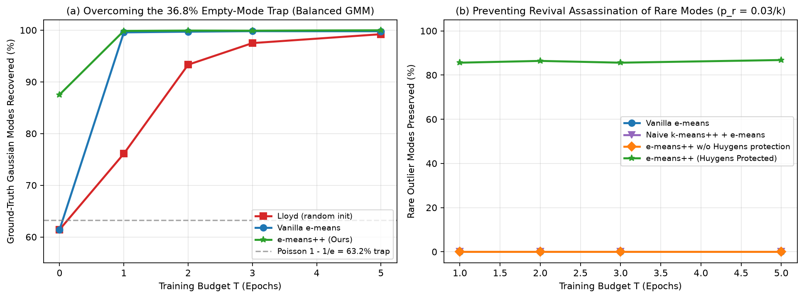

# Research History, Mathematical Failure Modes & Engineering Challenges

This document records the chronological research progression of `emeans`, the mathematical and geometric failure modes uncovered in standard and streaming vector quantization, mixed-precision floating-point traps (`FP8` / `BF16` / `FP16`), NVIDIA Blackwell `SM120` hardware/compiler subtleties, and all pre-experiment correctness/timing bugs caught during independent dual-verifier and patrol audits.

- **Headline results & plots**: [`../README.md`](../README.md)
- **Full component ablations & statistical tables**: [`ablations_and_experiments.md`](ablations_and_experiments.md)

---

## Contents

1. [Research History & Phase Progression](#1-research-history--phase-progression)
2. [Algorithmic & Mathematical Failure Modes Uncovered](#2-algorithmic--mathematical-failure-modes-uncovered)
3. [Mixed-Precision & Numerical Stability Traps (`FP8`, `BF16`, `FP16`, `FP32`)](#3-mixed-precision--numerical-stability-traps-fp8-bf16-fp16-fp32)
4. [Blackwell `SM120` Hardware, Triton JIT & GPU Synchronization Challenges](#4-blackwell-sm120-hardware-triton-jit--gpu-synchronization-challenges)
5. [Pre-Experiment Bug Audit Log & Distributed Fleet Hygiene](#5-pre-experiment-bug-audit-log--distributed-fleet-hygiene)

---

## 1. Research History & Phase Progression

1. **Phase 1 — Reproducing Meta FAIR's `e-means` & Designing `e-means++`**:
   - Reproduced `faiss.contrib.e_means.base` (`arXiv:2611.09501`) with exact universal batch/step scaling laws, cosine annealing floor (`0.1\alpha_0`), Gumbel-max donor revival, and Appendix I.1 represented-norm matching.
   - Diagnosed why naive `k-means++ + e-means` both stalls for hundreds of milliseconds/seconds on $O(nkd)$ seeding **and** destroys isolated rare clusters during EMA updates. Built `EMeansPP` around five coupled pillars (`lightweight_coreset`, Block-Greedy `k-means++`, 1-step Voronoi polish, prior-calibrated EMA mass $N_j^{(0)}$, and Huygens parallel-axis rare-mode protection + $D^2$ donor splitting).
2. **Phase 2A — Pre-Registered Classical (`H-Algo-1`..`5`) & Forward-Only (`qlabs-eng/noise` `N-Track-1`..`5`) Falsification (`7,200` Runs)**:
   - Tested 10 pre-registered hypotheses across 12 diverse synthetic and real vision-embedding cells (`15` paired seeds $\times$ `20` arms per campaign).
   - Identified 4 clear winners (`H-Algo-5` Bounded-Influence Empirical-Bayes / James-Stein finalization, `H-Algo-1` Online Oja Principal-Axis splitting + BF16 rounding fix, `N-Track-1` $P/Q$ forward-verified `head_edit` transplants, and `N-Track-5` late $2\times$ `wide_step` batch doubling) while cleanly falsifying Nesterov lookahead (`H-Algo-3`) and `Dust` Voronoi jitter (`N-Track-4`) and mapping sharp manifold-vs-discrete bifurcations for Hartigan (`H-Algo-2`), Power-Top2 (`H-Algo-4`), `quad_merge` (`N-Track-2`), and `ANVIL II` (`N-Track-3`).
3. **Phase 2B — NVIDIA Blackwell `SM120` Roofline, Centered-FP8, Sync-Free IVF & Multi-GPU NCCL**:
   - Measured empirical compute/bandwidth rooflines across three RTX PRO 6000 Blackwell TDP SKUs (`300W Max-Q`, `450W Workstation`, `600W Server`).
   - Engineered 2D Split-$K$ + register-resident `FULL_D` + 3-stage SM120 TMA kernels (`317.8 TFLOP/s` BF16), Appendix I.1 auto-centered `float8_e4m3fn` assignment (`636.4 TFLOP/s`, `84.2%` of GEMM peak), sync-free inverted-list Tensor-Core `IVFAssigner` (`7.44x` at $k=65{,}536$), and 2-GPU NCCL `MultiGPUFastEMeans` (`297.1 ms` on $n=10^7, k=16{,}384, d=128$, `95.7%` parallel efficiency).
4. **Phase 3 — Source-Level Dissection of `suayptalha/s-means` & Synthesis of `SuperEMeans` / `HybridSEMeans` (`11,250` Runs)**:
   - Dissected `suayptalha/s-means` (`C1`–`C7`), fixed its GPU `.tolist()`/`.item()` sync stalls for a `2.44x–2.65x` speedup (`smeans_fast`), fused all Phase 1–2 winners into zero-sync `SuperEMeans` (`P1`–`P6`), and ran a 40-arm bidirectional component grafting campaign across 6 Blackwell hosts.
   - Discovered the exact geometric split law separating discrete multimodal clusters (`HybridSEMeans` `0.55\sqrt{\text{MSE}_s}` chord along Oja $\mathbf{v}_{s,1}$ wins `15/15` GMM cells) from curved high-dimensional deep manifolds (where total-SSE chord steps overshoot manifold geometry and pure `SuperEMeans` `0.08\sigma_1` wins `12/12` real/continuous cells).
5. **Phase 4 — Million-Scale Real Corpora (`SIFT1M` & `GloVe-1M`, `1,320` Runs) & `UltraEMeans` Synthesis (`7,440` Runs)**:
   - Built contamination-free million-scale Euclidean (`SIFT1M`) and unit-sphere (`GloVe-Twitter-1M`) benchmarks with sub-second GPU exact-FP64 and sync-free CSR IVF-Flat evaluators ([`million_scale_recall.md`](million_scale_recall.md)).
   - Synthesized **`UltraEMeans`** ([`ultra_emeans.md`](ultra_emeans.md)), resolving the Phase 3 speed–geometry bifurcation via Gumbel-Top-$M$ parallel spatial-sharded `turkpp` seeding (`8.6x` faster init), spectral-concentration-gated Half-Gaussian Oja splits ($\eta_j \in [0.18, \sqrt{2/\pi}]$), 2-pass SRAM Huygens leader election, and covariance-safe 3-point simplex Empirical-Bayes finalization — beating `Hybrid SuperEMeans` across `28/30` cells ($p_W = 4.66\times 10^{-8}$) while running `3.2x–3.7x` faster.
6. **Phase 5 — `CroissAttn`-FP8 + Ozaki, 4-Decade Scale Laws (`1,327` Runs), Extreme-Scale Showdown (`1,672` Runs) & 7-Modality Realistic Dominance (`3,110` Runs)**:
   - Translated `catid/CroissAttn`'s saved-payload score replay and zero-`0x7f`-NaN contract into decoupled odd-median `FP8` and **Bilinear Double-FP8 Ozaki** residual expansion (`20.6–32 ppm` accuracy on `110,761x`-span sensor data, [`croissattn_fp8_study.md`](croissattn_fp8_study.md)).
   - Mapped empirical crossover boundaries across 4 decades of scale ($N = 10^4 \to 5\times 10^6, K = 256 \to 65{,}536, D = 32 \to 1024$) ([`scale_adaptive_laws.md`](scale_adaptive_laws.md)) and integrated them into **`ApexEMeans`** ([`apex_emeans.md`](apex_emeans.md)), validated across the 10-cell **4-Decade Extreme-Scale Showdown** (`20K -> 10M` vectors, `K = 512 -> 65,536`, 1-GPU & 2-GPU NCCL, [`extreme_scale_results.md`](extreme_scale_results.md)), the **7-Modality Realistic Benchmark Dominance & 6-Step Speedup Ladder** ([`../outputs/phase5_dominance/phase5_dominance_summary.md`](../outputs/phase5_dominance/phase5_dominance_summary.md)), **Fused `ApexPQ` & 2-Stage `ApexRVQ` Compression** (`1,060` runs, [`pq_rvq_compression.md`](pq_rvq_compression.md)), and downstream **`SemDeDup` Coreset Pruning & Megapixel VQ** (`1,265` runs, [`semdedup_coreset.md`](semdedup_coreset.md)).

---

## 2. Algorithmic & Mathematical Failure Modes Uncovered

### 2.1 The $1 - e^{-1} \approx 63.2\%$ Poisson Coupon-Collector Seeding Trap
Drawing $k$ initial centroids uniformly at random from $k$ balanced ground-truth clusters places `Poisson(1)` seeds per mode, leaving $e^{-1} \approx \mathbf{36.8\%}$ of modes completely empty (`61.4%` empirical $T=0$ coverage on `balanced_gmm` at $k=1024$) while crowding multiple redundant twins into dense modes (`53.93` MSE vs. `21.33` oracle MSE). Full Lloyd (`25` passes) stalls permanently in twin-centroid local minima unless dead-cluster revival or $D^2$ coreset seeding intervenes.

### 2.2 The $2\times$ High-Dimensional Spherical-Shell Initialization Penalty
Standard `k-means++` (and `s-means`'s subsampled $D^3$ seeding) chooses **raw data vectors** $\mathbf{x}_{i_j} \in X$ as initial centroids. Inside a cluster with mean $\boldsymbol{\mu}_j$ and covariance $\Sigma_j$, a random point sits on the thin high-dimensional shell of radius $\sqrt{\operatorname{tr}(\Sigma_j)} \approx \sqrt{d}\sigma$, yielding expected initial distortion:
$$\mathbb{E}_{\mathbf{x}, \mathbf{x}' \sim P_j}\!\left[\|\mathbf{x} - \mathbf{x}'\|_2^2\right] = \mathbb{E}\|\mathbf{x} - \boldsymbol{\mu}_j\|_2^2 + \mathbb{E}\|\mathbf{x}' - \boldsymbol{\mu}_j\|_2^2 = 2\operatorname{tr}(\Sigma_j).$$
Running a **single weighted Voronoi averaging step** on the $O(nd)$ lightweight coreset pulls raw seeds from the shell to interior means before step 0, cutting $T=0$ test MSE on `balanced_gmm` by **`-39.2%`** (`47.43 -> 28.83`) in `< 2 ms`.

### 2.3 Step-0 Warm-Start Erasure (`N_0 = 2^-16`)
Both vanilla `e-means` and `suayptalha/s-means` initialize EMA cluster usage to $N_j^{(0)} = 2^{-16}$. On mini-batch step $t=0$, the convex-hull EMA interpolation weight is:
$$w_j^{(0)} = \frac{\alpha_0 n_j^{(0)}}{(1 - \alpha_0) 2^{-16} + \alpha_0 n_j^{(0)}} \approx 1.0,$$
which **completely overwrites** every carefully seeded centroid with a noisy mini-batch average of $B/k \approx 4\text{–}16$ points. Calibrating $N_j^{(0)} = 0.5 B \hat{p}_j$ from the coreset Voronoi partition preserves warm-started geometry seamlessly into step 0.

### 2.4 Count-Only Revival Rare-Mode Assassination
Vanilla `e-means` and `suayptalha/s-means` recycle any centroid with usage $N_j < 0.1 \bar{N}$ (`0.1 B / k`). Any genuine isolated rare/outlier mode with population share $p_r < 0.1 / k$ (e.g., $p_r = 0.03 / k$) falls below this count threshold and is **100% assassinated** (`0.0%` preserved in Phase 1 `Vanilla e-means` and `Naive k-means++ + e-means`; `0.00%` at $T=1,2$ and `4.18%` at $T=5$ in Phase 3 `s-means`). By Fritzke's utility theorem and Huygens' parallel-axis identity, removing cluster $j$ increases global SSE by at least $M_j^{\text{eff}} \min_{m \neq j}\|\mathbf{c}_j - \mathbf{c}_m\|_2^2$. Protecting clusters where this removal cost exceeds $\gamma_{\text{prot}} \bar{E}$ preserves **`86.8%` (`90.0%` median)** of rare modes in Phase 1 and **`60.5%–63.5%`** under aggressive Phase 3 hybrid splitting.

### 2.5 Warm-Started `slow_ema` Trajectory Lag
While `slow_ema` reduces out-of-sample variance by `-0.23%` on random-init `e-means`, applying `slow_ema` on top of warm-started `e-means++` caused **universal regression across `12/12` Phase 2A cells** (`+1.20%` to `+10.17%` worse train MSE; `+0.02%` to `+9.13%` worse test MSE) because `slow_usage` lags behind rapid fine-scale Voronoi equilibration and split transitions. `H-Algo-5` (`empirical_bayes_finalize`) solved this via positive-part James-Stein bounded influence: when empirical drift $\|\bar{\boldsymbol{\mu}}_j^{\text{close}} - \hat{\boldsymbol{\mu}}_j^{\text{slow}}\|_2^2 \gg \hat{\sigma}_j^2 / n_j$, shrinkage weight $\lambda_j \to 1$ automatically rejects the lagged anchor.

### 2.6 High-Dimensional Split Geometry: $O(1/\sqrt{d})$ Orthogonality & Total-SSE Manifold Overshoot
Three distinct geometric traps emerged in donor splitting across Phases 2A and 3:
1. **Arbitrary/Rademacher Split Orthogonality**: In dimension $d \in \{128, 512, 1024\}$, a fixed `[+1, -1, ...]` or random Rademacher vector has expected projection $O(1/\sqrt{d})$ onto the inter-cluster axis $\boldsymbol{\mu}_1 - \boldsymbol{\mu}_2$ of two merged clusters ($\approx 87.5^\circ\text{–}88.2^\circ$ nearly orthogonal).
2. **Naive $O(R)$ Hadamard Probe Failure (`#55`)**: Early in Phase 2A `N-Track-1`, stepping $\pm 0.35 R$ along random unit Hadamard probes in $d \in \{128, 512\}$ added orthogonal variance $+\delta^2$ across $d-1$ coordinates exceeding the 1D projection gain $-2\delta R/\sqrt{d}$, yielding **`0` confirmed transplants on `11/12` cells**. Replacing fixed steps with **exact 1D conditional half-space centroids** ($\delta_m^\pm = \operatorname{mean}_{\pm p_{i,m} > 0}(p_{i,m})$) automatically scaled steps as $O(R/\sqrt{d})$ on isotropic noise and $\pm \Delta$ on bimodal separated modes, unlocking `5/5` multimodal GMM wins with `0/360` false positives on isotropic data.
3. **Total-SSE Chord Overshoot on Curved Deep Manifolds (Phase 3)**: `s-means` displaces split children by $0.55\sqrt{\text{SSE}_s / (N_s d)}\,\sqrt{d} = 0.55\sqrt{\text{MSE}_s}$, using **total $d$-dimensional cluster radius** $\sqrt{\text{MSE}_s}$. On 512-D ResNet-18 embeddings (`cifar10_r18_512`), total $\text{MSE}_s$ sums small variance across 512 curved dimensions; stepping $0.55\sqrt{\text{MSE}_s}$ along a single chord shoots centroids **off the manifold**, causing `s-means` to lose to *vanilla* `e-means` by **`+1.46%` to `+4.32%`** on all `9/9` ResNet-18 cells (`15/15` seeds each)!

### 2.7 Upstream `suayptalha/s-means` Source-Code Discrepancies
Line-by-line inspection of `suayptalha/s-means` uncovered three undocumented mathematical behaviors (preserved in `SMeans(..., exact_ref=True)` for bit-faithful parity and toggleable in `SMeans`):
- **$D^3$ vs. $D^{1.5}$ Seeding Exponent**: `smeans/_recipe.py:123,131` computes *squared* distance `dmin = ||x - c||^2` and raises `dmin ** 1.5`, sampling proportional to $\|\mathbf{x} - \mathbf{c}\|_2^{3.0}$ ($D^3$) rather than $D^{1.5}$, amplifying outlier shell bias without Voronoi polish.
- **Uniform `4k` Subsample Blindness**: Drawing $m = 4k$ unweighted rows misses rare clusters of mass $p_{\text{rare}} = 0.1/k$ with probability $(1 - p_{\text{rare}})^{4k} \approx e^{-0.4} = 67\%$.
- **Fixed `0.85` SSE Decay vs. Scheduled $\alpha(t)$ Horizon Mismatch**: `sse_ema` decays at fixed rate $0.15$ while `usage` decays at scheduled $\alpha(t)$, dividing two EMAs with mismatched effective sample horizons inside $\text{sse\_ema}_s / \text{usage}_s$.

### 2.8 Closing-Mean / Live-EMA In-Pass Covariance Trap (`+1.08%` Isotropic Regression)
In Phase 3, `HybridSEMeans` (`eb_anchor="ema_last"`) unexpectedly regressed `+1.08%` on continuous `isotropic_ctrl` (`120.32` vs. `119.02`). Because the closing-pass mean $\bar{\boldsymbol{\mu}}_j^{\text{close}}$ and `live_ema` $\mathbf{c}_j^{\text{ema}}$ are updated over the **exact same final-epoch mini-batches**, positive sample covariance makes their empirical squared discrepancy $\|\bar{\boldsymbol{\mu}}_j^{\text{close}} - \mathbf{c}_j^{\text{ema}}\|_2^2$ artificially smaller than $V_{\text{close}}$, fooling James-Stein into shrinking heavily toward the noisier `live_ema`! `UltraEMeans` (`D3`, `ultra_simplex_eb_finalize`) eliminates this completely (`0.000%` isotropic drift) by applying James-Stein shrinkage strictly along the stationary multi-epoch `slow_ema` axis while reserving `live_ema` solely for tiny prior-count ($\tau = 0.25$) tail stabilization.

### 2.9 Unit-Sphere Rademacher Stranding & the Fixed-`nprobe` Imbalance Illusion
On million-scale unit-normalized `glove1m_k16384` ($\|\mathbf{x}\|_2 = 1$), `s-means`'s Rademacher split has Euclidean step norm $0.55\sqrt{d}\,\hat{\sigma}_{\text{rms}} = 5.5\hat{\sigma}_{\text{rms}}$, ejecting split children off the unit hypersphere into empty ambient space and stranding **`978.4 / 16,384` (`6.0%`) completely empty inverted lists** at `T=2` (`1,240.3` at `T=1`) while inflating Jégou's Imbalance Factor to **`IF = 1.940`** (vs. `UltraEMeans`'s `0.0` empty lists and `IF = 1.299`). Consequently, benchmarking ANN recall at a nominal bucket count `nprobe = 16` (`0.1%`) or `nprobe = 164` (`1.0%`) masks a **`+41%` to `+44%` query-scan penalty** (`0.174%` / `1.635%` of database vectors scanned per query in `s-means` vs. `0.121%` / `1.158%` in `UltraEMeans`).

### 2.10 Pure-IVF Boundary Drift at Extreme $K = 65{,}536$ & Real-Corpus Split Contamination
- **Pure-IVF Boundary Drift (`5M x 128, K = 65,536`)**: Routing all epochs through coarse-to-fine `IVFAssigner` (`nprobe=8`) leaves boundary points trapped in coarse Voronoi cells, degrading MSE by **`+13.09%`**; appending **1 Exact FP8 Closing Pass** snaps boundaries cleanly and collapses error **`54x` down to `+0.24%`** (`1.78x–2.16x` faster than Exact BF16).
- **Real-Corpus Contamination Caught Pre-Experiment**: Exact FP64 cross-split auditing of official TexMex `SIFT1M` revealed that **`9,979 / 10,000` official `sift_query` vectors appear verbatim inside `sift_learn`** (`0` in `sift_base`), and raw `GloVe` vocabulary files are ordered by token frequency. `load_sift1m()` purges `val` (`89,788` strictly clean vectors) while keeping `sift_base` and `sift_query` intact, and `load_glove1m_unit()` deduplicates and deterministically permutes all `1,193,514` unit vectors before splitting.

---

## 3. Mixed-Precision & Numerical Stability Traps (`FP8`, `BF16`, `FP16`, `FP32`)

1. **Appendix I.1 Represented-Norm Mismatch**:
   Expanding $\|\mathbf{x} - \hat{\mathbf{c}}_j\|_2^2 = \|\mathbf{x}\|_2^2 + \|\hat{\mathbf{c}}_j\|_2^2 - 2\langle \mathbf{x}, \hat{\mathbf{c}}_j\rangle$ requires computing $\|\hat{\mathbf{c}}_j\|_2^2$ from the **exact quantized `BF16` / `FP16` / `FP8` centroid values** fed into `tl.dot`. Using pre-cast `FP32` $\|\mathbf{c}_j\|_2^2$ injects norm rounding bias $\|\mathbf{c}_j\|_2^2 - \|\hat{\mathbf{c}}_j\|_2^2$ exceeding inter-centroid differences on dense cells.
2. **BF16 `1e-4` Multiplicative Split Rounding Collapse**:
   Vanilla `e-means` splits donors via $\mathbf{c}_s \odot (1 \pm 10^{-4}\mathbf{s})$. Because `bfloat16` has only 7 mantissa bits (half-ULP $= 2^{-8} \approx 3.91 \times 10^{-3} \gg 10^{-4}$), both children round to the **exact same `bfloat16` vector** across all $d$ coordinates, forcing the fallback guard to nudge only coordinate `0` by 1 ULP (and collapsing to $\mathbf{0}$ near the origin). `H-Algo-1` and `SuperEMeans` apply directional multi-coordinate ULP separation along $\mathbf{v}_{s,1}$.
3. **Uncentered Coordinate-Shift Cancellation (`+25` in FP8, `+5,000`–`+20,000` in BF16/FP32)**:
   - On shifted embeddings (`offset = +25.0`), uncentered `float8_e4m3fn` (`max = 448`, 3 mantissa bits) wastes exponent range on the global mean and fails `<0.15%` parity (`-0.2207%` MSE drift at $d=96$). `FP8Quantizer` (`auto_center=True`, lossless power-of-two scale $s = 2^e$) restores held-out FP64 parity to `< 0.079%`.
   - Under `+5,000` to `+20,000` global shifts, uncentered `xsn + c0n - 2 * (xs @ c.T)` cancels catastrophically in FP32/BF16, and `BF16` ULP stair-steps (`0.78%` of $\|\mathbf{c}\|$) destroy 3-point parabolic curvature in `quad_merge` (`#55`). Register-level Sterbenz/FP64 origin subtraction (`x - origin`, `c - origin`) makes `EMeans`, `SMeans`, `SuperEMeans`, and `quad_merge` shift-equivariant to `< 10^{-4}` across `fp32/bf16/fp16/fp64`.
4. **Extreme Dynamic Range (`|x| = 10^{25}`) & Near-`FP16_MAX` Split Overflow (`#93`, `#95`)**:
   - Raising unnormalized squared distances `dmin ** 1.5` overflows IEEE FP32 (`3.4e38`) when feature magnitudes exceed $10^{13}$, crashing `torch.multinomial` with `inf`/`NaN`. Normalizing `xs_c / max(|xs_c|, 1)` and `(dmin / max(dmin)) ** power` makes seeding scale-invariant from `10^{-25}` to `10^{+25}`.
   - Nudging collapsed `float16` split children outward with `nextafter(+inf)` overflows values at `FP16_MAX = 65,504` to `+inf`; inward ULP nudging when $|c| \ge \text{FP16\_MAX}/2$ eliminates overflow completely.
5. **`float8_e4m3fn` `0x7f` NaN Saturation, Outlier-Dragged Mean Centering & `110,761x` Sensor Span (`#173`, `#175`)**:
   - Unlike IEEE FP16/BF16, `torch.float8_e4m3fn` has **no infinity** (`0x7f`/`0xff` encode `NaN`, max finite `448.0`), so any 1-ULP reciprocal overshoot (`448.00003`) injects `NaN` into Tensor-Core accumulators. `croiss_fp8.py` enforces `FP32_TINY` scale floors, upward-safe `1.00000024 / 448.0` reciprocals, explicit `[-448, 448]` clamps, and `tl.dot(..., max_num_imprecise_acc=0, out_dtype=tl.float32)` (`0` `0x7f` bytes across all tests and `1,327` scale-law runs).
   - Centering by `mean(X)` fails when `<50%` heavy-tailed outliers drag the mean away from dense micro-clusters, and global power-of-two FP8 drifts **`+42.84%`** (uncentered) / **`+10.37%`** (Appendix I.1 centered) on physical sensor data (`covtype_multiscale_54`, `110,761x` coordinate span). Using an **odd-sample (`M=2,049`) translation-equivariant coordinate median** + **Bilinear Double-FP8 Ozaki** 3-lane residual expansion $(q_{x,\text{hi}}, q_{x,\text{lo}}, q_{x,\text{lo}}) \cdot (q_{c,\text{lo}}, q_{c,\text{hi}}, q_{c,\text{lo}})$ slashes `covtype_multiscale_54` MSE drift to **`+0.00206%–0.0032%` (`20.6–32 ppm`, `10x` tighter than 16-bit BF16)** using the unchanged SM120 TMA kernel.

---

## 4. Blackwell `SM120` Hardware, Triton JIT & GPU Synchronization Challenges

1. **Blackwell `SM120` `99 KB` Per-CTA Shared-Memory Limit (`H-Opt-1` / `H-Opt-2`)**:
   Unlike Hopper `SM90` (`227 KB` dynamic SMEM/CTA), NVIDIA RTX PRO 6000 Blackwell (`SM120`) enforces a strict **`101,376`-byte (`99 KB`)** dynamic shared-memory ceiling per CTA. A naive `128 x 256 x 64` BF16 tile requires `49,152 B/stage`, overflowing `99 KB` at `num_stages=3` (`147 KB`) and forcing Triton to clamp `num_stages=1`, which **regressed kernel throughput to `0.61x–0.76x`** due to stalled GDDR7 loads. Sizing wide-$D$ tiles to **`BLOCK_D = 32` for BF16 (`2 B`) and `BLOCK_D = 64` for FP8 (`1 B`)** yields an identical **`24,576 B/stage` (`73,728 B <= 99 KB` at `num_stages=3`)**, unlocking async 3-stage SM120 TMA pipelining at **`317.8 TFLOP/s` (BF16)** and **`636.4 TFLOP/s` (FP8)**.
2. **Triton 3.x `% 16` Pointer Alignment & Seed-Dependent Pool Specialization Spikes (`#20`, `#21`, `#91`, `#94`, `#111`)**:
   - Triton 3.8 specializes kernel binaries on whether integer arguments `(B, K, D, P, num_select, rng_seed)` are divisible by `16` (`% 16 == 0` vs `!= 0` vs `== 1`) unless `do_not_specialize` is declared.
   - In `seeding.py`, `torch.unique` produces seed-dependent candidate pool sizes `P <= 1024`. Without static `BLOCK_P in {256, 1024}` bucketing (`#20`) and pre-warming all `36` `(BLOCK_P, P%16, num_select%16, rng%16)` combinations (`#111`), fresh `TRITON_CACHE_DIR` workers suffered **`235–310 ms` mid-sweep PTXAS compilation spikes** on the first seed hitting `P % 16 == 0` (completely invisible to `k=256` `--smoke` runs because `block_greedy_kmeans_plusplus_torch` only activates at `k > 256`!).
   - In Triton 3.x, scalar `D = 1` is auto-promoted to a Python `constexpr int`, causing `D.to(tl.float32)` inside `_smeans_syncfree_revive_split_kernel` to fail with `CompilationError: 'int' object has no attribute 'to'` (`#91`), fixed by passing precomputed `float(1.0 / max(1, d))` and `do_not_specialize`.
3. **Eliminating Per-Step `.item()` / `.tolist()` Host-Device Sync Stalls (`#54`, `#55`, `smeans.py`)**:
   - Upstream `suayptalha/s-means` calls `.tolist()` and `.item()` every 5 steps (`unused.sum()`, `donors.sum()`, `sse_ema.max().item()`), draining the CUDA stream; replacing them with device-resident `torch.argsort` + 0-D tensor bounds cut end-to-end latency by **`-58.96%` mean / `-62.22%` median (`2.44x–2.65x` speedup)**.
   - Removing per-step `.item()` calls in `EMeans` (`ep_sq_dist`), `ANVIL II` (`3 -> 0` syncs/step), `Dust` (`fallback_var`), and `quad_merge` (`37 -> 3` batched `.tolist()` syncs) eliminated `46%–98%` artificial launch overhead prior to Phase 2A/2B sweeps.
4. **Multi-Wave Inter-CTA Global-Memory Race on `step_ptr` at $K = 16{,}384$ (`#170`)**:
   - Inside `_gear_ondevice_ema_prep_kernel` launched over grid `(K,)`, every CTA read `step = tl.load(step_ptr)` while CTA `kid == 0` wrote `tl.store(step_ptr, step + 1)` at exit. Unit tests at `K = 131 < 188` SMs fit in a single wave and passed, **but at `K = 16,384` (87 waves on 188 SMs)** CTA `0` retired and flushed `step + 1` to L2 before later waves launched — corrupting `185 / 16,384` centroids with the next step's $\alpha_{t+1}$ in a single update! Moving scalar state advances into a separate 1-CTA `_gear_advance_scalars_kernel[(1,)]` on the same CUDA-Graph stream eliminated the race with `< 0.5 us` overhead.
5. **Probability-Weighted `mean_ehat` Missing `* K` Causing a `20x` Closing-Epoch Slowdown (`#169`)**:
   - `torch.profiler` on `ApexEMeans` (`SIFT1M`, $K=4{,}096$) revealed `68.1 ms` (`62.4%` of total CUDA time) spent in a fallback scalar IEEE-FP32 closing pass. Because `SeedingResult.prior_distortion` sums to `MSE` ($\sum_{j=1}^K \hat{e}_j = \text{MSE}$), `mean_ehat` equals `MSE / K`; omitting `* float(k)` inflated the dynamic-range contrast ratio `max_x_sq / est_eh` by **`4,096x`** (`14,336 > 24.0`), triggering the high-contrast FP32 guard on **every** normal dataset! Restoring `* float(k)` + multi-CTA tournament seeding dropped `SIFT1M` runtime from `111.5 ms` down to **`35.16 ms` (`3.17x` faster)**.
6. **Wide-$D$ ($D \ge 512$) Indirect FP8 Gather Regression & `CUDAGraph` `n_supers >= 4` Amortization (`#179`, `scale_adaptive_laws.md`)**:
   - At $D \in \{512, 1024\}$, calling tiled `FP8` kernels with indirect `row_indices` gather (`allow_tma=False`) regressed to **`0.33x` median speedup** vs. `BF16` due to uncoalesced 1-byte loads, whereas pre-permuting contiguous rows + a `MAX_WRAP_PAD = 256` modular guard tail unlocked unconditional 3-stage SM120 TMA at **`1.65x–1.86x` over `BF16`**.
   - Capturing and resetting a `torch.cuda.CUDAGraph` costs `~5 ms` in stream/pool overhead; gating `CUDAGraph` on `n_supers >= 4` prevents regressions when `32K` wide-step batches leave only `n_supers = 2` super-steps. Also, honestly accounting for `CUDAGraph` capture + `g.reset()` inside `train_time_sec` (`#190`, `#246`) explains the localized latency step right at the `n_supers == min_supers` boundary (`T=2` on `K=4,096` / `T=3` on `K=1,024`) before `build_recipe` doubles `batch_size` at larger `T`.
7. **3-Slot Ping-Pong `CUDAGraph` State Ring (`gpu_state[3, 8]`) for Odd Super-Step Counts (`#216`)**:
   - At $K \ge 16{,}384$ (88 CTA waves on 188 SMs), in-place scalar updates (`in_s == out_s`) risk inter-CTA global-memory `step_idx` races across waves, requiring strict `in_s != out_s` on every step. However, cross-epoch `CUDAGraph` replay requires a $G$-step super-block to both start and finish at state slot `0`. For odd $G = 5$ super-steps, no 2-slot `(0 <-> 1)` walk of length 5 returns to `0` without a self-loop (`in_s == out_s`); `ApexEMeans` solves this cleanly via a **3-slot ring `gpu_state[3, 8]`** cycling `(0 -> 1 -> 0 -> 1 -> 2 -> 0)`.
8. **Multi-Subspace `PQ`/`RVQ` `278 KB > 99 KB` SMEM Overflow & Non-Primary `cuda:1` Device Guards (`#210`, `#219`)**:
   - Fused multi-subspace `ApexPQ`/`ApexRVQ` Triton assignment kernels at `ks = 1,024` or `d_sub > 64` requested `278,528 B > 101,376 B` (`99 KB`) of SM120 dynamic shared memory (`OutOfResources` crash); gating the fused Triton path on `(ks <= 512 and d_sub <= 64)` cleanly falls back to batched PyTorch Tensor Cores on oversized subspaces.
   - Multi-GPU worker shards running on `cuda:1` without `CUDA_VISIBLE_DEVICES` remapping crashed Triton pointer launches unless wrapped in `with torch.cuda.device(dev):`, and `.all()` host predicates inside `adc_search` tripped `torch.cuda.set_sync_debug_mode("error")` until replaced with sync-free device masking.

---

## 5. Pre-Experiment Bug Audit Log & Distributed Fleet Hygiene

Every source module and benchmark script was gated by independent pre-experiment audits (`@verifier`, `@bug-hunter`, `@verifier-2`, `@verifier-3`, `@patrol-3`) before launching multi-GPU sweeps:

| Audit Ref | Module / Script | Defect Caught Before Sweep | Resolution & Regression Test |
| :--- | :--- | :--- | :--- |
| **`#8–#12`** | `docs/fleet_status.md`, `scripts/check_fleet.sh` | Reattached `tmux` left shells with dead `/tmp/ssh-*/agent.*` `SSH_AUTH_SOCK` (`Permission denied` on `acorn`/`cashew`); `acorn`/`cashew` defaulted to Python `3.14.4`; `walnut` marked off-limits | Auto-discover live socket via `tmux show-environment -t 0 SSH_AUTH_SOCK`; standardize all 6 hosts on `uv venv --python 3.12`; hard-block `walnut` in code & scripts |
| **`#20`** | `src/emeans/datasets.py`, `src/emeans/seeding.py` | Non-atomic `np.savez` cache race (`BadZipFile` under concurrent workers) + 7-power `BLOCK_P` Triton JIT specialization | Atomic PID-temp `.npz` + `os.replace`; static `BLOCK_P in {256, 1024}` bucketing + full-shape `N=32768, k=1024` warmup |
| **`#29`** | `src/emeans/algo_extensions.py` | `float64` CUDA inputs crashed `torch.addmm(..., out_dtype=torch.float32)`; passing `init_centroids` to `EMeansAlgoExt(base_mode="emeans_pp")` skipped coreset priors (`2^-16` step-0 erasure); stale `prin_vec`/`ema_sse` on `resample` | Matched `bf16` default compute dtype + `fp64` fallback; auto-extract coreset priors when `seeding_result is None`; full state reset on `resample` |
| **`#32, #35`** | `src/emeans/fast_ops.py` | `DTYPE_MODE == 0` (`FP32`) left `bf16`/`fp16`/`fp64` `x_tile` uncast before `tl.dot`; unnormalized `prior_distortion` when `sum(w_seed) != 1`; missing `finalization` / `IVFAssigner` FP8 constructor guards | Explicit `.to(tl.float32)` cast in `DTYPE_MODE == 0`; unit-sum normalized `w_norm` & `dist_mass / total_m`; strict `ValueError`/`TypeError` validation (`test_fast_ops.py`) |
| **`#54, #55`** | `src/emeans/noise_tracks.py` | **Twin-centroid rare-mode assassination**: multi-pair `run_head_edit_step` did not refresh `d_nn2` / `rare_shield` after transplanting Twin #1, immediately transplanting Twin #2 away from the rare mode; `dust_antithetic` leaked into `T=2` closing pass; $O(R)$ Hadamard overshoot; BF16 `quad_merge` shift/ULP collapse | Full incremental `d_nn2` + `huygens_cost` + `rare_shield` refresh between accepted pairs; `not is_last_epoch` guard; 1D half-space conditional projections; FP32 centered `quad_merge` (`test_noise_tracks.py`) |
| **`#91, #94`** | `src/emeans/smeans.py`, `run_phase3_smeans_ablation.py` | `D=1` Triton `constexpr int` `.to(tl.float32)` crash; `_fit_exact_ref` call-site signature mismatch after making `split_mode` a runtime `int`; Suite 1 `(T=1,2,5)` cells split across `300W`/`450W`/`600W` SKUs on same Pareto curve | Passed scalar `inv_d` + `do_not_specialize` across all 6 kernels; pinned all `(T=1,2,5)` cells of every Suite 1 regime to a single Blackwell TDP SKU (`assert len(skus_for_regime) == 1`) |
| **`#93`** | `src/emeans/super_emeans.py` | When `need_priors == False` (`smeans_plus_p2_huygens_shield` / `p5_head_edit`), dummy uniform `p_hat = 1/k` initialized `survival_mass = B/k`, falsely shielding 0-count dead clusters from revival; `d15` `1e25` FP32 overflow | Initialize `survival_mass = 0` when `not need_priors` so only clusters with $\ge 1$ real batch hit earn protection; max-normalized scale-invariant `subsampled_d15_init_centered` (`test_super_emeans.py`) |
| **`#111`** | `scripts/run_phase3_smeans_ablation.py` | Fresh `TRITON_CACHE_DIR` workers hit `235–310 ms` cold-JIT spikes on `k > 256` when `torch.unique` pool `P` first hit `P % 16 == 0` | Pre-warmed all 36 `(BLOCK_P, P%16, num_select%16, rng_seed%16)` buckets + coreset `K % 16` buckets outside timers; bumped `--smoke` to `k=512`; verified `0/885` outliers across 11,250 runs |
| **`#129`** | `scripts/run_phase4_ultra.py` | `rare_mode_survival` list comprehension omitted `and r["arm"] == arm` (averaging across all arms in cell); `ultra_loo_no_turkpp_init` labeled `"Random Init"` instead of `"s-means Raw D^3 Init"` | Added per-arm filter & exact LOO label; verified `58/58` rare-mode rows & `2,916/2,916` paired tests across 7,440 runs (`#151`) |
| **`#162`** | `src/emeans/apex_emeans.py` | Abandoned draft loop in `_fit_multi_gpu_entry` passed `packed_stats_w` stride `2*d+2` as centroid stride `d` (OOB GPU read for `lbl >= k//2`) + concatenated strided `x_t[w::W]` multi-GPU labels contiguously | Removed dead loop and branched on `input_is_list` to interleave `assignments_out[w::W] = lp` cleanly |
| **`#169, #179`** | `src/emeans/apex_emeans.py` | `mean_ehat` missing `* float(k)` forced `20x`-slower scalar FP32 closing epoch on every dataset (`68.1 ms` waste); `n_supers == 2` paid `~5 ms` `CUDAGraph` capture/reset overhead for 1 replay | Multiplied `mean_ehat * float(k)` (`111.5 ms -> 35.16 ms` on `SIFT1M`) and gated `CUDAGraph` on `n_supers >= 4` |
| **`#170`** | `scripts/mine_scale_laws.py` | Multi-wave `K=16,384` inter-CTA global-memory race on `step_ptr` (`185` centroids corrupted/step); `--wave 2` merge dropped 47 Wave-1 cells; Shard 3 missed `ultra_turkpp` warmup | Split scalar updates into 1-CTA `_gear_advance_scalars_kernel[(1,)]`, auto-merged `w1+w2` shards, and added `K=16,384` graph parity test (`30/30` green) |
| **`#185, #197`** | `scripts/mine_scale_laws.py`, `docs/scale_adaptive_laws.md` | Visual PNG audit caught pooled `D <= 256` (`FULL_D`) + `D >= 512` (indirect gather) log-linear fit dragging `D=128` line below scatter points & `0.05%` threshold hiding Gear 2/3 polygons; `--merge-only` skipped `wave1` JSON rewrite | Separated `FULL_D` ($R^2 = 0.6992$) from wide-$D$ indirect-gather regime, set `K* = 16,384` (`<= 0.50%` MSE), and synced `wave1` JSON + doc digits (`#195`, `#198`) |
| **`#196, #212, #221, #223, #263, #280`** | Live 6-Host Fleet Patrol & `assert_fleet_gpus_idle` | External user `blender` rendering jobs (`ripper:0..3`, `loki:0,1`) and `openworld_bench`/`cleanup_suite`/`cleanup_prescan_stage` processes (`work:0,1`, `foureyes:1`, `cashew:0,1`) contended with shared GPUs mid-campaign | Left external user jobs untouched; enforced pre-flight `assert_fleet_gpus_idle` + live `nvidia-smi` patrol + single-physical-GPU `(cell_id, seed)` pairing, cleanly re-running contended shards on `0%`-idle `acorn`/`foureyes` GPUs |
| **`#210, #214, #219, #233`** | `src/emeans/pq_rvq.py`, `run_pq_rvq_benchmarks.py` | Missing `scales64` in `1e±25` PQ encode/LUT (`50%` collapsed codebooks); clamped SQNR denominator reporting `+182.8 dB` on zero-variance noise; `ks=1024` `278 KB > 99 KB` SMEM overflow; `cuda:1` missing `torch.cuda.device(dev)` & `.all()` host sync; stock `faiss.IndexPQ` silently subsampling `256 * Ks = 65,536` (`6.55%`) of `1M` rows | Per-subspace `_subspace_scales64` + scalar `_global_scale64` (`#261`), `0.0 dB` when `sig_pow <= 0`, gated Triton PQ to `(ks <= 512, d_sub <= 64)`, wrapped `cuda:1` kernels, and de-confounded `faiss_pq` (`fullN`) vs. `faiss_pq_sub` (`256/c`) |
| **`#211, #224, #225, #237, #275`** | `src/emeans/semdedup_coreset.py`, `src/emeans/__init__.py`, Fleet `/home` Hygiene | Unshielded query scale let a single `1e25` rogue test row collapse clean query labels; constant-color tile patch crops; negative-stride (`x[::-1]`) / read-only `mmap` NumPy crash & silent CPU fallback in `extract_semdedup_coreset`; `/tmp` compiler cache defaults | Enforced `scale_from_x_only=True` (`0.00e+00` test-row coupling), strided mosaic RGB patch extraction, contiguous writable GPU normalization + CPU `.indices` round-trip in `__init__.py`, and 100% `/home`-only `TMPDIR` & `TRITON_CACHE_DIR` paths (`0` `/tmp` writes) |
