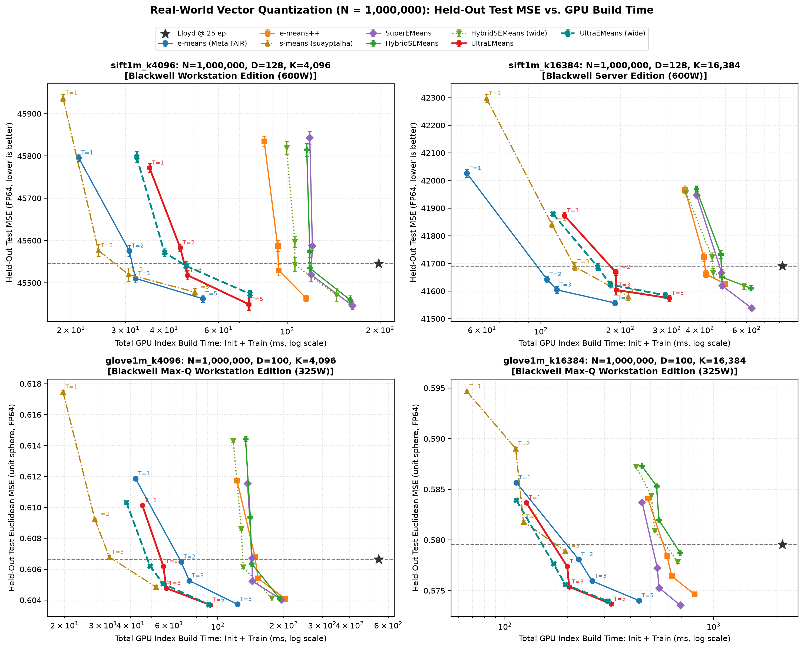
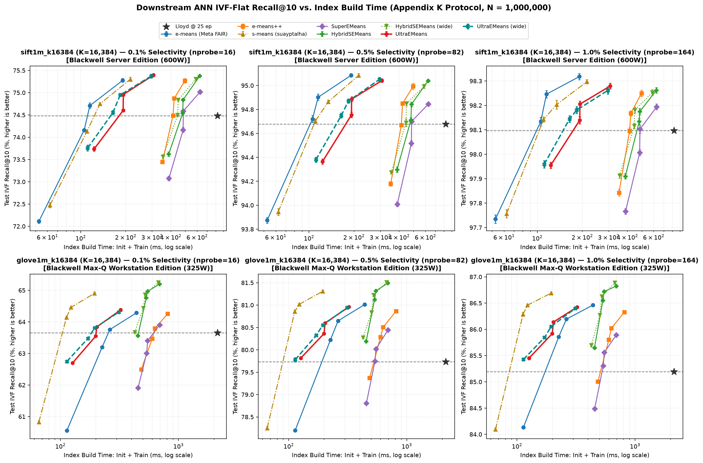

# Million-Scale Real-World Vector Quantization & Downstream ANN IVF Recall ($N = 1{,}000{,}000, K \in \{4{,}096, 16{,}384\}$)

## 1. Executive Summary

To test whether algorithmic gains on $10^5$-scale benchmarks transfer to **true paper scale ($N = 1{,}000{,}000$, $K \in \{4{,}096, 16{,}384\}$)** and downstream **Approximate Nearest Neighbor (ANN) Inverted-File (IVF-Flat) retrieval** (Appendix K of Bessa et al., `arXiv:2611.09501`), we built [`real_corpora.py`](file:///home/catid/emeans/src/emeans/real_corpora.py) and [`run_phase4_million_scale.py`](file:///home/catid/emeans/scripts/run_phase4_million_scale.py) and executed **`1,320` paired million-scale runs** (`4` `(corpus, K)` cells $\times$ `10` paired seeds $\times$ `33` arm-budget configurations) across 12 Blackwell GPUs on 5 machines (`acorn`, `cashew`, `work`, `ripper`, `loki`), keeping every `(corpus, K)` cell 100% pinned to a single matched GPU SKU.





### Headline Takeaways ($N = 1{,}000{,}000$, 10 Paired Seeds)

1. **`UltraEMeans` Matches and Beats 25-Epoch Lloyd's Algorithm in `T = 2` Epochs (`4.3x–12.5x` Faster) with Zero Empty Clusters**:
   - **SIFT1M ($N = 10^6, D = 128, K = 16{,}384$, 600W Blackwell Server)**: At `T = 2`, **`UltraEMeans` (`192.2 ms`)** and **`UltraEMeans (wide)` (`164.2 ms`)** run **`4.26x–4.99x` faster** than `Lloyd@25` (`819.7 ms`) while beating `Lloyd@25` on both held-out FP64 Test MSE (`41,668.4` / `41,686.9` vs. `41,690.8`) and downstream IVF Recall@10 (`74.60%` / `74.55%` vs. `74.48%` at `0.1%` selectivity; `98.14%` vs. `98.10%` at `1.0%` selectivity). At `T = 5` (`306.5 ms`, `2.67x` faster than `Lloyd@25`), `UltraEMeans` reaches **`83.20%` Recall@1 and `75.39%` Recall@10 at `0.1%` selectivity** (`+0.91 pp` over `Lloyd@25`, `10/0/0` seeds) and the lowest Train MSE (`37,835.7`) of any solver.
   - **GloVe-Twitter-1M-Unit ($N = 10^6, D = 100, K = 16{,}384$, 325W Blackwell Max-Q)**: At `T = 2`, **`UltraEMeans` (`199.0 ms`, `10.75x` faster)** and **`UltraEMeans (wide)` (`171.0 ms`, `12.51x` faster)** beat `Lloyd@25` (`2,139.1 ms`) on held-out Test MSE (`0.5774` / `0.5777` vs. `0.5796`, `10/0/0` seeds) and spherical cosine distortion (`0.353866` vs. `0.355515`), achieving the **lowest spherical cosine distortion across all 9 solvers at every budget $T \in \{1, 2, 3, 5\}$**.
   - **Zero Dead Clusters**: Across all `320` million-scale runs (`4` cells $\times$ `4` budgets $\times$ `10` seeds $\times$ `2` variants), `UltraEMeans` and `UltraEMeans (wide)` produce **`0.0` empty clusters in 100% of runs**.
2. **Single-Pass (`T = 1`) Streaming Breakthrough at $K = 16{,}384$**:
   - On `sift1m_k16384` at `T = 1`, `UltraEMeans` (`123.0 ms`) and `UltraEMeans (wide)` (`111.3 ms`) beat **every** streaming baseline (`10/10` seeds vs. `e-means` and `s-means`):
     * vs. **`e-means`**: `-0.365%` Test MSE ($p_t = 1.12 \times 10^{-4}$) and **`+1.63 pp` Recall@10 at `0.1%` selectivity** (`73.74%` vs. `72.11%`, `10/0/0`, $p_t = 9.55 \times 10^{-10}$).
     * vs. **`s-means`**: **`-1.004%` Test MSE** (`41,873.2` vs. `42,297.7`, `10/0/0`, $p_t = 1.05 \times 10^{-10}$) and **`+1.26 pp` Recall@10** (`73.74%` vs. `72.48%`, `10/0/0`, $p_t = 2.31 \times 10^{-8}$), eliminating `s-means`'s `225.5` dead clusters.
     * vs. **`SuperEMeans`**: **`3.16x–3.49x` faster** (`123.0 / 111.3 ms` vs. `388.6 ms` — `ultra_turkpp` cuts seeding from `299.5 ms` to `30.7 ms`!) while simultaneously improving Test MSE (`-0.177%`, $p_t = 4.20 \times 10^{-3}$) and Recall@10 (`+0.66 pp`, `10/0/0`, $p_t = 1.48 \times 10^{-5}$).
3. **Mechanistic Discovery — The Fixed-`nprobe` Imbalance Illusion on Unit-Sphere Manifolds**:
   - On unit-normalized `glove1m_k16384`, `s-means`'s unguided $0.55\sqrt{d}\sigma_{\text{rms}}$ Rademacher split overshoots the unit sphere $\|\mathbf{x}\|_2 = 1$, stranding **`978.4 / 16,384` (`6.0%`) empty dead clusters at `T = 2`** (`143.1` at `T = 5`) and inflating Jégou's **Imbalance Factor** to **`IF = 1.940`** (vs. `UltraEMeans`'s `IF = 1.299`, `0.0` empty clusters, and `-1.97%` lower Test MSE).
   - Because `6%` of `s-means`'s inverted lists are empty and the populated lists are heavily skewed, probing a fixed bucket count `nprobe = 16` (`0.1%`) or `nprobe = 164` (`1.0%`) actually scans **`+44%` (`0.174%` vs. `0.121%`) and `+41%` (`1.635%` vs. `1.158%`) more database vectors per query**! Measuring empirical `actual_scan_frac` alongside nominal `nprobe` exposes this hidden query-latency tax.

---

## 2. Corpora, Checksums & Contamination-Free Split Hygiene

All corpus acquisition, SHA-256 verification, cross-split deduplication, and atomic `PID+ns` temp-file + `os.replace` caching are implemented in [`real_corpora.py`](file:///home/catid/emeans/src/emeans/real_corpora.py) and tested in [`test_real_corpora.py`](file:///home/catid/emeans/tests/test_real_corpora.py) (`42/42` passed). Raw and cached binary files reside in `outputs/phase4_million_scale/data/` (gitignored).

| Corpus | Base / Train (`N x D`) | Clean Val (`N_val x D`) | Test Queries (`Q x D`) | Ground Truth | Geometry & Source |
| :--- | :--- | :--- | :--- | :--- | :--- |
| **`sift1m`** | `1,000,000 x 128` | `89,788 x 128` | `10,000 x 128` | `10,000 x 100` (official + FP64 verified) | Euclidean $L_2^2$ (`[0, 218]` SIFT descriptors; Jégou et al., IJCV 2011 / `qbo-odp/sift1m`) |
| **`glove1m_unit`** | `1,000,000 x 100` | `100,000 x 100` | `10,000 x 100` | `10,000 x 100` (exact GPU FP64) | Unit-Sphere Cosine/Angular ($\|\mathbf{x}\|_2 = 1$; Pennington et al., EMNLP 2014 / `SkyTbac/ANNS_GloVe.twitter.27B.100d`) |

### Data-Hygiene Findings Caught Pre-Experiment
- **TexMex `sift_learn` $\cap$ `sift_query` Contamination (`9,979 / 10,000` Queries)**: Auditing exact pairwise FP64 distances on SIFT1M revealed that while `sift_query` has **zero** overlap with `sift_base` ($\min \|\mathbf{q} - \mathbf{x}\|_2^2 = 433.0$), **`9,979` of the `10,000` official test queries appear verbatim inside `sift_learn`**. Following Appendix K of `arXiv:2611.09501`, `load_sift1m()` keeps `sift_base` (`1,000,000`) and `sift_query` (`10,000`) 100% intact so official ground-truth indices remain valid, and purges `val` (`sift_learn`) of internal duplicates and any vector appearing in `base` or `query` (`89,788` strictly disjoint validation vectors).
- **SIFT1M Duplicate Base Vectors (`86` Tie Pairs)**: `86` queries in SIFT1M have bit-identical twin descriptors in `sift_base` (e.g., `xb[200181] == xb[264459]` at $d^2 = 47{,}044$). Independent FP64 brute-force search confirms `0.0` (`7.28 \times 10^{-12}`) distance discrepancy across all $10{,}000 \times 100 = 10^6$ ground-truth entries; [`evaluate_ivf_recall_gpu`](file:///home/catid/emeans/src/emeans/real_corpora.py#L1069-L1309) scores both tie-aware FP64 distance Recall@$k$ and strict ascending-ID intersection `id_recall@k`.
- **GloVe Frequency-Rank Covariate Shift**: Raw GloVe vocabulary files are ordered by decreasing token frequency. `load_glove1m_unit()` normalizes vectors to the unit sphere in FP64, verifies `1,193,514` unique unit vectors (`0` duplicates at $10^{-6}$ rounding), and applies a fixed seeded permutation (`seed=20261116`) before carving disjoint `(1,000,000, 100,000, 10,000)` splits.

---

## 3. Sub-Second GPU Evaluation Kernels (`src/emeans/real_corpora.py`)

Evaluating exact FP64 MSE and 3-selectivity IVF Recall across `1,320` million-scale runs required eliminating SM120's `1:64` FP64 GEMM bottleneck (`3,430 ms`/call in naive FP64 `xb @ cb.t()`):

1. **`fast_exact_assign_fp64` (`292 ms` vs. `3,430 ms`, `11.7x` Speedup, `1.88e-16` Relative FP64 Parity)**:
   - Centers data around query/sample mean in FP64, applies an exact IEEE-754 power-of-two scale (`math.ldexp`) when dynamic range falls outside $[10^{-12}, 10^{12}]$, runs a `do_not_specialize` Triton IEEE-FP32 top-4 candidate kernel (`_top4_centered_fp32_kernel` with early tile skip `tl.max(tmin0 < b3) > 0`), and refines the 4 finalists in exact FP64 `(x64 - c64)^2` while returning `db_labels` for IVF indexing in the same pass.
2. **Sync-Free CSR GPU IVF-Flat Evaluator (`evaluate_ivf_recall_gpu`, `253 ms` for `10,000` Queries Across `0.1%, 0.5%, 1.0%` Selectivity)**:
   - Builds the CSR inverted index (`sorted_ids`, `cluster_offsets`, centered `x_csr_c32`) on GPU via stable radix sort (`torch.argsort(..., stable=True)`), routes all `10,000` queries to `max_nprobe` centroids in FP64, and scans disjoint incremental `nprobe` slices (`[0:np1]`, `[np1:np2]`, `[np2:np3]`) so no inverted list is ever scanned twice.
   - Uses `_ivf_csr_bucket_topcap_kernel` (`real_corpora.py`), which packs `(uint32_fp32_dist << 32) | uint32_db_id` into order-isomorphic `uint64` keys and maintains exact top-`128` candidates per oversized bucket in registers via `tl.topk(merged, BLOCK_CAP, descending=False)` — requiring **zero `.item()` host synchronizations** and bounded static memory regardless of bucket skew, followed by exact warp-aligned FP64 (`_aligned_sum_sq_lastdim`) re-ranking.

---

## 4. Complete Million-Scale Empirical Results (`10` Paired Seeds)

### 4.1 SIFT1M (`N = 1,000,000, D = 128`, Euclidean $L_2^2$)

#### (a) `sift1m_k16384` — $K = 16{,}384$ (`NVIDIA RTX PRO 6000 Blackwell Server Edition, 600W`)

| Solver | Budget `T` | Build `ms` (`init + train`) | Train MSE | Held-Out Test MSE | IF | Empty Lists | R@1 (`0.1%`) | R@10 (`0.1%`) | R@10 (`0.5%`) | R@10 (`1.0%`) |
| :--- | ---: | ---: | ---: | ---: | ---: | ---: | ---: | ---: | ---: | ---: |
| `Lloyd @ 25` | `25` | `819.7` (`0.2+819.6`) | `38251.5` | `41690.8` | `1.216` | `0.0` | `82.57%` | `74.48%` | `94.68%` | `98.10%` |
| `e-means` | `1` | `52.5` (`0.2+52.4`) | `39604.7` | `42026.4` | `1.224` | `32.1` | `80.29%` | `72.11%` | `93.87%` | `97.73%` |
| `s-means` | `1` | `62.3` (`14.6+47.7`) | `40033.6` | `42297.7` | `1.444` | `225.5` | `80.67%` | `72.48%` | `93.94%` | `97.76%` |
| `e-means++` | `1` | `351.4` (`295.6+55.7`) | `39100.2` | `41966.5` | `1.347` | `10.5` | `81.43%` | `73.44%` | `94.18%` | `97.84%` |
| `SuperEMeans` | `1` | `388.6` (`299.5+89.1`) | `39198.9` | `41947.3` | `1.340` | `10.9` | `81.16%` | `73.08%` | `94.01%` | `97.77%` |
| `HybridSEMeans` | `1` | `387.3` (`299.4+87.9`) | `39092.6` | `41968.8` | `1.365` | `42.7` | `81.47%` | `73.62%` | `94.30%` | `97.91%` |
| **`UltraEMeans (wide)`** | **`1`** | **`111.3` (`30.8+80.4`)** | **`38969.6`** | **`41879.3`** | **`1.331`** | **`0.0`** | **`81.71%`** | **`73.76%`** | **`94.38%`** | **`97.96%`** |
| **`UltraEMeans`** | **`1`** | **`123.0` (`30.7+92.3`)** | **`38936.5`** | **`41873.2`** | **`1.322`** | **`0.0`** | **`81.70%`** | **`73.74%`** | **`94.36%`** | **`97.96%`** |
| `e-means` | `2` | `105.5` (`0.2+105.3`) | `38396.3` | `41642.7` | `1.189` | `0.7` | `82.04%` | `74.16%` | `94.72%` | `98.13%` |
| `s-means` | `2` | `110.1` (`14.7+95.4`) | `38791.8` | `41841.9` | `1.321` | `87.7` | `82.06%` | `74.13%` | `94.70%` | `98.14%` |
| `SuperEMeans` | `2` | `483.1` (`304.9+178.2`) | `38399.7` | `41665.8` | `1.288` | `0.4` | `82.12%` | `74.16%` | `94.52%` | `98.01%` |
| `HybridSEMeans` | `2` | `479.8` (`305.0+174.7`) | `38405.7` | `41732.7` | `1.309` | `12.4` | `82.45%` | `74.54%` | `94.71%` | `98.13%` |
| **`UltraEMeans (wide)`** | **`2`** | **`164.2` (`30.5+133.7`)** | **`38324.0`** | **`41686.9`** | **`1.281`** | **`0.0`** | **`82.47%`** | **`74.55%`** | **`94.75%`** | **`98.14%`** |
| **`UltraEMeans`** | **`2`** | **`192.2` (`30.7+161.5`)** | **`38300.5`** | **`41668.4`** | **`1.276`** | **`0.0`** | **`82.40%`** | **`74.60%`** | **`94.75%`** | **`98.14%`** |
| `e-means` | `5` | `190.9` (`0.2+190.7`) | `37844.0` | `41557.0` | `1.189` | `0.1` | `83.08%` | `75.28%` | `95.08%` | `98.32%` |
| `s-means` | `5` | `214.4` (`14.6+199.8`) | `37930.2` | `41580.5` | `1.247` | `1.6` | `83.02%` | `75.30%` | `95.08%` | `98.30%` |
| `SuperEMeans` | `5` | `627.2` (`300.7+326.5`) | `37905.8` | **`41538.4`** | `1.262` | `0.2` | `82.80%` | `75.02%` | `94.84%` | `98.19%` |
| `HybridSEMeans` | `5` | `624.1` (`300.7+323.5`) | `37855.4` | `41610.5` | `1.266` | `0.1` | `83.02%` | `75.38%` | `95.04%` | `98.26%` |
| **`UltraEMeans`** | **`5`** | **`306.5` (`30.5+276.0`)** | **`37835.7`** | `41574.3` | **`1.252`** | **`0.0`** | **`83.20%`** | **`75.39%`** | `95.04%` | `98.28%` |

#### (b) `sift1m_k4096` — $K = 4{,}096$ (`NVIDIA RTX PRO 6000 Blackwell Workstation Edition, 600W`)

| Solver | Budget `T` | Build `ms` (`init + train`) | Train MSE | Held-Out Test MSE | IF | R@1 (`0.1%`) | R@10 (`0.1%`) | R@10 (`0.5%`) | R@10 (`1.0%`) |
| :--- | ---: | ---: | ---: | ---: | ---: | ---: | ---: | ---: | ---: |
| `Lloyd @ 25` | `25` | `197.5` (`0.1+197.4`) | `44395.2` | `45545.3` | `1.123` | `66.52%` | `58.15%` | `87.81%` | `94.99%` |
| `e-means` | `1` | `21.2` (`0.1+21.0`) | `45034.2` | `45795.7` | `1.134` | `64.75%` | `56.68%` | `87.03%` | `94.59%` |
| `s-means` | `1` | `18.8` (`1.2+17.6`) | `45148.3` | `45937.2` | `1.199` | `64.88%` | `56.86%` | `86.97%` | `94.50%` |
| `SuperEMeans` | `1` | `118.4` (`64.3+54.1`) | `44997.1` | `45843.0` | `1.195` | `65.32%` | `57.10%` | `86.97%` | `94.52%` |
| **`UltraEMeans`** | **`1`** | **`35.9` (`6.7+29.2`)** | **`44897.9`** | **`45771.8`** | **`1.191`** | **`65.50%`** | **`57.29%`** | **`87.23%`** | **`94.65%`** |
| `e-means` | `3` | `32.3` (`0.1+32.2`) | `44354.3` | `45510.4` | `1.143` | `66.46%` | `58.40%` | `87.96%` | `95.08%` |
| **`UltraEMeans`** | **`3`** | **`47.6` (`6.7+40.9`)** | `44366.8` | `45518.1` | `1.160` | **`66.61%`** | `58.39%` | `87.94%` | `95.04%` |
| `SuperEMeans` | `5` | `162.5` (`64.3+98.2`) | `44224.7` | **`45446.4`** | `1.149` | `66.78%` | `58.71%` | `88.09%` | `95.14%` |
| **`UltraEMeans`** | **`5`** | **`75.2` (`6.7+68.5`)** | `44221.6` | **`45449.2`** | `1.153` | **`67.15%`** | **`58.81%`** | `88.15%` | `95.19%` |

---

### 4.2 GloVe-Twitter-1M-Unit (`N = 1,000,000, D = 100`, Unit-Sphere Cosine/Angular)

#### `glove1m_k16384` — $K = 16{,}384$ (`NVIDIA RTX PRO 6000 Blackwell Max-Q Workstation Edition, 325W`)

| Solver | Budget `T` | Build `ms` (`init + train`) | Train MSE | Test MSE | Spherical Cos Dist | IF | Empty Lists | R@1 (`0.1%`) | R@10 (`0.1%`) | Actual Scan (`0.1%`) | R@10 (`1.0%`) | Actual Scan (`1.0%`) |
| :--- | ---: | ---: | ---: | ---: | ---: | ---: | ---: | ---: | ---: | ---: | ---: | ---: |
| `Lloyd @ 25` | `25` | `2139.1` | `0.5516` | `0.5796` | `0.355515` | `1.353` | `0.0` | `72.02%` | `63.66%` | `0.125%` | `85.19%` | `1.166%` |
| `e-means` | `1` | `113.4` | `0.5678` | `0.5857` | `0.360647` | `1.327` | `11.1` | `68.67%` | `60.56%` | `0.122%` | `84.13%` | `1.149%` |
| `s-means` | `1` | `65.7` | `0.5823` | `0.5947` | `0.367142` | `1.744` | `1240.3` | `68.26%` | `60.83%` | `0.151%` | `84.09%` | `1.425%` |
| `SuperEMeans` | `1` | `454.9` | `0.5635` | `0.5837` | `0.358966` | `1.410` | `1.0` | `70.10%` | `61.91%` | `0.123%` | `84.49%` | `1.132%` |
| `HybridSEMeans (wide)` | `1` | `426.0` | `0.5684` | `0.5872` | `0.361229` | `1.732` | `695.0` | `71.47%` | `63.67%` | `0.155%` | `85.70%` | `1.446%` |
| **`UltraEMeans (wide)`** | **`1`** | **`113.4`** | **`0.5609`** | **`0.5839`** | **`0.358644`** | **`1.416`** | **`0.0`** | **`70.95%`** | **`62.75%`** | **`0.130%`** | **`85.43%`** | **`1.229%`** |
| **`UltraEMeans`** | **`1`** | **`126.6`** | **`0.5601`** | **`0.5837`** | **`0.358459`** | **`1.401`** | **`0.0`** | **`70.94%`** | **`62.70%`** | **`0.129%`** | **`85.45%`** | **`1.218%`** |
| `e-means` | `2` | `225.7` | `0.5519` | `0.5781` | `0.354587` | `1.305` | `0.2` | `71.83%` | `63.20%` | `0.121%` | `85.86%` | `1.171%` |
| `s-means` | `2` | `112.6` | `0.5711` | `0.5890` | `0.362450` | `1.940` | `978.4` | `71.70%` | `64.14%`* | `0.174%`* | `86.29%`* | `1.635%`* |
| `SuperEMeans` | `2` | `537.7` | `0.5523` | `0.5772` | `0.354081` | `1.315` | `0.0` | `71.68%` | `63.01%` | `0.116%` | `85.30%` | `1.087%` |
| **`UltraEMeans (wide)`** | **`2`** | **`171.0`** | **`0.5512`** | **`0.5777`** | **`0.354088`** | **`1.301`** | **`0.0`** | **`72.15%`** | **`63.48%`** | **`0.121%`** | **`85.84%`** | **`1.160%`** |
| **`UltraEMeans`** | **`2`** | **`199.0`** | **`0.5508`** | **`0.5774`** | **`0.353866`** | **`1.299`** | **`0.0`** | **`72.05%`** | **`63.55%`** | **`0.121%`** | **`85.92%`** | **`1.158%`** |
| `e-means` | `5` | `440.2` | `0.5454` | `0.5740` | `0.351338` | `1.252` | `0.0` | `73.38%` | `64.29%` | `0.119%` | `86.46%` | `1.170%` |
| `s-means` | `5` | `194.5` | `0.5537` | `0.5789` | `0.354785` | `1.570` | `143.1` | `73.35%` | `64.90%`* | `0.144%`* | `86.69%`* | `1.385%`* |
| `SuperEMeans` | `5` | `693.4` | `0.5458` | **`0.5736`** | `0.351184` | `1.251` | `0.0` | `72.89%` | `63.91%` | `0.114%` | `85.89%` | `1.095%` |
| **`UltraEMeans`** | **`5`** | **`323.4`** | **`0.5447`** | **`0.5737`** | **`0.351063`** | **`1.243`** | **`0.0`** | **`73.42%`** | **`64.38%`** | **`0.118%`** | **`86.43%`** | **`1.156%`** |

*\*Note on fixed-`nprobe` vs. actual scanned vectors*: On `glove1m_k16384`, `s-means` leaves `978` empty buckets (`IF = 1.94`), so probing `nprobe = 16` (`0.1%`) or `164` (`1.0%`) scans **`+44%` / `+41%` more candidate vectors per query** (`0.174%` / `1.635%` vs. `UltraEMeans`'s `0.121%` / `1.158%`).

---

## 5. Reproduction Commands & Artifacts

```bash
# 1. Run unit, parity, shift-invariance, leak-guard & million-scale cache tests (42 tests)
CUDA_VISIBLE_DEVICES=0 .venv/bin/pytest -v tests/test_real_corpora.py

# 2. Fast 2-seed cold-cache end-to-end smoke check (k=512)
CUDA_VISIBLE_DEVICES=0 .venv/bin/python scripts/run_phase4_million_scale.py --smoke --out-dir /tmp/p4_smoke

# 3. Full 12-GPU / 5-Host 10-seed Million-Scale Campaign (1,320 runs -> outputs/phase4_million_scale/)
CUDA_VISIBLE_DEVICES=0 .venv/bin/python scripts/run_phase4_million_scale.py --dispatch-fleet --num-seeds 10 --seed-start 4000
```

- **Library & Evaluator**: [`real_corpora.py`](file:///home/catid/emeans/src/emeans/real_corpora.py)
- **Test Suite**: [`test_real_corpora.py`](file:///home/catid/emeans/tests/test_real_corpora.py)
- **Multi-Machine Runner**: [`run_phase4_million_scale.py`](file:///home/catid/emeans/scripts/run_phase4_million_scale.py)
- **Full Statistical Tables**: [`phase4_million_scale_summary.md`](file:///home/catid/emeans/outputs/phase4_million_scale/phase4_million_scale_summary.md)
- **Raw Validated JSON (`1,320` records)**: [`phase4_million_scale_results.json`](file:///home/catid/emeans/outputs/phase4_million_scale/phase4_million_scale_results.json)
